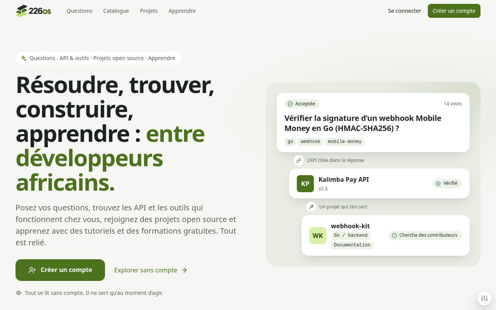
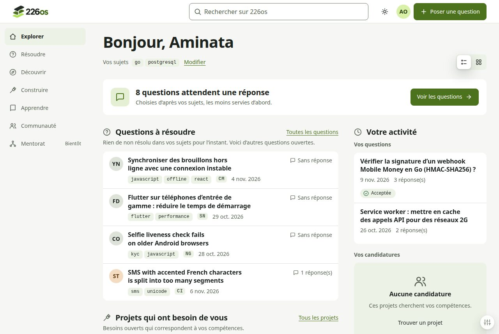
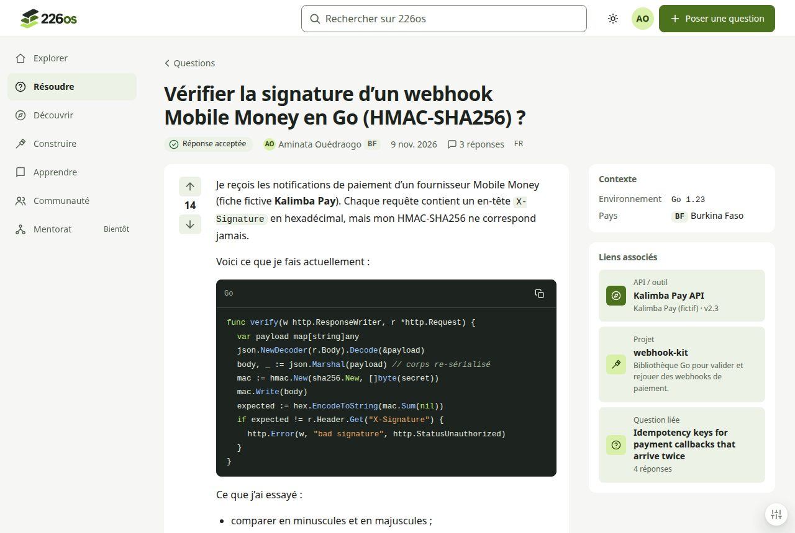
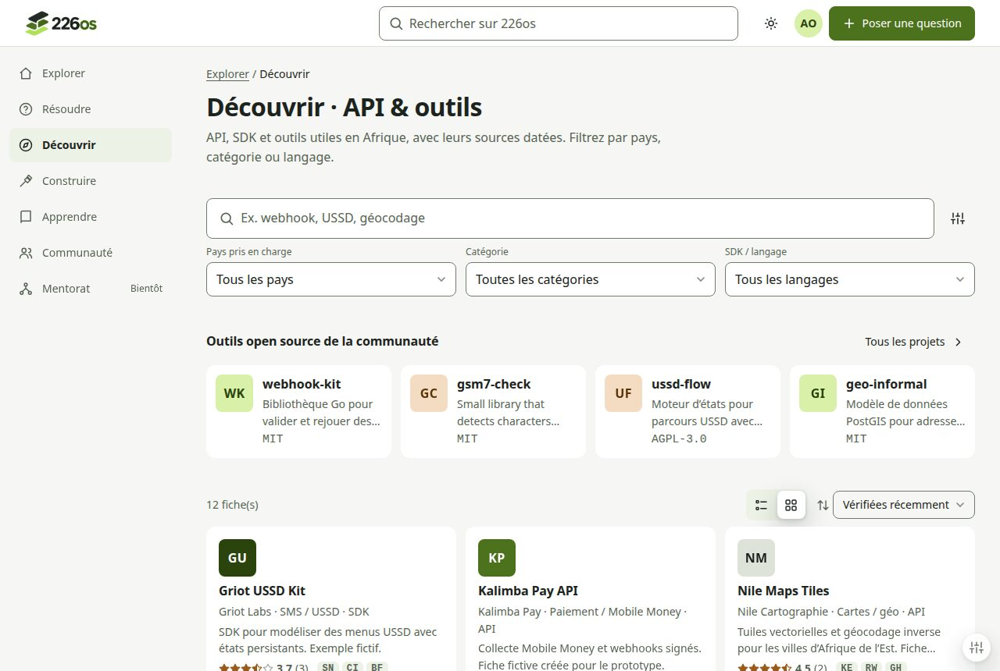
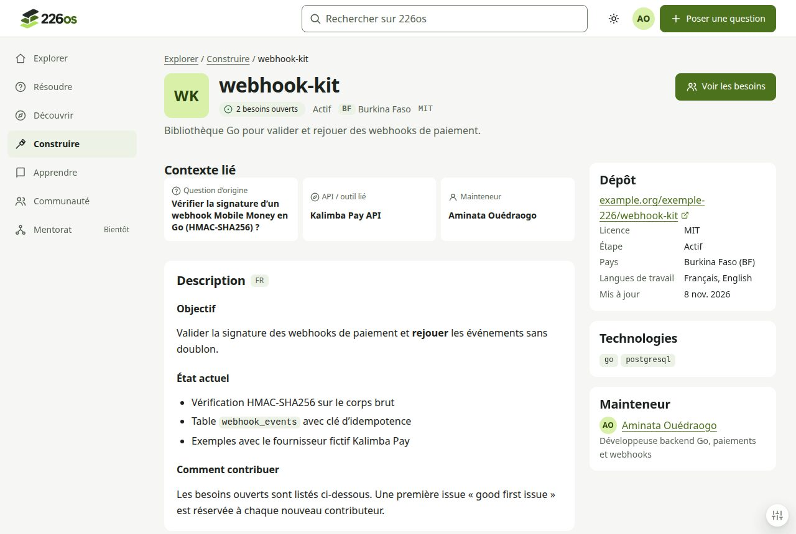
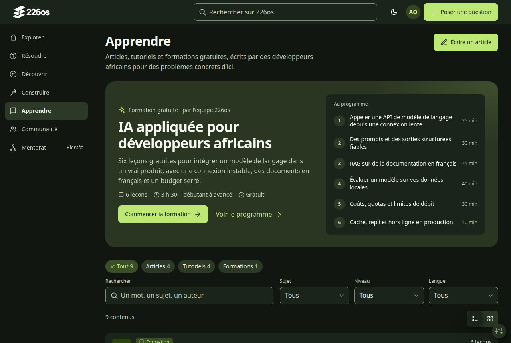
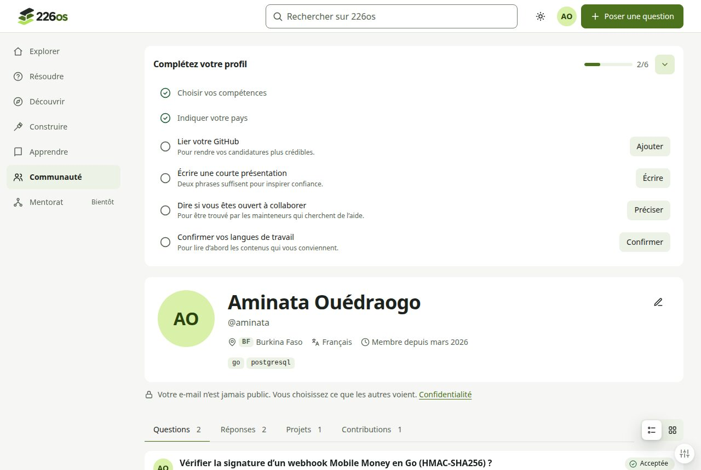
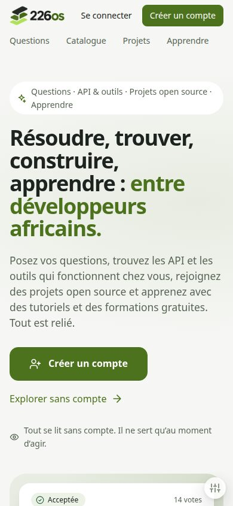
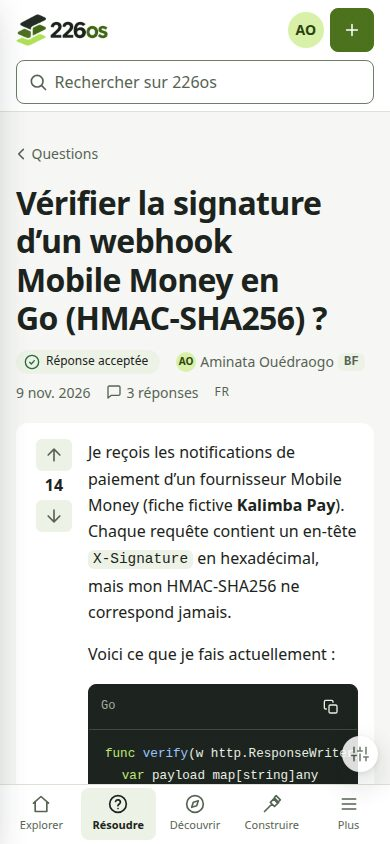
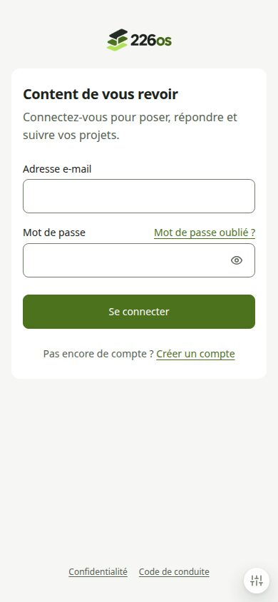

<p align="center">
  <picture>
    <source media="(prefers-color-scheme: dark)" srcset="docs/brand/226os-logo-white.png">
    
  </picture>
</p>

<p align="center"><strong>Questions · API &amp; outils · Projets open source · Apprendre</strong><br>Entre développeurs africains</p>

226os est une plateforme pensée pour relier l'entraide technique, les ressources utiles aux développeurs africains, les projets open source, l'apprentissage et les personnes qui les font avancer. L'objectif n'est pas de créer un forum, un annuaire d'API ou un réseau professionnel supplémentaire. C'est de rendre plus direct le passage d'un problème rencontré à une solution documentée, puis à une contribution réutilisable.

**Quatre piliers publics :** **Questions** (entraide technique), **API & outils** (ressources pour développeurs africains), **Projets open source** (collaboration) et **Apprendre** (articles, tutoriels et formations).

**Apprendre** est un pilier à part entière, de même poids que les trois autres. Il rassemble des articles, des tutoriels et des formations, dont des **formations gratuites à l'IA que le fondateur donne lui-même à travers ses articles et ses tutoriels**. Chaque membre est **invité à publier les siens** : 226os est aussi un lieu où l'on partage ce que l'on sait.

Il s'adresse aux développeurs de toute l'Afrique, quels que soient leur pays, leur langue ou leur niveau d'expérience.

> **État du projet :** cadrage et initialisation du dépôt. La documentation de cadrage est organisée dans `docs/`; les fonctionnalités présentées ci-dessous constituent la vision et le périmètre envisagés, et ne sont pas annoncées comme déjà livrées.
>
> **Domaine prévu :** [226os.tech](https://226os.tech) 
> **Équipe :** 7's   
> **Premier contexte de livraison :** CADEV 2026.

## Pourquoi 226os ?

Intégrer un service de paiement, retrouver un exemple fiable, comprendre une erreur de déploiement ou rechercher des contributeurs implique souvent de passer d'un groupe de discussion à une documentation incomplète, puis à plusieurs dépôts GitHub. Une solution trouvée disparaît parfois dans un fil de messages ; un projet intéressant peine à rencontrer les bonnes compétences.

Les plateformes existantes répondent chacune à une partie du problème. Ce qui manque souvent, c'est la **continuité du contexte** : les services disponibles selon les pays, les contraintes techniques réellement rencontrées, les solutions vérifiables et les personnes qui peuvent faire progresser un projet.

226os veut relier ces éléments plutôt que les juxtaposer.

## Un parcours continu

**Discover → Solve → Build → Share back**

Prenons un développeur qui intègre un service de paiement au Burkina Faso :

1. **Discover :** il identifie les fournisseurs, les pays couverts, les SDK, les exemples et les limites documentées.
2. **Solve :** il pose une question avec son contexte technique, partage son code, échange avec la communauté et documente la résolution.
3. **Build :** il découvre un projet open source lié à son besoin, propose une contribution ou recherche d'autres développeurs.
4. **Share back :** le correctif, l'exemple ou le guide devient une ressource que d'autres peuvent retrouver et évaluer.

C'est cette boucle de contribution qui constitue le cœur de 226os.

## Les neuf domaines du produit

| Domaine | Fonctionnalités envisagées |
| --- | --- |
| **Solve — Entraide et connaissances** | Questions/réponses, snippets, solutions acceptées, votes et réputation, revue de code et discussions thématiques. |
| **Discover — Ressources pour développeurs africains** | Catalogue d'API, SDK et outils, couverture par pays, documentation, comparaisons, exemples d'intégration et retours communautaires. |
| **Build — Open source et collaboration** | Découverte et import de projets GitHub, publication de projets, besoins en compétences, contributeurs et cofondateurs, candidatures et reconnaissance des contributions. |
| **Learn — Apprendre** | Articles et tutoriels (Markdown, code, tags, niveau, langue) liés aux questions, API et projets ; formations gratuites à l'IA du fondateur, lisibles publiquement ; publication ouverte à tous les membres. Séries structurées avec progression, mises en avant d'auteurs, certificats et exercices interactifs viennent ensuite (priorités à valider). |
| **Connect — Mentorat et carrière** | Mentorat, relecture de CV et de portfolios, préparation aux entretiens, groupes d'étude, stages et opportunités professionnelles. |
| **Identity & Community** | Profils développeurs, compétences, contributions, réputation, communautés, activités et découverte de personnes ou d'équipes. |
| **Language — Collaboration panafricaine** | Interface français/anglais, publications multilingues, recherche bilingue, traduction assistée avec préservation des textes originaux. |
| **Access — Connexions limitées** | Interface mobile-first, chargement progressif, réduction des transferts, cache, brouillons hors ligne et dégradation contrôlée. |
| **Intelligence — Assistance contextualisée** | Questions similaires, ressources et projets liés, aide à la rédaction, résumés et recommandations assistées par IA avec sources explicites. |

Ces domaines définissent la **vision complète**, et non une promesse de disponibilité immédiate.

### Ce qui doit nous distinguer

**Le contexte des intégrations africaines.** Une fiche d'API doit indiquer les pays couverts, les options techniques disponibles, les limites documentées et les échanges qui étayent ces informations.

**Du problème à la contribution.** Une bonne réponse peut alimenter un guide, une issue GitHub, un correctif ou un nouveau projet collaboratif, sans perdre son contexte.

**Le partage des connaissances.** Un article ou un tutoriel renvoie vers les questions, les API et les projets qu'il met en pratique, et inversement. Apprendre n'est pas un coin séparé : c'est la suite naturelle d'une réponse trouvée.

**La collaboration au-delà des frontières.** Compétences et besoins guident la découverte de contenus et de contributeurs, au-delà de la langue et du pays.

**La connaissance technique appuyée par des preuves.** Versions, étapes de reproduction, sources documentaires et confirmations communautaires doivent permettre de juger une solution autrement qu'au nombre de votes.

## Aperçu du prototype

Prototype HTML haute fidélité, navigable et sans dépendance : ouvrez [`prototypes/html/index.html`](prototypes/html/index.html) dans un navigateur. Les données sont fictives et les actions simulées. Détails : [`prototypes/html/README.md`](prototypes/html/README.md).

<p align="center">
  
</p>

<table>
  <tr>
    <td width="50%"><br><sub><b>Accueil connecté</b> · questions à résoudre et projets selon vos sujets</sub></td>
    <td width="50%"><br><sub><b>Résoudre</b> · question, réponse acceptée, code et liens associés</sub></td>
  </tr>
  <tr>
    <td><br><sub><b>Découvrir</b> · API & outils sourcés, vue cartes</sub></td>
    <td><br><sub><b>Construire</b> · projet open source et besoins de contributeurs</sub></td>
  </tr>
  <tr>
    <td><br><sub><b>Apprendre</b> · formation IA gratuite, articles et tutoriels (thème sombre)</sub></td>
    <td><br><sub><b>Communauté</b> · profil et liste de complétion</sub></td>
  </tr>
</table>

<p align="center">
  
  
  
</p>

## Première livraison : CADEV 2026

Le premier périmètre s'organise autour de trois parcours fonctionnels (auxquels s'ajoute la lecture et la publication d'articles et de tutoriels, priorité P0 validée : voir l'amendement 3.1 du PRD), appuyés par des profils, la recherche, une interface accessible et une navigation bilingue :

- **Solve :** publier une question technique avec code et contexte, répondre et identifier une résolution.
- **Discover :** rechercher une API ou une ressource pertinente selon le pays et consulter une fiche documentée.
- **Build :** publier ou référencer un projet open source, annoncer des besoins en compétences et manifester son intérêt pour contribuer.

**La collaboration open source fait partie du premier périmètre**, et ne constitue pas une option repoussée à plus tard. Les autres domaines restent dans la vision du produit ; leur profondeur de livraison dépendra des capacités réelles de l'équipe et des contrôles qualité.

La participation à CADEV implique un projet original, un dépôt Git et une démonstration utilisable en ligne, déployée avec un service Datacloud éligible. Les dépendances, leurs licences et l'assistance IA doivent être déclarées. Réécrire ou traduire le code d'un tiers ne suffit pas à faire disparaître les obligations de droit d'auteur et d'originalité.

## Architecture et méthode d'ingénierie

226os adopte un **monolithe Go modulaire** exposant une API REST/OpenAPI, une application React indépendante et PostgreSQL comme source de vérité et moteur de recherche initial. Les composants d'infrastructure supplémentaires sont introduits en réponse à des besoins justifiés, pas par défaut.

| Couche | Choix et orientations |
| --- | --- |
| **Frontend** | React 19, TypeScript, Vite, TanStack Router / Query / Form, Meta Astryx comme système de composants principal, Tailwind CSS uniquement en complément de mise en page. |
| **Backend** | Go, Chi, REST/OpenAPI, pgx, sqlc ; domaines métier explicitement séparés. |
| **Base et recherche** | PostgreSQL, recherche full-text, index GIN, `pg_trgm`, migrations SQL versionnées. |
| **Cache** | Valkey, compatible Redis et sous BSD-3, uniquement pour cache, limitation de débit ou coordination justifiés. |
| **Objets** | Interface S3-compatible ; service Datacloud à évaluer en production et SeaweedFS à étudier pour l'auto-hébergement. |
| **Infrastructure** | Docker, Docker Compose, Traefik et HTTPS. |
| **Automatisation** | Make comme interface stable des tâches locales ; GitHub Actions pour CI/CD et contrôles de livraison. |

Meta Astryx est le système de composants principal approuvé par [DESIGN.md](DESIGN.md). Sa version, ses APIs installées et son intégration restent à vérifier avant implémentation.

La méthode de développement repose sur des objectifs explicites, des contrats BDD, le cycle TDD, des tests d'intégration, des vérifications de sécurité, des preuves de performance et des **gates déterministes** avant livraison. Les objectifs de couverture documentés sont **100 % des statements backend Go mesurables** et **plus de 70 % pour les métriques frontend définies** ; la couverture ne remplace ni les tests d'autorisation ni la vérification des parcours complets.

### Organisation actuelle du dépôt

```text
226os/
├── .github/agents/            # Orchestration documentaire COP-ASS
├── AGENTS.md                  # Contrat d'orchestration des agents
├── README.md                  # Présentation et point d'entrée du dépôt
├── DESIGN.md                  # Direction visuelle frontend
├── CONTRIBUTING.md            # Règles de contribution, brouillon gouverné
├── AI_USAGE.md                # Provenance IA, brouillon gouverné
├── THIRD_PARTY_NOTICES.md     # Politique licences, brouillon gouverné
├── .mailmap                   # Normalisation des identités Git
└── docs/
	├── PRD.md                 # Vision et périmètre produit
	├── SPEC.md                # Comportements et contrats fonctionnels
	├── DEV.md                 # Playbook de développement
	├── TEST.md                # Tests et quality gates
	├── SHIP.md                # Livraison et exploitation
	├── RULES.md               # Règles d'ingénierie
	├── architecture/          # Architecture et frontières
	├── decisions/             # Registre ADR et décisions humaines
	├── quality/               # Périmètre de couverture
	├── research/              # Références externes
	└── spec-kit/              # Handoff, contrats, tâches et G0
```

Les répertoires d'application (`apps/`), de données (`db/`), d'infrastructure (`infra/`), le contrat `api/openapi.yaml`, le `Makefile` et les workflows CI restent à créer. **Il n'existe pas encore de procédure d'installation en une commande vérifiée.**

## Références étudiées

226os s'inspire d'approches existantes pour comprendre les bons compromis, sans présenter leurs implémentations comme du code original :

- **[225 Open Source](https://github.com/kouame09/225_os)** — découverte de projets, lancements, pitches, articles et visibilité des développeurs. Une référence régionale qui montre qu'un annuaire seul ne suffirait pas à nous différencier.
- **[Apache Answer](https://github.com/apache/answer)** — structure des questions/réponses, recherche, réputation, historique et extensibilité.
- **[Flarum](https://github.com/flarum/framework)** — discussions, modération, permissions et expérience communautaire adaptable.
- **[Nuxt Hacker News](https://github.com/nuxt/hackernews)** — navigation sobre, lecture de contenus et attention portée aux performances.
- **[Meta Astryx](https://github.com/meta/astryx)** — système de design React 19+ retenu comme fondation principale, sous réserve de vérification de la version et des APIs installées. shadcn/ui reste une référence comparative, pas une dépendance approuvée.

Ces projets sont **des références de recherche, pas des dépendances déclarées**. Les analyses, attributions et décisions de réutilisation appartiennent à [`docs/research/REFERENCES.md`](docs/research/REFERENCES.md).

## Documentation

| Document | Rôle |
| --- | --- |
| [PRD](docs/PRD.md) | Vision, utilisateurs, neuf domaines, besoins et priorités, amendement 3.1 (pilier Apprendre) |
| [SPEC](docs/SPEC.md) | Comportements, critères d'acceptation et contrats |
| [Design](DESIGN.md) | Direction visuelle, tokens, composants et validation de la palette |
| [Architecture](docs/architecture/ARCHITECTURE.md) | Architecture approuvée et frontières techniques |
| [Development](docs/DEV.md) | Conventions et workflow de développement |
| [Testing](docs/TEST.md) | Stratégie de tests et quality gates |
| [Shipping](docs/SHIP.md) | Déploiement, vérification et rollback |
| [Rules](docs/RULES.md) | Contraintes d'ingénierie |
| [Git workflow](docs/GIT_WORKFLOW.md) | Branches, pull requests, staging/preview et production |
| [Agent instructions](AGENTS.md) | Orchestration par objectifs, permissions et preuves |


## Licence

La licence du **code original de 226os** n'est pas encore définie. Aucune autorisation de réutilisation illimitée ne doit donc être présumée. Les dépendances tierces conservent leurs licences et obligations de notification.

---

**226os prend racine au Burkina Faso. Son terrain de collaboration dépasse les frontières.**
