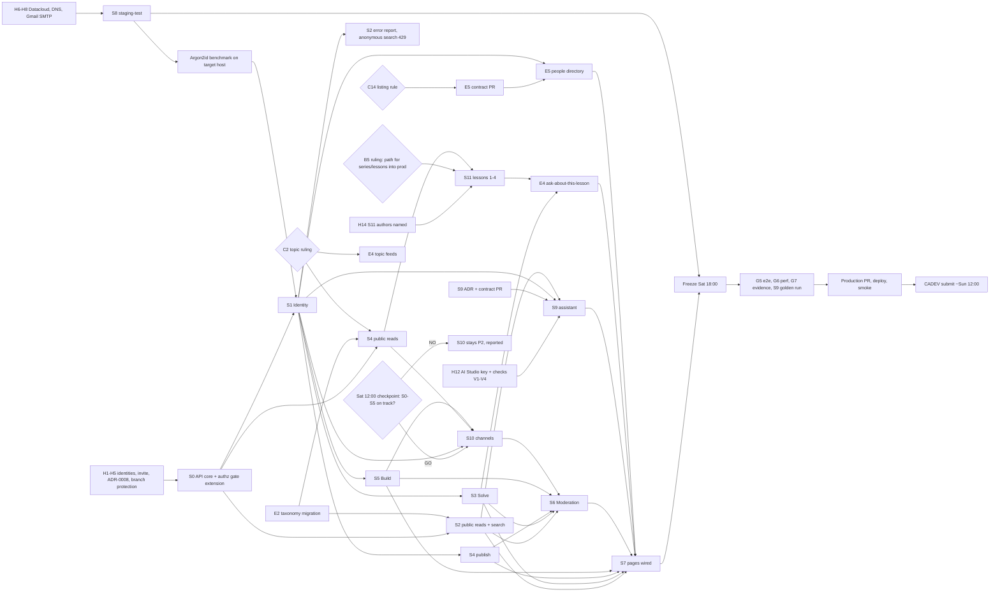

# 226os P0 roadmap to the CADEV submission

> **How to use this file.** It is the stable plan from Thu 2026-11-12 to Sun 2026-11-15. The live task state is in [TODO.md](TODO.md). Update this file in the same PR as the work that changes it, one line per change. Never rewrite someone else's entry. Add decisions only to the dated log at the end. People are named by GitHub login only.
>
> **Sources.** Every fact cites a repository file. **GUESS** marks an estimate with no repository source. **INFERRED** marks a conclusion drawn from files but not executed. All times are GMT.

## 1. Deadlines and scope

| What | When (GMT) | Source |
|---|---|---|
| CADEV submission, hard limit | Sun 2026-11-15 17:00 | `docs/SHIP.md` section 6 |
| Planned submission | Sun 2026-11-15 about 12:00 | owner decision, 2026-11-12 |
| Progress checkpoint (drop decisions, S10 go/no-go) | Sat 2026-11-14 12:00 | owner decision, 2026-11-12 |
| Feature freeze on `develop` | Sat 2026-11-14 18:00 | owner decision, 2026-11-12 |
| **Every member votes**, or that member is excluded | Sun 2026-11-15 18:00 to Mon 2026-11-16 23:59 | `docs/SHIP.md` section 6 |

**Scope**

- **The full P0.** These are the 43 operations with `x-priority: P0` in `api/openapi.yaml`, moderation included, and 44 once the E5 contract PR is accepted. No cut line is agreed in advance.
- **S9, grounded AI assistant.** It is P0 by an owner decision taken 2026-11-12 ("AI first"). It amends `docs/PRD.md` 5.8, where the sourced assistant is P2. Its operations are **not yet** in `api/openapi.yaml`. It may not be claimed until the owner applies PRD amendment 3.2 and a SPEC story exists (`docs/PRD.md`, "Traçabilité produit"; `docs/SPEC.md` section 1).
- **S10, live channels.** Conditional ("channels if on track"). It is built only if the Sat 12:00 checkpoint shows S0 to S5 on track. Otherwise it stays P2 and is reported as not built.
- **Product-review additions** (accepted by the owner on 2026-11-12):
  - **E1:** S9 teaching rules AI-1 to AI-5, AI-9 and AI-10 become acceptance tests plus the golden set.
  - **E2:** taxonomy additions and relabels through one new migration.
  - **E3 = S11:** Learn content. The free series "Coder avec l’IA sans perdre la main".
  - **E4:** zero-migration interaction modes. An "ask about this lesson" button and read-only topic feeds.
  - **E5:** Connect as a read-only people directory. This is a **new operation**, suggested `GET /profiles`, so it is a contract change. Once its contract PR is accepted, P0 has **44 operations**. Office hours are a process note only.
  - **Pillars:** "Learn & Grow" and "Connect" become the prominent pillars in navigation, home and copy. This is an information-architecture and copy change only. The PRD amendment is OPEN (O7).
  - See section 12 for what slips first.
- **Out of scope:**
  - the 4 operations with `x-priority: P1`: `GET` and `POST /resources/{resourceId}/reviews`, and `GET` and `PUT /learn/series/{seriesId}/lessons/{lessonId}/progress`;
  - any P1 or P2 feature, which is never claimed as done (`docs/PRD.md`, "Non-objectifs de CADEV").

**Go/no-go must be honest.**

- `docs/SHIP.md` section 7 allows `GO` only when G0 to G7 have passed.
- A check that did not run counts as not passed, unless a human records a dated exception with its duration and risk.
- No exception is possible for an exposed secret, a confirmed critical vulnerability or likely data loss (`docs/TEST.md:52`).
- Submitting the project does not make it a GO.

## 2. Starting point (2026-11-12)

**B0 is merged (PR #24).** It contains:

- a Go API skeleton that mounts only `GET /healthz` (`src/api/internal/platform/httpx/router.go:24`) and has no database connection (`compose.yaml:90`);
- migrations `00001` to `00010`;
- the generated `apigen` server interface, with 47 operations, not mounted;
- sqlc queries for identity, platform and reference data (`db/queries/`);
- a web skeleton (Vite, React 19, TanStack, Astryx 0.7.14) with API types in `src/web/src/api/schema.d.ts`;
- the Compose profiles.

**Gates.** `make quality` (G1 to G4) is green in CI. G5, G6 and G7 are **NOT RUN**. `make test-e2e`, `make perf` and `make seed` exit with `NOT IMPLEMENTED` (`mk/40-quality.mk:18-22`, `mk/50-ops.mk:50-51`).

## 3. What must be true on Sunday

Each item below is a demo journey from `docs/SPEC.md` section 2 or a smoke step from `docs/SHIP.md` section 4. A reference such as `US-SOLVE-001/2` is numbered by the order of scenarios in SPEC.md; SPEC.md has no scenario ids of its own.

1. **HTTPS and health.** The public URL serves HTTPS with a valid certificate, and `/healthz` and `/readyz` respond (SHIP 4.1, 4.2).
2. **Anonymous visitor** (US-DISCOVER-001/1, US-LEARN-001/1, US-IDENTITY-001/1):
   - filters APIs by country and category, and sees each entry's provenance;
   - reads an article, a tutorial and the free AI series without an account;
   - searches across questions, resources, projects and Learn;
   - follows the links from a question to its resource and its project.
3. **Account.** A member signs up, verifies their email through a real inbox, signs in and signs out (SHIP 4.3).
4. **Solve.** Alice publishes a question, Bob answers and votes, and Alice accepts one answer. Bob's own attempt to accept gets 403 and changes nothing (US-SOLVE-001/1, /2).
5. **Build.**
   - Alice publishes a project and a Go need.
   - Bob applies. A second click creates nothing.
   - Alice sees the application.
   - Charlie gets 403 if the project is visible to him, or 404 if it is private (US-BUILD-001/1, /2).
6. **Learn.** Alice publishes an article. An anonymous publish gets 401 and creates nothing (US-LEARN-001/2, /3).
7. **FR/EN.** Switching language changes the labels but never the original content, and each content item shows its language (US-LEARN-001/4, US-IDENTITY-001/2).
8. **Mobile on a throttled network.** Explore, Solve and Build stay usable, with clear loading, empty and error states (US-ACCESS-001/1).
9. **Moderation.** The owner account, promoted to moderator, hides and restores content, and each action writes an `audit_log` row (`docs/spec-kit/AUTHORIZATION_MATRIX.md`, "Moderator scope at P0").
10. **S9 assistant, subject to V3.** Until the owner rules on V3 (free tier or billing-linked, given the EEA rule), the assistant stays disabled by config. Once enabled, it is available in search and in the ask-a-question flow. It answers only from platform content, with links to the sources it used, and it refuses when it has no source. It never invents a guarantee about an API or about whether a solution is verified (`docs/PRD.md` 5.8). The golden evaluation set has been run, and its result is recorded.
11. **S11 and E4.**
    - The free series "Coder avec l’IA sans perdre la main" is readable without an account. It contains only lessons written by a named human author and published by Sat 14 18:00. If B5 is unresolved, the lessons are not in production.
    - From a lesson, "Poser une question sur cette leçon" opens the Solve form pre-filled and links the new question to the lesson's article.
12. **E5 and pillars.**
    - The Connect page lists people. Anyone, signed in or not, can filter by country, language and skill. The list shows only fields that each profile allows, never an email and never a non-listable profile.
    - The "spaces" block stays labelled "bientôt". Mentoring and opportunities are shown as coming soon (PRD 5.5).
    - Navigation and home put Learn & Grow and Connect first, with Solve, Discover and Build as the toolbox beneath.
13. **S10, only if built.** A member posts in a project or series channel and other members see the message live. A moderator can hide it. If S10 is not built, it is presented as P2.
14. **Gates.** G1 to G4 are green on the target SHA. G5, G6 and G7 each have evidence or a dated human exception (see section 1). The logs contain no secrets (SHIP 4.5).
15. **CADEV.** The obligations in section 9 are met.

## 4. People and slices

The slices were assigned by owner decisions on 2026-11-12. The review rules come from ADR-0008, which is still **PROPOSED**. The detail of each slice is in [TODO.md](TODO.md).

| Slice | Content | Owner | Ops | Starts after |
|---|---|---|---:|---|
| S0 | API core: DB pool, `/readyz`, apigen mount, validation, cursors, ETag, Idempotency-Key, transactions, mailer | `Y4NN777` | 0 | - |
| S1 | Identity: auth (8), me (2), profiles (1) | `NICE-DEV226` | 11 | S0 |
| S2 | Discover and search, demo seeds | `mibienpanjoe` | 5 | S0 (the error report also needs S1) |
| S3 | Solve | `NICE-DEV226` | 10 | S1 |
| S4 | Learn | `mibienpanjoe` | 5 | S0 (publishing also needs S1) |
| S5 | Build | `mibienpanjoe` | 9 | S1 |
| S6 | Moderation, built last | `Y4NN777` | 3 | S0, S1; targets from S2 to S5 |
| S7 | Frontend: the prototypes become React pages | `PANK4SS` | - | typed fixtures first, then each merged endpoint |
| S8 | Ops, release and CADEV submission | `Y4NN777` | - | Datacloud, DNS, SMTP |
| S9 | Grounded AI assistant (P0 by owner decision) | `Y4NN777` (contract, ADR, port); second developer **OPEN**; UI `PANK4SS` | new, TBD | S1, S2; owner verification V1 to V4 (H12) |
| S10 | Live channels (**CONDITIONAL**) | **OPEN**; migrations `mibienpanjoe` | new, TBD | Sat 12:00 GO, S1, S4, S5 |
| E2 | Taxonomy: +5 learn topics, +3 resource categories, 4 relabels, no deletions, one new migration | `mibienpanjoe` | 0 | none (migration only) |
| S11 | Learn content: the free series, up to 9 lessons, FR first | authors **OPEN** (owner names them, H14) | 0 | S4 reads; B5 ruling (H15) |
| E4 | "Ask about this lesson" button, read-only topic feeds | `PANK4SS` with `NICE-DEV226` (Solve owner) | 0 | S3 `createQuestion`; C2 ruling before the feeds |
| E5 | Connect people directory (new operation, suggested `GET /profiles`), `connect` page, office-hours process note | backend **OPEN** (proposed: `mibienpanjoe` or `NICE-DEV226` after their first slice merges); UI `PANK4SS` | +1 (44 total once accepted) | contract PR; S1 (profiles); C14 ruling |
| IA | Pillar emphasis: navigation, home and FR/EN copy promote Learn & Grow and Connect | `PANK4SS` | 0 | none (no new endpoints) |

Workload: the 43 P0 operations are spread as 11 + 5 + 10 + 5 + 9 + 3. `NICE-DEV226` has 21 of them and `mibienpanjoe` has 19. The owner carries S0, S6, S8, the core of S9 and most reviews. S9, S10, E1 to E5 and the pillar change add work for the same four people (GUESS; not quantified). E1 is part of S9.

## 5. Rules for every slice (R1 to R11, referenced from TODO.md)

- **R1 Test-first.** Write a failing test (RED), make it pass (GREEN), then refactor without changing behaviour. Invariants and authorization need real PostgreSQL integration tests (`docs/TEST.md`, `AGENTS.md`).
- **R2 Go coverage.** First-party Go statements must reach exactly 100.00%. The only exclusion is `src/api/internal/platform/apigen/apigen.gen.go` (`docs/quality/COVERAGE_SCOPE.md`). External services such as SMTP and the LLM sit behind ports with fakes, so tests use no network.
- **R3 Frontend coverage.** Statements, branches, functions and lines must each be strictly above 70%.
- **R4 CI before merge.** `make quality` (G1 to G4) must be green in CI before a merge into `develop`. Never weaken a gate, skip a test or change a threshold.
- **R5 Authz** (see section 10 for blockers B1 to B5).
  - Add a mounted route to `scripts/public-routes.txt` only if it is public by design.
  - Every member, owner or moderator route needs negative authz tests taken from `docs/spec-kit/AUTHORIZATION_MATRIX.md`.
  - Today the gate fails on any mounted route that is not in that allowlist (blocker B1).
- **R6 Migrations.** Only `mibienpanjoe` writes migrations, one at a time. They are forward-only and immutable after merge (ADR-0005; ADR-0008 lets the lead delegate this).
- **R7 Shared files.**
  - `api/openapi.yaml`, `go.mod`/`go.sum`, `pnpm-lock.yaml` and `mk/**` take one change per PR.
  - An OpenAPI change merges first, in its own PR, reviewed by `Y4NN777` and `PANK4SS`.
- **R8 Branches.** Use `feature/<domain>/<name>` from `develop` and open the PR into `develop`. Nobody reviews their own PR.
- **R9 Commits.**
  - Commit under your own confirmed Git identity.
  - No AI attribution: no `Co-authored-by` naming an agent and no "Generated with" footer.
  - Record any AI help in `AI_USAGE.md`.
- **R10 Data and secrets.**
  - Demo data is visibly marked (`provenance='demo'`) and never runs in `production-live`.
  - No secrets in Git, logs, fixtures, prompts or screenshots. This covers SMTP, the cursor key and the LLM API key.
- **R11 Honest status.** Never claim a P1 or P2 feature. Report a check that did not run as `NOT RUN`, never `PASS`.

Reviews (ADR-0008, proposed):

- Backend PRs: the lead or the other backend developer.
- Frontend PRs: `Y4NN777`.
- The owner's own PRs: a backend developer.
- `api/openapi.yaml`: `Y4NN777` and `PANK4SS`.

## 6. Timeline (GMT)

**Thu 12, evening**

- `Y4NN777`: human tasks H1 to H6 and H14 (name the S11 authors). S0 work: authz gate extension (B1), pgxpool, `/readyz`, mounting apigen. Opens the S0 PR.
- `NICE-DEV226`: identity record (H1). S1 RED tests for the domain and service with fakes: hashing, tokens, CSRF, sessions. Mounts no routes before S0 merges.
- `mibienpanjoe`: identity record (H1). S2 sqlc queries with local EXPLAIN. Designs the seeds. Raises the Learn `topic` decision (C2). Opens the E2 taxonomy migration PR (`make migrate-new`, plus the pgtest list update).
- `PANK4SS`: accepts the invitation (H2) and records identity (H1). S7 shell, i18n and shared components on typed fixtures.

**Checkpoint, Thu end of day: S0 merged or in review.**

**Fri 13, until noon**

- `Y4NN777`: merges S0. S0 follow-ups: Idempotency-Key, mailer, Mailpit. Starts S8 staging. Reviews.
- `NICE-DEV226`: S1 auth endpoints and the rate limiter.
- `mibienpanjoe`: S2 reads merged, then `make seed`, then the S4 reads.
- `PANK4SS`: public read pages: accueil, discover, resource, recherche.

**Checkpoint, Fri 12:00: public reads merged.** That means S2's `listResources`, `getResource`, `listResourceSources` and `search`. The S4 reads are in review. The Solve and Build reads come with S3 and S5, after S1.

**Fri 13, afternoon and evening**

- `Y4NN777`: staging up with TLS, DNS and SMTP. Argon2id benchmark on the target host. Drafts the S9 ADR (PROPOSED, including AI-1 to AI-5, AI-9 and AI-10) and the S9 contract PR. Reviews S1. Rules on B5 (H15) and C2.
- S11 authors (OPEN): write lessons 1 to 4 in FR, each as a tutorial article, until the Sat 18:00 cutoff.
- E5: the owner rules on C14 and names the E5 backend owner. The E5 contract PR (backend lead plus `PANK4SS` review) is opened and merged, with `make generate`.
- `PANK4SS`: pillar emphasis in navigation, home and FR/EN copy (information architecture only).
- `NICE-DEV226`: S1 `me` and profiles. Merges S1.
- `mibienpanjoe`: S4 reads merged. S2 error report and S4 publish once S1 has merged.
- `PANK4SS`: apprendre, article, formation, solve and question pages (on fixtures), then the identity pages. Reviews the S9 contract.

**Checkpoint, Fri end of day: S1 merged. AI Studio key in the staging env file, and V1 to V4 checked, including the free versus billing decision (H12, K21).**

**Sat 14, until noon**

- `Y4NN777`: S9 LLM port, fake adapter and retrieval over S2 search. Starts the S8 `make test-e2e` harness. Reviews.
- `NICE-DEV226`: S3 Solve.
- `mibienpanjoe`: S4 publish, then S5 Build.
- `PANK4SS`: wires the identity pages to live endpoints, and solve and question to S3.

**Checkpoint, Sat 12:00 (progress).** The owner decides any drop or exception from measured progress (merged PRs, CI status), and decides whether S10 is a GO. These decisions go in the log below.

**Sat 14, until 18:00**

- `Y4NN777`: S6 moderation merged. S9 merged, with the second developer (OPEN). `make perf` harness. Backup and restore drill on staging.
- `NICE-DEV226`: S3 merged. If S10 is a GO, may build it (owner assigns).
- `mibienpanjoe`: S5 merged. If S10 is a GO, writes its migration.
- `PANK4SS`: write flows (ecrire, build, project, the solve ask form). The S9 panel in recherche and in the ask flow. E4 with `NICE-DEV226`: the "ask about this lesson" button once S3 merges, and the topic feeds only after C2 is ruled.
- S11: the cutoff is Sat 18:00. A lesson that is not finished and reviewed by then is not published.
- E5 backend (OPEN owner, after their first slice merges): the people directory with privacy tests. `PANK4SS` builds the `connect` page, and the spaces block stays "bientôt".

**Freeze, Sat 18:00.** After the freeze, `develop` takes only fixes for failing gates or smoke checks. The freeze applies to S9 and S10 as well.

**Sat 14, evening**

- `Y4NN777`: `make quality-full` on the `develop` SHA. Rollback drill. S9 golden evaluation run. Collects the G7 evidence.
- `NICE-DEV226`: bug fixes and e2e support.
- `mibienpanjoe`: bug fixes and a seed check on staging.
- `PANK4SS`: bug fixes. ADR-0007 visual, axe and responsive evidence.

**Sun 15, morning**

- `Y4NN777` runs the release:
  - opens the production PR from `develop` to `main` and gives owner approval;
  - takes a backup, runs the migrations and deploys the exact SHA;
  - runs the production smoke test;
  - promotes the owner account to moderator;
  - **submits around 12:00.**
- `NICE-DEV226` and `mibienpanjoe` support the smoke test. `PANK4SS` runs the mobile and FR/EN smoke.

**Sun 18:00 to Mon 23:59: every member votes (H10).**

## 7. Dependencies and critical path

**Critical path.** Each step waits for the one before it:

1. human identity records (H1);
2. S0, including the authz gate extension (B1);
3. S1;
4. the member writes in S3, S4 and S5;
5. the S7 write flows;
6. the freeze;
7. G5, G6 and G7;
8. production;
9. submission.

**What waits on S0 and S1.**

- S0 and S1 block every member write.
- Public reads need no login. Even so, `listProjects`, `getProject`, `listContributionNeeds`, `getTrainingSeries`, `getProfile` and `search` accept an optional session (`security: [{}, cookieAuth]` in `api/openapi.yaml`). They need a session resolver that defaults to anonymous.

**Parallel paths.**

- Datacloud leads to staging, and staging to the Argon2id benchmark that S1 needs before it pins its parameters (ADR-0003, "Evidence").
- The provider decision (H12) leads to S9, and the S9 contract leads to its UI panel.

## 8. Human tasks and lead time

| Id | Task | Who | Start by | Lead time |
|---|---|---|---|---|
| H1 | Confirm the Git identity records for `NICE-DEV226`, `mibienpanjoe` and `PANK4SS`; all three are "no" today (`docs/team/CONTRIBUTORS.md:10-12`). Nobody commits before confirmation. | `Y4NN777` + each member | Thu evening | minutes (GUESS) |
| H2 | `PANK4SS` accepts the repository invitation (pending, `docs/team/CONTRIBUTORS.md:12`) | `PANK4SS` | Thu evening | minutes (GUESS) |
| H3 | ADR-0008 set to ACCEPTED or amended; it is PROPOSED today (`docs/decisions/0008-team-work-areas-and-ownership.md:3`) | `Y4NN777` | Thu evening | - |
| H4 | Branch protection and required reviews on `develop` and `main`, with the `quality` check required (ADR-0006 "CI", ADR-0008 "Consequences") | `Y4NN777` | Thu evening | minutes (GUESS) |
| H5 | Rulings on blockers B1 to B4 and contradictions C1 to C14 (section 10); B5 is H15 | `Y4NN777` | Thu evening | - |
| H6 | Datacloud account and an **active commercial product**, SSH key, ports 80/443, storage (`docs/SHIP.md` section 3; a CADEV condition). Handled by the owner. | `Y4NN777` | Thu evening | UNVERIFIED; hours to a day (GUESS) |
| H7 | DNS for `226os.tech` pointing to the host. Let's Encrypt works only once DNS resolves. | `Y4NN777` | as soon as the host IP is known | minutes to hours (GUESS) |
| H8 | Gmail SMTP: create an app password, stored in the staging and production env files only; test with a real inbox | `Y4NN777` | Fri morning | GUESS: an app password needs 2-step verification on the account; verify |
| H9 | CADEV registration: team declaration (2 to 5 members), representative and country, split, members registered (`docs/SHIP.md` section 6) | `Y4NN777` | Fri | UNVERIFIED |
| H10 | Vote reminders to all four members, plus a named follow-up person (SHIP section 6, "Prévoir responsable de suivi") | `Y4NN777` | Sun 17:00 | - |
| H11 | Choose the "public demo URL" (O1) | `Y4NN777` | Sat 12:00 | - |
| H12 | S9: create the Google AI Studio API key (the owner holds the access) and store it only in the staging, then production, env file. Never in Git, CI logs or images. Check items V1 to V4 (section 10, O5) in AI Studio and Google's own current documentation. | `Y4NN777` | Fri 13 evening | UNVERIFIED |
| H13 | Apply PRD amendment 3.2 (text in the S9 ADR) and add a SPEC story for S9, and for S10 if it is a GO; the owner applies these | `Y4NN777` | Fri evening | - |
| H14 | Name the S11 lesson authors (human, named; UNASSIGNED today) | `Y4NN777` | Thu evening | - |
| H15 | Rule on B5: how series and lesson rows reach production | `Y4NN777` | Fri afternoon | - |
| H16 | Decide whether "Learn as the heart" becomes a PRD amendment (3.2 or 3.3), or the pillars keep equal weight and only topics, series and home ordering change (O7) | `Y4NN777` | OPEN | - |

## 9. CADEV obligations (`docs/SHIP.md` section 6)

- [ ] The team has 2 to 5 members, a declared representative and country, an agreed split, and every member registered.
- [ ] The names in `docs/PRD.md` section 12 match the declared team. Today that section says "3 personnes", names two people and leaves the third unnamed, while the team has four members (`docs/team/CONTRIBUTORS.md`). This is flagged here; the PRD is not edited.
- [ ] Git URL, a **public demo URL**, an **active Datacloud product**, the repository and its documentation, and a secured demo account if needed.
- [ ] The project is original and was built during the contest. `THIRD_PARTY_NOTICES.md` and `AI_USAGE.md` are complete, dependency provenance is recorded, and no licence forbidden by the rules is used. The S9 provider's terms and SDK licence, if any, are added.
- [ ] Submitted before Sun 2026-11-15 17:00 GMT.
- [ ] Each member votes between Sun 2026-11-15 18:00 and Mon 2026-11-16 23:59 GMT.

## 10. Blockers, contradictions, open decisions

### Blockers

**B1. The authz gate cannot pass once any protected route is mounted.**

- `scripts/authz/routes_check.go.txt:48-66` fails on every mounted route that is not in `scripts/public-routes.txt`. It has no way to see that a negative test exists.
- `HandlerWithOptions` mounts all 47 operations at once.
- S0 must therefore extend the gate without weakening it. Either:
  - add a protected-route manifest that binds each route to named negative tests, and check that those tests ran and passed; or
  - mount only the operations that are implemented.
- The extension needs owner review.
- The check calls `httpx.NewRouter(logger)` (line 32). If S0 changes that signature, update the overlay in the same PR.

**B2. `/readyz` cannot be reached from outside.** The edge rule routes only `/api/` and `/healthz` (`deploy/traefik/dynamic.edge.yml:6`), but SHIP 4.2 smoke-tests `/readyz`. The owner decides between routing it and checking it from the host.

**B3. The router's request timeout breaks long requests.** It is 30 s (`src/api/internal/platform/httpx/router.go:14,23`) and applies to every route. A server-sent events stream (S10) is cut after 30 s, and slow LLM calls (S9) are cut too (INFERRED). S0, S9 and S10 need a per-route timeout decision.

**B4. Production has no deploy path yet.**

- `make up-production-live` runs only from an automated release job: it requires `CI=true`, no interactive terminal and `PRODUCTION_UP_CONFIRM=production-live`.
- The Makefile itself says "There is no deploy workflow yet (TASK-OPS-001), so today no context satisfies the guard" (`mk/50-ops.mk:20-24`).
- ADR-0006 ("CI") keeps the deploy workflows `NOT IMPLEMENTED` until TASK-OPS-001.
- S8 must deliver a reviewed release workflow, with the protected `production` environment, before Sunday. The guard must not be weakened.

**B5. Real lesson content has no path into the production database.** This needs an owner ruling (H15); it is not resolved here.

- Only reads of series and lessons are P0. No operation creates a `training_series` or a `training_lessons` row (`api/openapi.yaml:1734-1798`).
- Seeds never run in production (ADR-0005 point 17).
- The lesson bodies themselves can go through the API: each lesson is a tutorial `learn_article` that its named author creates with `createLearnArticle`, including `links[]`. Only the series row and the lesson rows (`training_lessons.article_id`, `db/migrations/00008_learn.sql:97`) lack a path.

| Option | For | Against |
|---|---|---|
| (a) Content migration, `provenance='live'`, reviewed like code | Reviewed, reproducible, runs through the existing gated `migrate-up` | Migrations are immutable, so every correction needs a new migration. `author_id` and `article_id` are foreign keys to rows that are created in production by sign-up and the API, so the ids are unknown when the migration is written. Mixes content with schema. |
| (b) One-time admin script run by the owner | Can use the real user and article ids after the authors publish. No contract change. | Manual production mutation that needs human approval (AGENTS.md). Must be rehearsed on staging, take a backup first and write an `audit_log` row. Not exercised in CI. |
| (c) Restricted create endpoint (for example moderator-only) | A proper, tested path | A contract change late in the week (R7 review by `Y4NN777` and `PANK4SS`), new negative authz tests, B1 applies, and more scope |

### Contradictions (rulings needed; nothing is resolved here)

**C1. Maintainer rights.**

- The matrix gives "O or maintainer" for `PATCH /projects/{projectId}`, `POST .../contribution-needs` and `GET .../applications` (`docs/spec-kit/AUTHORIZATION_MATRIX.md:40,42,45`; ADR-0005 point 10).
- OpenAPI x-authz says `allow: owner` with "no delegation in P0" (`api/openapi.yaml:1313-1317`, `:1397-1401`, `:1515-1519`).
- No P0 operation creates a maintainer.

**C2. Learn `topic`.**

- `listLearnArticles` types `topic` as a `TagSlug` that "matches an article tag" (`api/openapi.yaml:1626-1630`).
- The database stores `topic_code` as an FK to `learn_topics` (`docs/spec-kit/DATABASE_DESIGN.md:920,931`).
- `ArticleCreate` has no topic field at all (`api/openapi.yaml:4194-4241`).

**C3. `my_progress` without a progress table.** `getTrainingSeries` promises `my_progress` when a session exists (`api/openapi.yaml:1780`), but `learn_progress` is P1 and arrives in migration 00011 (ADR-0005 point 16).

**C4. Search query length.** `q` has `maxLength: 200` (`api/openapi.yaml:1905`, `:1621`), but ADR-0005 point 6 bounds queries at 100 characters.

**C5. Error codes.**

- The router emits `METHOD_NOT_ALLOWED` (`src/api/internal/platform/httpx/router.go:29`), which is not in the `ErrorCode` enum (`api/openapi.yaml:2631-2657`).
- No code exists for a wrong `Content-Type` (ADR-0004 point 8).

**C6. Ownership.**

- ADR-0008 is PROPOSED, but `docs/spec-kit/TASKS.md:3` and `docs/DEV.md:58` still say there are 3 members and one owner/reviewer (`Y4NN77`) for everything.
- ADR-0008 gives migrations to the lead, who may delegate them. The owner decision gives them to `mibienpanjoe`. The two agree only if that is recorded as a delegation.

**C7. Stale `db/` status.** `docs/spec-kit/DATABASE_DESIGN.md:3` and `:1266` say `db/` does not exist. B0 created migrations 00001 to 00010.

**C8. Branch domains.** `docs/GIT_WORKFLOW.md:38` lists the allowed domains without `learn`. The CI regex accepts any lowercase domain (`.github/workflows/branch-policy.yml:29`).

**C9. Stale x-authz labels.** Some `matrix:` labels do not match the matrix paths, for example `POST /sessions`, `GET /users/me` and `PATCH /profiles/me` (`api/openapi.yaml:55,173,339,369`).

**C10. S9 priority.**

- `docs/PRD.md` 5.8 puts the sourced assistant at P2.
- The owner made it P0 on 2026-11-12.
- PRD amendment 3.2 is needed (H13).

**C11. Migration 00011 is reserved.** `docs/spec-kit/DATABASE_DESIGN.md:1280` reserves `00011` for the deferred P1 tables (`learn_progress`, `resource_reviews`, `content_reports`). S10 tables, and any S9 cost-counter table, take the next free number from `make migrate-new` (`scripts/migrate-new.sh`). Choosing that number is the owner's call.

**C12. Who may create an article-to-question link.**

- The database allows only canonical pairs, and `('article','question')` is not one of them; only `('question','article')` is (`db/migrations/00009_content_relations.sql:51-53`).
- ADR-0005 point 13 says only the author of the source item creates a relation, and `ArticleCreate.links[]` accepts questions.
- So an article author linking to a question stores a relation whose source, the question, they did not write.
- E4 in the other direction (a question linking to an article) is consistent.

**C13. `LinkRef` accepts `series`, but the database cannot store it.** `LinkRef.type` includes `series` (`api/openapi.yaml:3171`), but `content_relations` has no series column (`db/migrations/00009_content_relations.sql:24-25`; `docs/spec-kit/DATABASE_DESIGN.md:142`). This is why each S11 lesson is a `learn_article`.

**C14. A "private profile" has no column (blocks E5).**

- `getProfile` declares `private_profile: 404` (`api/openapi.yaml:414-415`), and E5 requires "private profiles never listed".
- The `profiles` table has only per-field visibility (`country`, `languages`, `skills`, `github`, `bio`, `open_to_collab`; `db/migrations/00003_identity.sql:53-58`). It has no profile-level visibility and no listing opt-in.
- The owner chooses one of:
  - a derivation rule, for example listed only when `users.status='active'` plus a rule on `open_to_collab` and its visibility;
  - a new column through a migration (`mibienpanjoe`, number from `make migrate-new`).
- Filters must also apply only to fields visible to the caller. Otherwise filtering by a hidden country, language or skill reveals that field (INFERRED).

**C2, addition (blocks the E4 topic feeds).** Questions have no topic; `listQuestions` filters only by `tag` (`api/openapi.yaml:462`). A topic feed of questions therefore needs a mapping rule, for example topic code = tag slug. That rule is part of the C2 ruling.

### Open decisions

**O1. The public demo URL.**

- Seeds never run in `production-live` (ADR-0005 point 17), so production starts empty.
- Option one is staging, which is seeded and marked as demo.
- Option two is production with real content entered by the team. Catalogue entries need real sources, which the owner loads outside the API (`docs/spec-kit/AUTHORIZATION_MATRIX.md:37`).

**O2. Where the shared pieces live.** These are listed in TODO.md under "Shared pieces": the rate limiter, the session resolver that defaults to anonymous, the `links[]` relation writer and reader, the audit-log writer, and the `EMAIL_NOT_VERIFIED` check.

**O3. The 4 P1 routes.** `HandlerWithOptions` mounts them. The choice is between keeping them at 501 with gate coverage, or not mounting them.

**O4. Resending the verification email.** ADR-0003 sets a resend rate limit of 3 per account per hour, but no P0 operation resends a verification email.

**O5. S9 questions the PROPOSED ADR must decide.**

The provider is decided: Google AI Studio, Gemma 4, free tier (Decisions log). These items stay open:

- Exactly what is sent to the provider: the question text and retrieved public content only. No emails, no private data, no secrets.
- The cost cap, or the quota guard, and where its counter lives.
- Timeouts.
- The fallback when the provider is down or its quota is exhausted. The assistant degrades to a clear "assistant unavailable" response and never fails the page.
- FR/EN behaviour.
- The evaluation set and its pass criteria.
- Whether anonymous users may call it, and the per-subject rate limit.
- Who the second developer is.

**Facts from Google's terms.** Source: `https://aistudio.google.com/docs/terms`, "Effective March 23, 2026". The coordinator fetched this page and this review re-fetched it on 2026-11-12; label OFFICIAL.

- **Unpaid Services.**
  - Google uses submitted content to improve its products.
  - "Human reviewers may read, annotate, and process your API input and output."
  - The terms say: "Do not submit sensitive, confidential, or personal information to the Unpaid Services."
- **Paid Services.**
  - Google does not use prompts or responses to improve its products.
  - It logs them for a limited period to detect policy violations.
- **When a project counts as paid.**
  - For the Gemini API: only through a Cloud project associated with an active billing account.
  - For AI Studio: it counts as paid if the account has access to a Cloud project with active Cloud Billing. The coordinator's summary said "AI Studio itself counts as free"; the re-fetch shows this condition.
- **EEA, Switzerland and UK.** "You may use only Paid Services when making API Clients available to users in the European Economic Area". The same rule applies to Switzerland and the UK.

**NOT CONFIRMED.**

- **Gemma 4 model ids.**
  - Third-party aggregators list `gemma-4-31b-it`, `gemma-4-26b-a4b-it` and `gemma-4-e2b-it`, as reported by the coordinator.
  - The official models page fetched by the coordinator listed no Gemma model, and that fetch may have been incomplete.
- **Free-tier rate limits for Gemma.**
  - They are not published in the public docs. AI Studio shows the limits per project.
  - Third-party figures conflict: Gemma 3 at 30 requests/min and 14,400/day; a 2026 blog on Gemma 4 at 15/min and 1,500/day.
  - Treat the limits as UNKNOWN.
- Further sources cited by the coordinator, not re-fetched here: `https://ai.google.dev/gemini-api/docs/logs-policy` and `https://ai.google.dev/gemini-api/docs/rate-limits`.

**Open verification items.** These replace the earlier V1 to V6 list. Owner `Y4NN777`, due Fri 13 evening:

- **V1.** Confirm the exact Gemma 4 model id and its availability inside AI Studio.
- **V2.** Read the project's real limits in AI Studio.
- **V3.** Decide between a free project and a billing-linked project, given the EEA rule (K21).
- **V4.** Measure FR/EN latency and quality on the golden evaluation set before the demo.

**Design consequences proposed for the S9 ADR** (the owner decides):

- Send only the question text and retrieved public content. Never send emails, private data or secrets.
- Show a visible notice that the question is sent to Google.
- Redact obvious secrets and email addresses before sending, with tests.
- Make the assistant switchable off per environment through configuration.
- When the quota is exhausted, return a clear "assistant unavailable" response. The page must never fail.

**Fallback.** If the free tier is rate-limited or its terms are unsuitable, switch provider through the LLM port by configuration. An alternative paid key is possible; that is the owner's decision.

**O6. S10 builder and displacement.**

- Nobody owns S10 yet.
- If it is built, it takes Saturday afternoon capacity from S6 and S7 integration, the G5/G6 harnesses, the backup/restore drill and the bug-fix buffer before the freeze (GUESS; not quantified).
- It also displaces the E4-type work.

**O7. "Learn as the heart", extended to two prominent pillars (OPEN, not applied).**

- The owner wants "Learn & Grow" and "Connect" as the two prominent pillars, with Solve, Discover and Build as the toolbox beneath.
- The PRD amendment must cover both pillars and end the equal pillar weight of amendment 3.1. If S9 takes 3.2 (H13), this one would be 3.3.
- The owner approves the amendment text. This plan does not edit the PRD.
- Meanwhile, only the navigation, home and FR/EN copy change (`PANK4SS`), with no new endpoints and nothing non-functional announced.

**O9. E5 backend owner.** OPEN. Proposed: `mibienpanjoe` or `NICE-DEV226`, after their first slice merges.

**O8. S11 authors.** UNASSIGNED; the owner names them (H14).

## 11. Risk register

| Id | Risk | Level | Mitigation |
|---|---|---|---|
| K1 | Capacity: 19 to 21 operations per backend developer, at 100% coverage with negative authz tests, in about 2.5 days | high (GUESS) | Sat 12:00 checkpoint, small PRs, the owner can ask for help (ADR-0008) |
| K2 | Owner review bottleneck: the owner reviews frontend, S1 and much more while building S0, S6, S8 and S9 | high | Backend developers review each other (ADR-0008 "Consequences") |
| K3 | B1 authz gate blocks the S0 merge | high | First S0 task, owner-reviewed |
| K22 | B4: no release workflow, so production cannot be started under the existing guard | high | S8 builds the workflow by Sat; rehearse it on staging first |
| K4 | Gmail SMTP daily sending limits and spam filtering | medium (GUESS) | Real inbox test on staging; Mailpit locally |
| K5 | Datacloud account or product lead time | high (GUESS) | Start Thu evening (H6) |
| K6 | Argon2id m=64 MiB (ADR-0003) against the 128M API memory limit (`compose.yaml:99`): two concurrent hashes may exceed it | medium (INFERRED) | Size the hashing semaphore or the limit; benchmark on the host |
| K7 | The 54 country names in `db/migrations/00002_reference_taxonomy.sql:55-109` were not checked here against an ISO source. Migrations are immutable, so a fix needs a new migration. | low | Owner checks before the demo |
| K8 | `/healthz` is not in `api/openapi.yaml`, but the web client calls it (`src/web/src/api/health.ts`) | low | Owner ruling: document it as an infrastructure route |
| K9 | The CSP has `style-src 'unsafe-inline'` (`src/web/nginx/security-headers.conf:2`) | medium | G4 review item; record as residual risk or remove |
| K10 | `createProject` fetches GitHub with anti-SSRF controls (`api/openapi.yaml:1226`), a new outbound surface | medium | S5 threat model, owner co-review |
| K11 | The rate-limit table is UNLOGGED, so counters reset after a crash | low | Accepted (ADR-0003) |
| K12 | No demo content in production (O1) | high | Decide by Sat 12:00 |
| K13 | S9 provider (Google AI Studio, Gemma 4): the model id and free-tier limits are UNKNOWN (V1, V2); third-party figures conflict | high | Owner verifies by Fri 13 evening; the fake adapter means work does not wait; provider can be switched by configuration |
| K21 | **EEA rule (OFFICIAL, AI Studio terms):** only Paid Services may be offered to users in the EEA, Switzerland or the UK. INFERRED: a French UI and a public demo make EEA users likely, and the free tier cannot serve them. The free tier also allows human review and product use of the data, and forbids personal information. | high | Owner decides (V3): link the project to a billing account (paid terms; cost to be measured) or do not offer the assistant to EEA users (not realistic). Until then, the assistant is switchable off per environment. |
| K14 | S9 key handling and quota or cost: key leak, quota exhausted during the demo | high | Key only in the env secret; per-subject rate limit; quota or cost guard; "assistant unavailable" degradation; no prompt logging of personal data or secrets |
| K15 | S9 answer quality: hallucination, invented API guarantees (PRD 5.8) | high | Answers must cite retrieved sources or refuse; golden evaluation set as acceptance |
| K16 | S9 prompt injection through retrieved user content | high | Retrieved content treated as untrusted data; injection cases in the golden set |
| K17 | S9 and S10 both raise moderation load: AI answers quoting bad content, chat abuse | medium | S10 messages covered by moderation hide; S9 cites only published, non-removed content |
| K18 | S9 and S10 compete with S0 to S8 for the same four people | high (GUESS; not quantified) | S10 only if the Sat 12:00 checkpoint is GO; S9 second developer only after their first slice merges |
| K19 | S10 live delivery: a `LISTEN` holds a dedicated DB connection; the 30 s router timeout (B3); Traefik streaming behaviour unverified | medium (INFERRED) | S10 ADR covers the transport, connection budget and timeouts |
| K23 | E1 to E5 and the pillar change raise the total scope with no added people | high (GUESS; not quantified) | The slip order in section 12.1, decided at the Sat 12:00 checkpoint |
| K28 | E5 privacy: a hidden field or a non-listable profile leaks through the list or the filters; scraping of the directory | high | Visibility-filtered projection and filters; email never selected; bounded `limit` (max 50, ADR-0004); a rate limit per IP and per user (window to be set by the owner, ADR-0003 has none for this route); privacy tests |
| K29 | E5 adds an operation, so `apigen` regenerates and the 47-operation count in `contract_test.go` and `docs/quality/COVERAGE_SCOPE.md:17` changes; B1 applies to the new route | medium | Handled in the E5 contract PR, with owner approval for `COVERAGE_SCOPE.md` |
| K24 | B5: S11 lessons may have no path into production | high | Owner ruling (H15) by Fri afternoon; otherwise S11 is demonstrated on staging only, and reported that way |
| K25 | The relabel of learn topic `ai` changes its meaning, from "IA appliquée et langues africaines" (`db/migrations/00002_reference_taxonomy.sql:113`) to "Comprendre les LLM". Content already tagged `ai` (seeds, fixtures) may need re-tagging to `african-languages`. | low (INFERRED) | Check seeds and fixtures in the E2 PR |
| K26 | E2 changes the reference lists, so `migrate_integration_test.go` (exact lists and counts at `:140-150`, `:180`, `:219`) fails unless it is updated in the same PR | medium | Same PR; owner review, because pgtest is in the platform area |
| K27 | S11 lessons: generated text could be presented as expert work, or a lesson could be published unfinished | high | Named human author per lesson; AI help recorded in `AI_USAGE.md`; Sat 18:00 cutoff; unfinished lessons stay unpublished |
| K20 | S9 sends user questions and platform content to a third-party provider. On the free tier, the content may be used to improve Google products and may be read by human reviewers (OFFICIAL). | high | The ADR fixes what is sent: the question text and retrieved public content, never emails, private data or secrets. The UI tells the user. |

## 12. Product review findings (2026-11-12)

### 12.1 The plan is bound by capacity

E1 to E5 and the pillar change raise the total scope with the same four people (K23).

If progress is behind at the Sat 12:00 checkpoint, the suggested order of what slips first is below. It is a GUESS, and the owner decides.

1. S10 never starts.
2. The E4 topic feeds.
3. The E5 people directory. The `connect` page then stays "bientôt" and is reported as not built.
4. S11 lessons beyond the first four.
5. The S6 moderation endpoints. The fallback is the documented SQL runbook, and they are reported as not built.

### 12.2 Failure modes (S9, S11 and E5)

| Failure | User sees | System does | Test |
|---|---|---|---|
| Provider down or quota exhausted | "Assistant unavailable"; the page still works | No retry storm; 503 problem; logged without the prompt | Fake adapter returns an error or a quota response |
| Retrieval returns no published passage (AI-1) | "No source found", with a link to search | The provider is **not called** | Assert the fake adapter receives zero calls |
| Citation not in the retrieved set (AI-2) | Only valid citations; refusal if none remain | Strips or rejects the citation; needs at least one | Fake answer cites an unknown id |
| Prompt injection in retrieved content | A normal grounded answer, or a refusal | Retrieved text treated as untrusted data | Golden-set case with a planted instruction |
| Secrets or emails in the question (AI-10) | The answer; a notice says the question is sent to Google | Redacted before sending; never logged | Assert the redacted payload at the fake adapter |
| Unfinished lesson at the Sat 18:00 cutoff | The lesson is absent; the series shows only published lessons | Not published | Series read test: only published lessons |
| Lesson published by a non-author | Never happens | Article author = session subject; no named author means no publish | `createLearnArticle` authz tests (S4); B5 path review |
| E5: a hidden field or a non-listable profile appears in the list | Never happens | Visibility-filtered projection; filters only on caller-visible fields; email never selected; non-listable profiles excluded (C14) | Privacy tests: a hidden field is absent; filtering on a hidden field does not match; no email key; a non-listable profile is absent from the list and its direct read returns 404 |
| E5: listing abuse or scraping | 429 with `Retry-After` past the limit | Bounded `limit` (above 50 returns 422), cursor only, per-IP and per-user rate limit | Limit-51 test; N+1 rate-limit test |
| E5: empty result | A clear empty state, with a reset-filters action | 200 with `items: []` and `next_cursor: null` | Contract test and a web empty-state test |

### 12.3 Not in scope

- Hint-first mode (AI-6, P1).
- Ask-for-your-attempt (AI-7, P1).
- Study groups.
- Mentoring and mentor matching, CV review, interview preparation, and opportunities (internships, jobs, missions). These are shown honestly as coming soon; no matchmaking is announced (PRD 5.5). Office hours exist only as a process note (E5).
- Community spaces. The `connect` page "spaces" block stays "bientôt", with no fake spaces.
- Certificates.
- Progress tracking (`learn_progress`, P1).
- Taxonomy removals (`ussd-messaging`, `geo-data`, the `logistics` merge). These are deferred until after CADEV and need explicit human approval.
- Translation of content.
- Live chat, unless S10 is greenlit.

## 13. NOT RUN (as of 2026-11-12)

- **Gates.** G5 e2e, G6 perf and G7 release. `make test-e2e`, `make perf` and `make seed` are NOT IMPLEMENTED. There is no deploy or release workflow (B4).
- **Frontend evidence.** The ADR-0007 visual, axe and responsive evidence, and frontend coverage of the new pages.
- **Before pinning parameters.** The Argon2id benchmark on the target host (ADR-0003).
- **Operations.**
  - Staging deployment, TLS and DNS.
  - A real-inbox SMTP test.
  - Backup and restore drill.
  - Rollback drill.
- **Search.** The relevance dataset and EXPLAIN evidence (ADR-0005).
- **Reviews.**
  - Per-surface threat models.
  - The human and legal licence review (G4/G7).
- **S9.**
  - Owner verification V1 to V4.
  - The integration run with the real AI Studio key.
  - The FR/EN latency and quality measurement (V4).
  - The golden evaluation set runs in CI only against the fake adapter.
- **S10.** Everything; it is conditional.
- **E2.** The migration and the updated pgtest lists, on fresh and upgrade runs.
- **S11.** Every lesson. Authors are not named.
- **E4.** All of it.
- **E5.** The contract PR, the backend, the privacy tests and the `connect` page.
- **Pillar change.** The navigation, home and copy change.
- **UNVERIFIED.** Whether `SMTP_*` variables exist in `.env.example`; this review could not read the file.

## 14. Decisions log

| Date | Decision | By |
|---|---|---|
| 2026-11-12 | Scope is the full P0: 43 operations, moderation included. No cut line is agreed in advance; drops are decided only at the Sat 14 12:00 checkpoint, from measured progress. Freeze Sat 14 18:00. Submission around Sun 15 12:00 GMT. | `Y4NN777` |
| 2026-11-12 | Email: Gmail SMTP for `staging-test` and `production-live`. The app password lives only in the env file, never in Git. Mailpit in `local-dev` (ADR-0003). | `Y4NN777` |
| 2026-11-12 | Idempotency-Key is implemented for the six operations that bind the header: `createQuestion`, `createAnswer`, `createProject`, `createContributionNeed`, `createApplication`, `createLearnArticle`. | `Y4NN777` |
| 2026-11-12 | Moderation stays in P0 and is built last. No fake moderator is seeded; the owner account is promoted through a documented one-time step. The emergency fallback is a documented SQL runbook. | `Y4NN777` |
| 2026-11-12 | The Datacloud account and product are handled by the owner, `Y4NN777`. | `Y4NN777` |
| 2026-11-12 | Slices S0 to S8 and their owners are as in section 4. Only `mibienpanjoe` writes migrations. Review rules are as in section 5. | `Y4NN777` |
| 2026-11-12 | **AI first, channels if on track.** S9 is P0 and amends PRD 5.8; the owner applies amendment 3.2 from the S9 ADR. S10 is built only if the Sat 12:00 checkpoint shows S0 to S5 on track; otherwise it stays P2 and is reported as such. The LLM provider and cost are open owner decisions. | `Y4NN777` |
| 2026-11-12 | S9 provider: the OpenAI API, with a key the owner buys (billing and a monthly spending cap). Never a ChatGPT or Codex login: personal OAuth tokens are never used in the product. **Superseded by the next entry.** | `Y4NN777` |
| 2026-11-12 | **Supersedes the OpenAI entry.** S9 provider: Google AI Studio, model Gemma 4, free tier; the owner holds the access. The AI Studio API key lives only in the staging and production env files, never in Git, CI logs or images. The LLM port keeps the provider swappable. Development and the golden evaluation set run against the fake adapter. V1 to V6 (section 10, O5) are open verification items for the S9 ADR. Fallback: switch provider through the port by configuration; an alternative paid key is possible, at the owner's decision. | `Y4NN777` |
| 2026-11-12 | S9 terms findings recorded (section 10, O5; K21). Free-tier content may be used by Google and read by human reviewers. Only Paid Services may be offered to EEA, Swiss or UK users. The open items are now V1 to V4: confirm the model id, read the real limits, decide free versus billing-linked, measure on the golden set. Design rules proposed for the S9 ADR: public content and question only, a visible notice, redaction of secrets and emails, a per-environment switch, and an "assistant unavailable" fallback. | Coordinator's search results, re-fetched in this review. **Not an owner decision.** |
| 2026-11-12 | **E1 accepted.** S9 acceptance tests and golden set: - AI-1: ground or refuse. With zero retrieved passages, the provider is not called and the answer links to search. - AI-2: citations are validated on the server, with at least one per answer. - AI-3: no guarantees about an API or a verified solution. - AI-4: every answer ends with "Comment vérifier". - AI-5: uncertainty is stated, with source dates. - AI-9: answers are labelled AI and can never be accepted or voted as an answer. - AI-10: only the question text and public retrieved content are sent, after redaction. AI-6 (hint-first) and AI-7 (ask for your attempt) are P1. | `Y4NN777` |
| 2026-11-12 | **E2 accepted.** Taxonomy changes are add and relabel only, in one new migration by `mibienpanjoe`. Its number comes from `make migrate-new`; 00011 is reserved. - +5 learn topics: `learn-to-learn`, `ai-assisted-dev`, `ai-agents`, `open-models`, `african-languages`. - Relabels: `ai`, `mobile`, `open-source`, and the category `cloud-hosting`. - +3 categories: `ai-models`, `ai-tooling`, `ai-datasets`. Result: 14 topics and 18 categories. `payments`, `ai`, `mobile-money` and `sms-ussd` stay valid. The pgtest lists change in the same PR; the DATABASE_DESIGN lists are a docs follow-up. Removals are deferred until after CADEV and need explicit approval. | `Y4NN777` |
| 2026-11-12 | **E3 accepted as S11.** - The series "Coder avec l’IA sans perdre la main": 9 planned lessons, FR first, cutoff Sat 14 18:00 GMT. - Only lessons written by a named human author are published. Authors are UNASSIGNED (owner to name them). - Each lesson is a tutorial `learn_article` referenced by `training_lessons.article_id`. - Lessons 5 to 8 are outline or P1. - No generated text is presented as expert work. B5 is flagged and not resolved. | `Y4NN777` |
| 2026-11-12 | **E4 accepted.** An "ask about this lesson" button, using the existing `links[]` on question creation, and read-only topic feeds. No new table and no new moderation system. Owner: `PANK4SS` with the Solve owner. The topic feeds wait for the C2 ruling. | `Y4NN777` |
| 2026-11-12 | **E5 accepted: Connect as a people directory.** - A new read-only operation, suggested `GET /profiles`, with country, language and skill filters and cursor pagination. - Public fields only, filtered by `field_visibility`. Email is never returned, and private profiles are never listed. - Anonymous callers and members are both allowed. - This is a contract change: the contract PR comes first (backend lead plus `PANK4SS`), with `make generate`. P0 then has 44 operations. - The route goes in `scripts/public-routes.txt`. - The `connect` page gets the people list. Spaces stays "bientôt". - Office hours: a process note only. - Mentoring, CV review, interview preparation, study groups and opportunities are not in scope and are shown as coming soon. - The backend owner is OPEN. C14 (no profile-level visibility column) needs a ruling first. | `Y4NN777` |
| 2026-11-12 | **Pillars.** "Learn & Grow" and "Connect" are the two prominent pillars. O7 is extended: the PRD amendment must cover both and end the equal weight of 3.1. It is OPEN, and the owner approves its text. Meanwhile `PANK4SS` changes only the navigation, home and FR/EN copy, with no new endpoints. | `Y4NN777` |
| 2026-11-12 | **OPEN, not applied.** "Learn as the heart": a PRD amendment 3.2 or 3.3 ending the equal pillar weight of 3.1, or equal weight kept and only topics, series and home ordering change (O7). S10 is unchanged: it is conditional on the Sat 12:00 checkpoint, and if built it displaces E4-type work. | `Y4NN777` (pending) |
