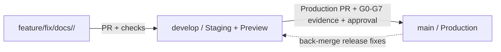

# 226os Git Workflow

**Status:** Accepted workflow (ADR-0001, ADR-0002); repository administration and deployment secrets still require human configuration

## Branches and environments

| Branch | Role | Environment | Allowed source |
|---|---|---|---|
| `main` | Production history and release point | Production | PR from `develop` only, except emergency procedure |
| `develop` | Shared integration and staging branch | Staging/Preview | PR from work branches only |
| Work branch | One bounded change | Local/CI checks | Created from the current target branch |

`develop` and `main` are long-lived protected branches. Direct pushes are disabled. Every promotion happens through a pull request with required checks. `develop` is the shared staging/preview environment (profile `staging-test`); `main` is production (profile `production-live`). Human approval is required for production, security, migration, and other irreversible gates; it is optional for routine low-risk integration into `develop` when the authenticated project owner is the only maintainer.

## Work branch naming

Use a semantic branch name with a domain and a short kebab-case description:

```text
feature/<domain>/<short-name>
fix/<domain>/<short-name>
hotfix/<domain>/<short-name>
refactor/<domain>/<short-name>
test/<domain>/<short-name>
docs/<domain>/<short-name>
chore/<domain>/<short-name>
```

Examples:

```text
feature/solve/accepted-answer
fix/identity/session-expiry
docs/platform/git-workflow
chore/ops/preview-environment
```

Allowed domains are `solve`, `discover`, `build`, `identity`, `community`, `connect`, `language`, `access`, `intelligence`, `platform`, `ops`, and `docs`. Use `platform` or `ops` for cross-domain engineering and infrastructure work.

Avoid personal names, ticket-only branches, generic names such as `work` or `tmp`, spaces, uppercase letters, and unrelated changes in one branch.

## Promotion flow



1. Create a work branch from `develop`.
2. Open a PR into `develop`. The PR must identify its story/task, allowed paths, acceptance criteria, risks, owner, and evidence plan. A second human reviewer is optional for routine low-risk Preview integration.
3. Merge after required checks. The agent/orchestrator may merge a green, low-risk PR into `develop` when the task contract is satisfied. `develop` is the staging/preview environment.
4. Validate the exact `develop` SHA with integration, contract, security, E2E, accessibility, performance, backup/restore and smoke checks.
5. Open a production PR from `develop` into `main`. Require G7 evidence and explicit production approval.
6. Deploy to production the artifact (image digest) built and tested from the `develop` SHA. The `main` merge commit must have the same tree as that `develop` SHA; the release check verifies it. Back-merge production-only fixes into `develop` through a PR.

## Emergency hotfixes

A critical production fix uses `hotfix/<domain>/<short-name>` from `main`. It must be reviewed as a PR into `main`, pass the applicable security and regression checks, and receive production approval. After release, back-merge it into `develop`. A hotfix never bypasses evidence or approval; it may reduce scope only when the incident record documents the reason and compensating checks.

## Commit and PR rules

- Each human contributor uses their own reviewed project identity. The repository owner identity is `Y4NN77 <axel.studiesmail@gmail.com>`; other identities require project review.
- Before a contributor's first commit, record their GitHub username, approved Git `user.name`, and approved Git `user.email` with the maintainer. The identity must be attributable to that human contributor and must not be shared.
- Recommended local setup after approval: `git config --local user.name "<approved commit name>"` and `git config --local user.email "<approved commit email>"`. Verify with `git config --local --get user.name` and `git config --local --get user.email`.
- Do not add `Co-authored-by` trailers for AI systems or agents; the responsible human contributor remains the sole commit author. Record AI assistance in `AI_USAGE.md` instead.
- Keep commits focused and use imperative subjects such as `docs: clarify branch promotion`.
- Do not force-push shared branches. Force-pushes to work branches are discouraged and must never rewrite `develop` or `main`.
- Promotion PRs (`develop` -> `main`) and back-merges (`main` -> `develop`) must use **Create a merge commit**. Never squash or rebase them: that rewrites the tested commits, makes `main` and `develop` diverge, and breaks SHA-based release evidence.
- Work-branch PRs into `develop` may use squash or merge commit; a work branch that contains a back-merge must use a merge commit.
- A PR cannot claim a gate passed without a real report tied to its commit SHA. `NOT RUN` remains `NOT RUN`.

## Required GitHub branch protection

Configure these settings in the repository administration UI; this file does not create them automatically:

- Protect `develop` and `main`.
- Require pull requests on both branches. Require zero approvals on `develop` for routine integration and at least one distinct human approval on `main`; during the interim single-maintainer period, owner approval satisfies this rule ([ADR-0002](decisions/0002-interim-single-maintainer-ownership.md)), and the production PR states that the approver is also the author.
- Require the workflow checks defined under `.github/workflows/`.
- Dismiss stale approvals after new commits and require conversation resolution.
- Restrict who can push and prevent force-push/delete on protected branches.
- Do not require linear history on `develop` or `main`: promotion and back-merge use merge commits.
- Require the `production` environment approval for `main` deployment. The `develop` staging/preview environment does not require a release approval gate.

## Current repository limitation

No application, deployment, or environment configuration exists yet. The workflow contract and policy check can be versioned now; develop staging/preview and production deployment jobs remain `NOT IMPLEMENTED` until the application and infrastructure tasks are approved and built.
