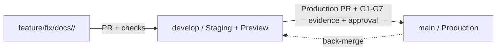

# 226os Git Workflow

**Status:** Accepted workflow ([ADR-0001](decisions/0001-g0-conditional-baseline.md), [ADR-0002](decisions/0002-interim-single-maintainer-ownership.md), [ADR-0008](decisions/0008-team-work-areas-and-ownership.md), [ADR-0010](decisions/0010-ci-parallel-gate-groups.md)). Repository administration settings belong to the owner.

## Branches and environments

| Branch | Role | Environment | Allowed source |
|---|---|---|---|
| `main` | Production history and release point | Production (`production-live`) | PR from `develop` only, except emergency procedure |
| `develop` | Shared integration and staging branch | Staging/Preview (`staging-test`) | PR from work branches only |
| Work branch | One bounded change | Local/CI checks | Created from the current target branch |

**Default branch: `develop`** ([ADR-0013](decisions/0013-default-branch-develop.md), once the owner switches it). New clones check out `develop`, a pull request opens against `develop` by default, and the review pipeline (`workflow_run`, `schedule`, `workflow_dispatch`) runs from `develop`'s copy of the workflows. Promotion rules below are unchanged: `main` still takes only a promotion PR from `develop` (or a hotfix). GitHub closes `Closes #N` and `Fixes #N` on a merge into the default branch, so they now act natively on merges into `develop`, `needs-owner` issues included; `scripts/close-merged-issues.py` stays as the idempotent backstop. A pull request that touches `.github/pipeline-paths.txt` is merged by the owner only; auto-merge refuses it and teammates do not merge it.

Direct pushes to `develop` and `main` are prohibited. Reviewer rules for the four-person team are in [ADR-0008](decisions/0008-team-work-areas-and-ownership.md) and [`team/CONTRIBUTORS.md`](team/CONTRIBUTORS.md). Human approval is required for production, security, migration and other irreversible gates.

## Work branch naming

`feature|fix|hotfix|refactor|test|docs|chore/<domain>/<short-name>`, kebab-case, for example `feature/solve/accepted-answer`, `fix/identity/session-expiry`, `chore/ops/preview-environment`.

Domains used by convention: `solve`, `discover`, `build`, `learn`, `identity`, `community`, `connect`, `language`, `access`, `intelligence`, `platform`, `ops`, `docs`. Domains are conventional: CI checks only the branch shape (`.github/workflows/branch-policy.yml`). Avoid personal names, ticket-only names, generic names such as `work` or `tmp`, uppercase letters, and unrelated changes in one branch.

`scripts/worktree.sh new <branch>` cuts a branch from `develop` under the git-ignored `.claude/worktrees/`; `scripts/worktree.sh done <branch>` removes it after the PR is merged (it refuses a dirty worktree or an unmerged branch).

## Promotion flow

1. Create a work branch from `develop` and open a PR into `develop`. The PR identifies its slice, allowed paths, acceptance criteria, risks, owner, reviewer and evidence (`.github/PULL_REQUEST_TEMPLATE.md`).
2. Merge after the checks and the review required by ADR-0008. `develop` is staging/preview.
3. Validate the exact `develop` SHA (integration, contract, security, E2E, accessibility, performance, backup/restore, smoke) as far as each gate is implemented.
4. Open a production PR from `develop` into `main` with G7 evidence and explicit approval. Before approving, the approver verifies that `git diff develop main` is empty; no automation does this today.
5. Deploy the image digest built and tested from the `develop` SHA.
6. Back-merge: right after the production PR merges, open a PR `main` -> `develop` (branch `chore/platform/sync-main-into-develop`, **Create a merge commit**) so `develop` is not shown behind `main`. It changes no file; check that `git diff develop...main` is empty first. The required check `Validate branch promotion` (`scripts/check-develop-contains-main.sh`) refuses other PRs into `develop` while `develop` lacks commits that `main` has.

## Emergency hotfixes

A critical production fix uses `hotfix/<domain>/<short-name>` from `main`, goes through a PR into `main` with the applicable security and regression checks and production approval, then is back-merged into `develop`. A hotfix never bypasses evidence or approval; it may reduce scope only when the incident record documents the reason and compensating checks.

## Commit and PR rules

- Each human contributor uses their own approved project identity; the Day one steps are in [`CONTRIBUTING.md`](../CONTRIBUTING.md#day-one). The repository owner's Git identity is `Y4NN77 <approved Git email>` (GitHub login Y4NN777). Verify with `git config --local --get user.name`.
- Never add `Co-authored-by` trailers for AI systems or agents; record AI assistance as one file in `docs/ai-usage/` (`AI_USAGE.md` is generated from those files). This repository rule overrides any default attribution suggested by a tool.
- Keep commits focused, with imperative subjects such as `docs: clarify branch promotion`.
- Do not force-push shared branches; never rewrite `develop` or `main`.
- Promotion PRs and back-merges use **Create a merge commit**; never squash or rebase them (it breaks SHA-based release evidence). Work-branch PRs into `develop` may squash, except a branch that contains a back-merge.
- A PR cannot claim a gate passed without a real report tied to its commit SHA. `NOT RUN` remains `NOT RUN`.

## GitHub branch protection

Configured today (owner settings; `quality` added 2026-11-12): `develop` and `main` require the status checks "Validate branch promotion" and `quality` (strict), conversation resolution, no force-push, and apply to admins. `develop` requires no review; `main` requires 0 approvals.

Pipeline paths are protected by convention and by auto-merge, not by a ruleset or a code-owner review requirement ([ADR-0013](decisions/0013-default-branch-develop.md)).

Planned owner setting: decide a review rule for `main` once the team pushes (with enforce-admins on, one required approval would block owner promotions until a teammate reviews). Linear history stays off, because promotion and back-merge use merge commits.

## If a bad change reaches develop

1. Open a revert PR (`git revert -m 1 <merge commit>`), bundle it with the fix if the fix is small. `develop` is staging, so this is quick and nothing reaches production.
2. The promotion PR into `main` is the second gate: the owner reads it and runs `make smoke` first; production is never promoted from a red `develop`.
3. In production, redeploy the previous image by digest ([SHIP](SHIP.md) section 5); an application rollback does not undo a migration.
4. Say what happened in the PR and add the missing check or rule, so the same change cannot pass again.

## Current state

No deployment workflow exists yet. The application, the Compose profiles and CI exist. Deployment jobs and the `production` environment approval remain `NOT IMPLEMENTED` until the ops slice (TODO S8) is done.
