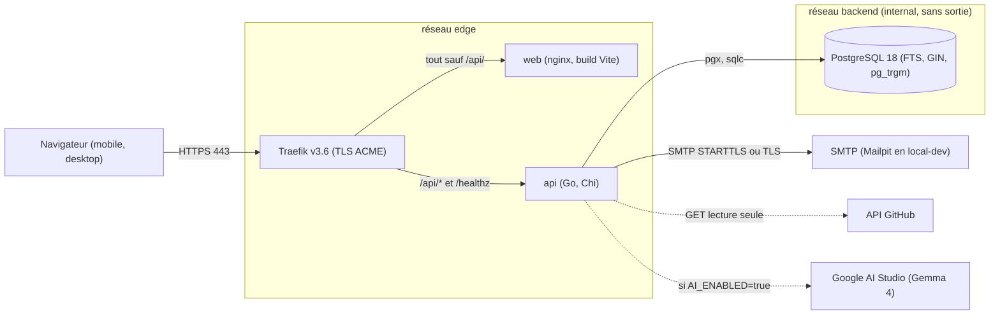
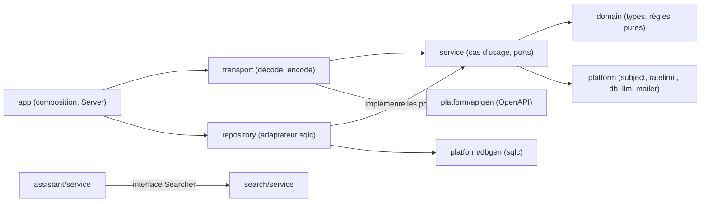
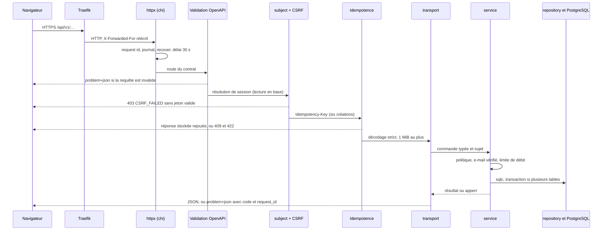
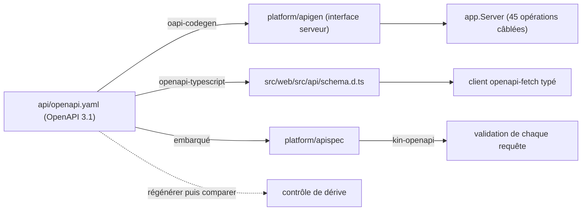
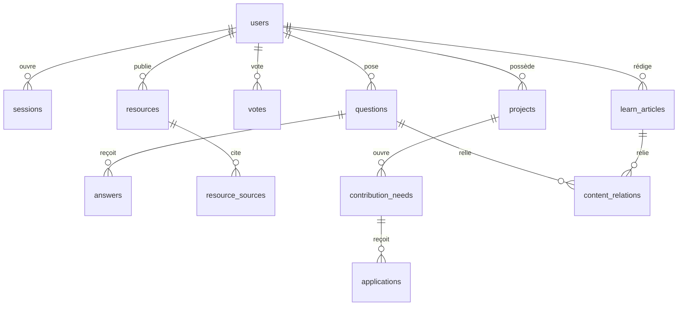
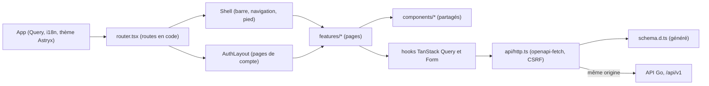
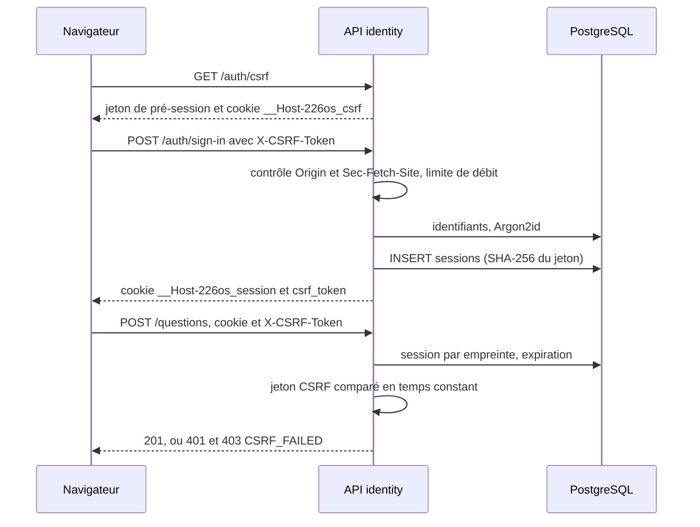
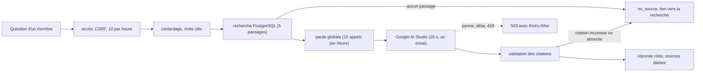
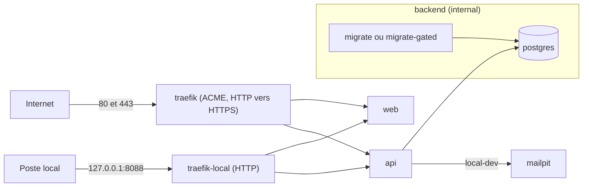

# 226os — Architecture logicielle

Ce document décrit le code tel qu'il est le 2026-11-15, sur la branche `develop` et les PR en cours. Ce qui n'existe pas encore dans le code est marqué « planifié ».

## 1. Objet et périmètre

226os est un monolithe modulaire : une application web React servie en statique, une API Go unique et une base PostgreSQL, derrière un seul point d'entrée Traefik.

- Produit (neuf domaines, quatre piliers publics) : [PRD](../PRD.md). Comportement attendu : [SPEC](../SPEC.md). Décisions : [registre des ADR](../decisions/README.md).
- Ce document couvre le logiciel : conteneurs, modules, contrat, données, web, sécurité, assistant, topologie d'exécution.

Règles de frontière, valables pour tout le code :
- Le web ne parle qu'à l'API, par le contrat, et n'a aucun accès à la base. L'API porte les invariants et les permissions.
- Un module métier n'importe jamais la couche `transport` d'un voisin. Le partage passe par des interfaces explicites et des modèles limités.
- PostgreSQL transactionnel est la seule source de vérité. La recherche plein texte vit dans le même cluster, sans index secondaire externe.
- Solve, Discover, Build et Learn partagent des *relations de contenu* typées, jamais une table qui mélange leurs modèles.
- Identité et profils servent tous les domaines. L'authentification est centralisée, l'autorisation est vérifiée au plus près de l'opération métier.
- Traefik est le seul service exposé publiquement. La base reste sur un réseau privé.

## 2. Vue d'ensemble

| Conteneur | Rôle | Technologie | Épinglé dans |
|---|---|---|---|
| `traefik` / `traefik-local` | seul point d'entrée, TLS, en-têtes de sécurité | Traefik v3.6, routes en fichier statique, sans socket Docker | [`compose.yaml`](../../compose.yaml), [`deploy/traefik/`](../../deploy/traefik/) |
| `web` | sert le build Vite, repli SPA sur `index.html`, CSP | `nginxinc/nginx-unprivileged` | [`src/web/Dockerfile`](../../src/web/Dockerfile), [`src/web/nginx/`](../../src/web/nginx/) |
| `api` | logique métier, `/api/v1`, `/healthz`, `/readyz` | Go 1.27.4, Chi v5, pgx v5, distroless `nonroot` | [`go.mod`](../../go.mod), [`src/api/Dockerfile`](../../src/api/Dockerfile) |
| `postgres` | données, contraintes, recherche | `postgres:18`, volume `pgdata` | [`compose.yaml`](../../compose.yaml) |
| `migrate` / `migrate-gated` | job ponctuel `goose up` | goose v3, distroless | [`src/api/Dockerfile`](../../src/api/Dockerfile) (cible `migrate`) |
| `mailpit` | capte tout le courrier en `local-dev` | Mailpit v1.33.1 | [`compose.yaml`](../../compose.yaml) |

- Toutes les images de base sont épinglées par digest.
- PostgreSQL n'est que sur `backend` (`internal: true`) et n'est publié dans aucun profil. Les appels de l'API vers l'extérieur partent par `edge`.

## 3. API Go

### 3.1 Modules et sens des dépendances

- Chaque module suit `domain`, `service`, `repository`, `transport`. Exception : `assistant`, sans `repository`, qui lit par `search` et appelle le modèle par `platform/llm`.
- Le package racine d'un module (`solve/solve.go`, `build/build.go`…) assemble `repository → service → transport` dans un `NewHandler` ; `identity` n'en a pas et `app` le câble directement.
- [`internal/app`](../../src/api/internal/app/app.go) branche ces handlers sur `app.Server`, seule implémentation de `apigen.ServerInterface` en production.
- Observé dans le code : aucun module n'importe le `transport` d'un autre ; la seule dépendance entre modules est `assistant → search`.

| Module | Domaine du PRD | Possède | Opérations | État |
|---|---|---|---|---|
| `identity` | Identity & Community, Connect (annuaire) | comptes, mots de passe, sessions, jetons, CSRF, profils, compétences, `GET /profiles` | 12 | construit |
| `solve` | Solve | questions, réponses, votes, réponse acceptée | 10 | construit |
| `discover` | Discover | fournisseurs, fiches, sources, signalements d'erreur | 4 | construit ; avis planifiés (P1) |
| `build` | Build | projets GitHub, besoins de contribution, candidatures | 9 | construit |
| `learn` | Learn | articles, tutoriels, formations et leçons | 5 | construit ; progression planifiée (P1) |
| `search` | Intelligence | recherche groupée sur quatre types de contenu | 1 | construit |
| `assistant` | Intelligence | réponses sourcées, jamais stockées | 1 | construit, désactivé par défaut |
| `moderation` | transverse | masquer, restaurer, clore un signalement, `audit_log` | 3 | construit |
| community | Identity & Community | espaces, fil, discussions, réputation | — | planifié |
| connect, au-delà de l'annuaire | Connect | mentorat, opportunités | — | planifié |
| language | Language | traduction des contenus | — | planifié (l'interface FR/EN existe, section 6) |

- Access (réseau limité, mobile) est transversal au frontend, sans module API.
- Pas de dossier vide pour un domaine sans fonctionnalité (SPEC section 3).
- Deux packages hors couches : `identity/password` (Argon2id) et `build/github` (adaptateur GitHub, section 7.4).

### 3.2 Couche plateforme

| Package | Rôle |
|---|---|
| `internal/app` | racine de composition : configuration, journaux JSON `slog`, pool pgx, purge horaire des clés d'idempotence, câblage |
| `platform/apigen`, `platform/apispec` | code généré depuis le contrat (oapi-codegen v2.8.2), contrat embarqué pour valider les requêtes ; opération non câblée : 501 |
| `platform/httpx` | routeur, middleware, décodage strict, problem+json, `ClientIPKey` (dernière entrée `X-Forwarded-For`, préfixe /24 ou /48) |
| `platform/apperr`, `platform/config` | erreur applicative typée sans HTTP ; configuration validée (`APP_ENV` = `local-dev`, `staging-test` ou `production-live`) |
| `platform/cursor`, `platform/etag`, `platform/idempotency` | conventions de l'[ADR-0004](../decisions/0004-api-contract-conventions.md) |
| `platform/db`, `platform/dbgen`, `platform/pgtest` | transactions (`InTx`, rollback sur erreur ou panique), code sqlc, tests sur PostgreSQL 18 réel |
| `platform/subject` | l'appelant, anonyme par défaut ; résolu par `identity/transport` (`NewResolver`) |
| `platform/ratelimit` | fenêtre fixe dans `rate_limit_buckets`, clés HMAC ; échec fermé ou ouvert au choix de l'appelant |
| `platform/mailer` | port d'envoi ; SMTP avec STARTTLS exigé ou TLS implicite, `AUTH PLAIN` sous TLS seulement |
| `platform/llm` | port vers le modèle ; adaptateur AI Studio, client factice, client désactivé, `Tracker` |
| `cmd/*` | `api` (serveur), `healthcheck` (sonde embarquée), `aicheck` et `mailcheck` (vérifications manuelles) |

### 3.3 Cycle de vie d'une requête

- Ordre défini dans [`httpx/router.go`](../../src/api/internal/platform/httpx/router.go). La validation passe avant la lecture de session (ADR-0004 point 8). Un échec CSRF ne consomme jamais de clé d'idempotence.
- Les limites de débit ne sont pas un middleware : chaque service les applique avec sa portée (`signin:ip`, `write:user`, `search:ip`, `assistant:user`…).
- `/healthz` et `/readyz` sont hors de `/api/v1` et de cette chaîne ; `/readyz` interroge la base avec un délai de 2 s.

## 4. Contrat d'API

- [`api/openapi.yaml`](../../api/openapi.yaml) est la source de vérité, écrite avant le code : 39 chemins, 49 opérations. 45 sont câblées ; les 4 opérations P1 (`listResourceReviews`, `createResourceReview`, `getLessonProgress`, `putLessonProgress`) répondent 501.
- Fichiers générés versionnés, jamais modifiés à la main (ADR-0004 point 10). Récit du contrat : [API_CONTRACT.md](../spec-kit/API_CONTRACT.md).

| Convention | Règle ([ADR-0004](../decisions/0004-api-contract-conventions.md)) |
|---|---|
| Base | `/api/v1` en même origine, JSON UTF-8, UUID opaques (`uuidv7()`), RFC 3339 UTC ; rupture seulement en v2, avec ADR |
| Erreurs | RFC 9457 : `type` = `urn:226os:problem:<code>`, `title`, `status`, `code` stable, `instance`, `request_id`, `violations` ; ni trace, ni SQL, ni hôte interne |
| Statuts | 401 sans session ; 403 si l'objet est visible ; 404 si son existence ne doit pas fuiter ; 409, 412, 428, 413, 422 ; 429 et 503 avec `Retry-After` |
| Pagination | curseur base64url signé HMAC ; `limit` 20 par défaut, 50 au plus, 422 au-delà ; `{items, next_cursor}` ; `/search` groupé par `per_group` |
| Idempotence | `Idempotency-Key` sur six créations (question, réponse, projet, besoin, candidature, article) ; sujet, route et hachage ; 24 h ; autre corps : 422, requête concurrente : 409. Votes protégés par l'unicité en base |
| Concurrence | `ETag` fort et `If-Match` obligatoire sur `updateQuestion` (412, 428), seule édition du contrat P0 |
| Validation | `additionalProperties: false`, bornes sur chaque champ, `DisallowUnknownFields`, corps limité à 1 MiB, `application/json` exigé |
| `PATCH` | JSON Merge Patch (RFC 7396) |
| Authentification | cookie `cookieAuth` et en-tête `X-CSRF-Token` sur toute méthode non sûre ; aucun jeton bearer |

## 5. Données

### 5.1 Modèle principal

| Agrégat | Tables | Points clés |
|---|---|---|
| Identité | `users`, `user_credentials`, `sessions`, jetons, `profiles`, `user_skills` | seul le SHA-256 des jetons est stocké ; visibilité par champ et par profil |
| Solve | `questions`, `answers`, `votes`, sources | état `open`, `answered`, `resolved` dérivé, jamais stocké ; `vote_score` tenu dans la transaction du vote |
| Discover | `providers`, `resources`, `resource_sources`, `error_reports` | vérification `unverified`, `claimed`, `verified`, `disputed` |
| Build | `projects`, `contribution_needs`, `applications`, `project_maintainers` | seul le propriétaire agit à P0 ; un mainteneur n'a aucun droit |
| Learn | `learn_articles`, `training_series`, `training_lessons` | articles `draft`, `published`, `archived`, `removed` |
| Relations | `content_relations` | une vraie FK par entité et par côté ; masquage par `status = 'hidden'` |
| Modération | `audit_log` | une ligne par action de modérateur, dans la même transaction |

- Contenu publiable : `published` ou `removed` (avec `removed_at`) ; masquer met `removed`, restaurer remet `published`.
- Chaque ligne racine porte `provenance` (`live` ou `demo`).
- `ON DELETE RESTRICT` sur tout contenu d'utilisateur ; cascade seulement pour les artefacts d'authentification et les tables de jointure.

### 5.2 Migrations et accès

- PostgreSQL 18, extensions `pg_trgm` et `unaccent` ; `unaccent` passe par l'enveloppe immuable `f_unaccent(text)`.
- Accès par `pgx` v5 et `sqlc` : les requêtes de [`db/queries/`](../../db/queries/) (dix fichiers) génèrent `platform/dbgen`. Pas d'ORM.
- Migrations goose en SQL, **forward-only** (sans `Down`), séquentielles, immuables après merge ([ADR-0005](../decisions/0005-data-model-migrations-search.md) point 3). Chaque fichier porte un en-tête : objet, verrous, volume, transaction, compatibilité, restauration, responsable.
- Retour arrière : restauration d'une sauvegarde `pg_dump -Fc` ou redéploiement de l'image précédente, jamais une migration inverse.

| Migration | Contenu |
|---|---|
| `00001_extensions` | `pg_trgm`, `unaccent`, `f_unaccent` |
| `00002_reference_taxonomy` | `countries` (54 États africains), `tags`, `learn_topics`, `resource_categories` |
| `00003_identity` | `users`, `user_credentials`, `profiles`, `user_skills`, `sessions`, jetons de vérification et de réinitialisation |
| `00004_platform_support` | `rate_limit_buckets` (`UNLOGGED`), `idempotency_keys`, `audit_log` |
| `00005_solve` | `questions`, `answers`, `votes`, étiquettes, sources |
| `00006_discover` | `providers`, `resources`, `resource_sources`, pays, étiquettes, langages de SDK, `error_reports` |
| `00007_build` | `projects`, mainteneurs, étiquettes, `contribution_needs`, `need_skills`, `applications` |
| `00008_learn` | `learn_articles`, étiquettes, `training_series`, `training_lessons` |
| `00009_content_relations` | `content_relations` |
| `00010_search_indexes` | index GIN plein texte et trigrammes, partiels sur le contenu publié |
| `00011_taxonomy_ai_topics` | cinq thèmes Learn, trois catégories Discover |
| `00012_profile_visibility` | visibilité globale du profil |
| `00013_error_report_source` | un signalement peut viser une source précise |

Soit 38 tables. Les trois tables P1 (dont `learn_progress` et `resource_reviews`) sont planifiées ([DATABASE_DESIGN.md](../spec-kit/DATABASE_DESIGN.md) section 2.1).

### 5.3 Invariants tenus par la base

| Invariant | Contrainte |
|---|---|
| La réponse acceptée appartient à sa question | `questions_accepted_answer_fk`, FK composite vers `answers (id, question_id)` |
| Un vote par utilisateur et par cible, +1 ou −1 | `votes_pk`, `votes_target_ck`, `votes_value_ck` |
| Une fiche vérifiée cite une de ses propres sources | `resources_verified_ck`, `resources_verified_source_fk` |
| Un signalement ouvert par auteur, fiche et type | `error_reports_open_uq` (unique partiel), `error_reports_source_fk` |
| Une candidature par utilisateur et par besoin | `applications_user_need_uq`, `applications_decision_ck`, `applications_withdrawn_ck` |
| Une URL GitHub par projet actif | `projects_github_url_uq` (unique partiel) |
| E-mail, nom d'utilisateur, jeton uniques | `users_email_uq`, `profiles_username_uq`, `sessions_token_hash_uq` |
| Seules les paires de relation prévues existent | `content_relations_pair_ck`, `content_relations_uq` |
| `removed` si et seulement si `removed_at` | `questions_removed_ck`, `answers_removed_ck`, `resources_removed_ck`… |
| URL externes en `https://`, bornées | `resources_urls_ck`, `resource_sources_url_ck` |

Les règles qui croisent des tables (pas d'auto-vote, mainteneur différent du propriétaire) sont vérifiées par le service, dans la transaction de l'opération.

### 5.4 Recherche

- Colonne générée `search_document tsvector` sur `questions`, `answers`, `resources`, `projects` et `learn_articles`, configuration `simple` sur `f_unaccent` : `éléphant` trouve `elephant`.
- Pondération A et B : titre et corps pour les questions, nom et résumé pour les fiches et les projets, titre et résumé pour les articles ; les réponses ne sont pas pondérées.
- Index GIN partiels sur le contenu publié, et public pour les projets ; les requêtes répètent le prédicat de l'index.
- `GET /search` : une requête bornée par groupe (questions, fiches, projets, articles), `websearch_to_tsquery`, 100 caractères au plus, 500 candidats avant `ts_rank`, tri `ts_rank DESC` puis `id`, extraits de 300 caractères. Une requête sans terme positif ne lit rien.
- Tolérance aux fautes de frappe (2026-11-15, #248) : quand le plein texte ne trouve rien dans un groupe, `GET /search` cherche les titres et noms qui contiennent un mot proche de la requête (`pg_trgm`, similarité de mot au-dessus de 0,6, opérateur `%>` servi par l'index trigramme partiel du groupe), mêmes prédicats et filtres, 500 candidats au plus, tri par similarité puis `id`. Il faut 3 caractères ; une requête sans terme positif ne lit rien. Une lettre manquante ou en trop est trouvée (« paiemnt »), deux lettres inversées non (« pyhton »). La récupération de l'assistant n'utilise pas ce repli : sans source exacte, il répond sans source (AI-1).
- Aucun contenu n'est traduit automatiquement ; chaque élément garde sa langue (`fr` ou `en`).

## 6. Web

| Brique | Version | Rôle |
|---|---|---|
| React, TypeScript, Vite | 19.3, 5.9 strict, 8 | rendu, typage, build statique |
| TanStack Router, Query, Form | 1.170, 5, 1 | routes typées sans générateur, cache serveur, formulaires |
| Astryx | 0.7.14 ([ADR-0007](../decisions/0007-astryx-version-pinning-and-verification.md)) | composants et thème ; Graphite & Lime de [DESIGN.md](../../DESIGN.md) posé sur ses jetons (`theme/theme226os.ts`, clair et sombre) |

### 6.1 Coquille et routes

- `Shell` (Astryx `AppShell`) : marque, recherche vers `/recherche?q=`, thème, menu du compte, « Poser une question » pour un membre ; navigation en deux groupes (Apprendre et Connect, puis Résoudre, Découvrir et Construire) ; rail d'icônes entre 768 et 1023 px ; barre inférieure et tiroir sur téléphone.
- Les pages de compte utilisent `AuthLayout`, sans coquille. Toute autre adresse affiche `NotFound`. Source : [`router.tsx`](../../src/web/src/app/router.tsx).

| Chemin | Page | Opérations principales |
|---|---|---|
| `/` | accueil public pour un visiteur, accueil personnel pour un membre | `listResources`, `listQuestions`, `listProjects`, `listLearnArticles` |
| `/apprendre`, `/apprendre/articles/$articleId`, `/apprendre/formations/$seriesId` | Learn | `listLearnArticles`, `getLearnArticle`, `listTrainingSeries`, `getTrainingSeries` |
| `/ecrire` | rédaction d'article | `createLearnArticle` |
| `/connect` | annuaire des membres | `listProfiles` |
| `/solve`, `/questions/$questionId` | Solve | `listQuestions`, `createQuestion`, `getQuestion`, `createAnswer`, `castVote`, `acceptAnswer`… |
| `/discover`, `/discover/$resourceId` | catalogue, fiche, signalement | `listResources`, `getResource`, `listResourceSources`, `createResourceErrorReport` |
| `/build`, `/build/$projectId` | projets, besoins, candidatures | `listProjects`, `createProject`, `createApplication`, `listProjectApplications`, `decideApplication`… |
| `/recherche` | recherche groupée, panneau de l'assistant | `search`, `askAssistant` |
| `/profils/$username` | profil public, liste de complétion du sien | `getProfile`, `updateMyProfile` |
| `/parametres` (`/settings` redirige) | nom affiché, visibilité, langue, thème | `getMe`, `updateMyProfile` |
| `/connexion`, `/inscription`, `/verifier-email`, `/mot-de-passe-oublie`, `/reinitialiser`, `/bienvenue` | pages de compte | `/auth/*` |

### 6.2 Client d'API

- `api/http.ts` est le seul point d'appel vers `/api/v1` : client `openapi-fetch` typé par `schema.d.ts`, `credentials: 'include'`.
- Toute méthode `POST`, `PUT`, `PATCH`, `DELETE` reçoit `X-CSRF-Token`. Le jeton vient de `GET /auth/session`, de la réponse de connexion ou de `GET /auth/csrf` et reste en mémoire ; après un 403 `CSRF_FAILED`, la mutation est rejouée une fois avec un jeton neuf.
- Toute erreur devient une `ApiError` (statut, `code`, `request_id`, `violations`, `Retry-After` plafonné à 300 s). Les pages réagissent au `code`, jamais au texte.
- Cookie de session `HttpOnly`, illisible par le script. Aucun jeton dans le stockage du navigateur ; `localStorage` ne garde que la langue et le thème.

### 6.3 Langue, contenu, accessibilité

- Interface FR et EN : langue du navigateur (français par défaut), choix dans le menu du compte, attribut `lang` du document tenu à jour. Messages dans `i18n/messages.ts` et `features/*/messages.ts`.
- Typographie française vérifiée par `i18n/translate.test.ts`.
- Markdown des membres rendu par le composant `Markdown` d'Astryx : aucun HTML brut, liens dangereux réduits à du texte. Extraits dans `CodeBlock`, jamais exécutés. Aucun `dangerouslySetInnerHTML`.
- Contenu de démo signalé par `DemoBadge`.
- Cible WCAG 2.2 AA ([DESIGN.md](../../DESIGN.md)). Vérifié : contrastes des jetons (4,5:1 pour le texte) dans `theme226os.test.tsx`, tests de composants par rôle et par libellé. Audit axe et parcours clavier de bout en bout : planifiés.

## 7. Sécurité

### 7.1 Session et CSRF

| Sujet | Règle ([ADR-0003](../decisions/0003-authentication-sessions-csrf-rate-limits.md)) |
|---|---|
| Mots de passe | Argon2id m=64 MiB, t=3, p=1, chaîne PHC ; sémaphore de hachage ; hachage factice pour un e-mail inconnu |
| Sessions | 32 octets aléatoires, seul le SHA-256 est stocké ; 2 h d'inactivité, 7 jours au plus ; nouveau jeton à la connexion, révocation à la déconnexion ; la réinitialisation révoque les autres sessions |
| Jetons à usage unique | vérification d'e-mail 24 h, réinitialisation 30 min ; hachés, jamais journalisés |
| Cookie | `HttpOnly`, `SameSite=Lax`, `Path=/`, sans `Domain` ; `__Host-` et `Secure` hors `local-dev`, choisis par `APP_ENV` |
| CSRF | jeton synchroniseur lié à la session, exigé sur toute méthode non sûre, JSON compris ; contrôle `Origin` et `Sec-Fetch-Site` sur chaque mutation ; aucun `GET` ne modifie d'état |
| Réponses génériques | connexion, inscription et réinitialisation ne révèlent pas l'existence d'un compte |
| Publication | e-mail vérifié exigé, sinon 403 `EMAIL_NOT_VERIFIED` |

### 7.2 Autorisation

- Sujets : `anonymous`, `member`, `moderator`, `owner` (propriétaire de la ressource visée, jamais un administrateur global).
- Le sujet vient de la session (`platform/subject`), jamais d'un identifiant envoyé par le client. Les décisions sont prises dans les services, au plus près de l'opération ; l'interface ne fait que masquer des commandes.
- Modérateur : masquer, restaurer, clore un signalement, rien d'autre ; une ligne `audit_log` par action.
- Matrice par opération et cas négatifs : [AUTHORIZATION_MATRIX.md](../spec-kit/AUTHORIZATION_MATRIX.md).
- Comptes de démo (`users.provenance = 'demo'`) : visibles dans l'annuaire `GET /profiles` en `local-dev` seulement. `WithDemoProfiles` n'est activé que si `APP_ENV` vaut exactement `local-dev` (`demoProfilesEnabled`, `app.go`) ; toute autre valeur les exclut et la configuration refuse un `APP_ENV` inconnu. Le 404 sur `GET /profiles/{username}` pour ces comptes arrive avec #241.

### 7.3 Limites de débit

- Compteurs à fenêtre fixe dans `rate_limit_buckets` (`UNLOGGED`, remis à zéro après un crash, risque accepté), clés HMAC de l'IP réduite à son préfixe ou de l'identifiant.
- Valeurs de l'ADR-0003, par exemple : connexion 5 échecs par compte et 20 par IP en 15 min ; écritures 60 par minute ; recherche anonyme 60 par minute et par réseau. Assistant : ADR-0012 (section 8).
- 429 `RATE_LIMITED` avec `Retry-After`. Authentification et écritures échouent fermé.
- IP cliente lue dans la dernière entrée `X-Forwarded-For`, que Traefik réécrit (`forwardedHeaders.insecure=false`).

### 7.4 Entrées externes et frontières de confiance

| Frontière | Entrée non fiable | Protection |
|---|---|---|
| Navigateur → API | corps, paramètres, en-têtes, cookies | TLS, validation OpenAPI avant la session, décodage strict, CSRF, limites, erreurs sans détail interne |
| API → PostgreSQL | saisies des membres | requêtes sqlc paramétrées, contraintes, transactions, réseau privé |
| API → GitHub | URL fournie par un membre | `GET` vers `https://api.github.com` seulement, 5 s, 1 MiB, ni redirection ni proxy ; adresse unicast publique sur le port 443 exigée au dial ; jeton éventuel envoyé à cet hôte seul |
| API → fournisseur IA | question, passages publics | caviardage, section de données délimitée, citations validées par le serveur |
| Contenu → navigateurs | Markdown, extraits, liens | rendu sans HTML, CSP nginx (`default-src 'self'`, `frame-ancestors 'none'`), HSTS et `nosniff` posés par Traefik |
| Fichiers téléversés | aucun aujourd'hui | planifié, avec sa propre revue |

- Aucun code déposé par un membre n'est exécuté. Les journaux ne contiennent ni secret, ni jeton, ni donnée personnelle inutile.

### 7.5 Secrets

- Aucun secret en clair dans le dépôt ([ADR-0009](../decisions/0009-secrets-with-sops-and-age.md)) : `secrets/<profil>.enc.env` chiffré avec SOPS et age, clés publiques par profil ([`secrets/README.md`](../../secrets/README.md)).
- `scripts/compose.sh` déchiffre dans un fichier temporaire en mémoire, pour une seule commande.
- `CURSOR_KEY`, SMTP, `GITHUB_TOKEN` et `AI_API_KEY` ne vont qu'au conteneur `api` ; le job de migration ne reçoit que l'URL de la base.
- L'échec d'ouverture du pool est journalisé par un message fixe, sans l'URL ni son mot de passe.

## 8. Assistant IA

- `POST /assistant/answers` (`askAssistant`), selon l'[ADR-0011](../decisions/0011-ai-assistant-provider.md) et l'[ADR-0012](../decisions/0012-ai-assistant-integration.md).
- Accès : membre avec e-mail vérifié, CSRF, sujet de la session.
- Récupération : la recherche de la section 5.4, contenu publié, visible et public seulement ; un passage par groupe à tour de rôle. Pas de base vectorielle.
- Données envoyées : question et passages caviardés (e-mails, clés, jetons, longues chaînes alphanumériques) ; aucun identifiant, profil ni contenu privé.
- Passages dans une section `<sources>` déclarée comme données ; les phrases qui promettent une garantie sont retirées.
- Réponse marquée `generated_by: ai`, jamais stockée, jamais une ligne `answers`, sans vote ; section « Comment vérifier ».
- Désactivé tant que `AI_ENABLED` ne vaut pas `true` ; alors `AI_API_KEY` et `AI_MODEL` sont obligatoires. Fournisseur derrière `platform/llm` : en changer touche la configuration et l'adaptateur, pas le code métier.
- Journaux : modèle, classe, statut, latence, nombre de sources ; jamais la question, les passages, la réponse ni la clé.

## 9. Déploiement et environnements

- Un seul arbre Compose à profils ([ADR-0006](../decisions/0006-toolchain-environments-quality-commands.md)), lancé par `scripts/compose.sh`, qui exige que `APP_ENV` soit égal au profil.
- `staging-test` et `production-live` sont prévus sur Datacloud. Aucun workflow de déploiement n'existe encore et rien n'est déployé ([SHIP.md](../SHIP.md) section 1).

| | `local-dev` | `staging-test` | `production-live` |
|---|---|---|---|
| Branche | toutes | `develop` | `main` |
| Entrée | `traefik-local`, HTTP sur loopback | `traefik`, 80 et 443, TLS ACME | comme `staging-test` |
| Cookies | `226os_session`, `226os_csrf`, sans `Secure` | `__Host-`, `Secure` | `__Host-`, `Secure` |
| Courrier | Mailpit (ports loopback 1025 et 8025) | SMTP depuis les secrets | SMTP depuis les secrets |
| Migrations | job `migrate` au démarrage | `migrate-gated` : `MIGRATE_CONFIRM` et preuve de sauvegarde `BACKUP_EVIDENCE` | comme `staging-test` |
| Données de démo ([`db/seeds/`](../../db/seeds/README.md)) | autorisées | autorisées | refusées |
| Comptes de démo dans l'annuaire | visibles | masqués | masqués |
| Réinitialisation de la base | autorisée | refusée | refusée |

- Routage edge ([`dynamic.edge.yml`](../../deploy/traefik/dynamic.edge.yml)) : `/api/` et `/healthz` vers l'API, le reste vers le web. `/readyz` n'est pas routé publiquement ; il se vérifie dans le conteneur.
- Conteneurs durables non root (65532 pour l'API, goose, Traefik et Mailpit ; 101 pour nginx ; 999 pour PostgreSQL), `cap_drop: [ALL]`, `no-new-privileges`, système de fichiers en lecture seule, limites CPU, mémoire et PID. Seule exception : le job ponctuel `acme-init`, root avec `CHOWN`, `DAC_OVERRIDE` et `FOWNER`, sans réseau, qui prépare le volume ACME.
- Santé : `/healthcheck` embarqué pour l'API, `pg_isready`, `traefik healthcheck --ping`, `wget` local pour le web. Traefik attend que l'API et le web soient sains.
- Arrêt : l'API termine ses requêtes en 10 s au plus, arrête la purge des clés d'idempotence, puis ferme le pool.
- Sauvegarde et repli : `pg_dump -Fc` avant une migration risquée, restauration vérifiée sur une base jetable, redéploiement de l'image précédente par digest ([SHIP.md](../SHIP.md) sections 3 et 5).
- Jeux de démo : SQL déterministe, UUID fixes, `provenance = 'demo'` sur chaque ligne racine, aucun mot de passe, vote, candidature ni vérification ; une seule transaction ; `local-dev` et `staging-test` seulement, jamais `production-live` (décision du propriétaire du 2026-11-15, dans le cadre de l'ADR-0005 point 17).

## 10. Qualité

Stratégie de test, couverture et portes de qualité : [TEST.md](../TEST.md). Livraison et exploitation : [SHIP.md](../SHIP.md).

## 11. Décisions qui façonnent le logiciel

| ADR | Titre | Statut | Conséquence pour le code |
|---|---|---|---|
| [0001](../decisions/0001-g0-conditional-baseline.md) | Socle G0 | ACCEPTED | pile React, Go, PostgreSQL, Compose et Traefik ; licence Apache-2.0 ; hébergement Datacloud |
| [0003](../decisions/0003-authentication-sessions-csrf-rate-limits.md) | Authentification, sessions, CSRF, limites de débit | ACCEPTED | Argon2id, sessions opaques en base, cookie `__Host-`, CSRF synchroniseur, compteurs PostgreSQL |
| [0004](../decisions/0004-api-contract-conventions.md) | Conventions du contrat d'API | ACCEPTED | OpenAPI d'abord, problem+json, curseurs signés, `Idempotency-Key`, `ETag` |
| [0005](../decisions/0005-data-model-migrations-search.md) | Modèle de données, migrations, recherche | ACCEPTED | goose forward-only, invariants en base, `simple` et `unaccent`, seeds hors production |
| [0006](../decisions/0006-toolchain-environments-quality-commands.md) | Outillage, environnements, commandes | ACCEPTED | trois profils Compose ; Valkey et stockage S3 exclus à P0 |
| [0007](../decisions/0007-astryx-version-pinning-and-verification.md) | Épinglage et vérification d'Astryx | ACCEPTED | Astryx épinglé et vérifié ; Tailwind en complément seulement |
| [0009](../decisions/0009-secrets-with-sops-and-age.md) | Secrets avec SOPS et age | ACCEPTED | secrets chiffrés par profil, déchiffrés en mémoire au lancement |
| [0011](../decisions/0011-ai-assistant-provider.md) | Fournisseur de l'assistant | ACCEPTED | Google AI Studio, Gemma 4, derrière `platform/llm` |
| [0012](../decisions/0012-ai-assistant-integration.md) | Intégration de l'assistant | ACCEPTED | réponses sourcées, citations validées, limites, repli 503 |

## 12. Critères de changement

Cette section est la seule référence pour la règle de dérogation. Tout écart à la pile, tout découpage en microservices, toute nouvelle base de données et tout moteur de recherche externe passent par un ADR qui apporte une justification mesurée, le coût, les risques et l'approbation humaine.
