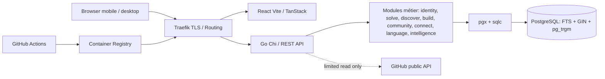

# 226os — Architecture Reference

**Décision acceptée :** React/TanStack + Go + PostgreSQL + Docker Compose/Traefik + GitHub Actions, monorepo, API REST/OpenAPI, monolithe modulaire. Détails de versions à verrouiller lors de l'initialisation.

## Boundaries
- Web ne parle qu'aux API explicites, sans accès DB ; API est propriétaire des invariants et permissions.
- Modules métier n'importent pas directement transport HTTP de leurs voisins ; partage via interfaces explicites et modèles limités.
- PostgreSQL transactionnel est la source de vérité ; FTS dans le même cluster pour MVP ; aucun index secondaire externe.
- Build/Discover/Solve partagent des *relations de contenu*, pas une table géante mélangeant leurs modèles.
- Profils et identité réutilisés ; auth et authorization centralisés, vérification d'accès au plus près des opérations métier.
- Traefik seul exposé publiquement, DB en réseau privé ; secrets via variables sécurisées et volumes maîtrisés.

## Critères de changement
Tout écart à la stack ou toute fragmentation microservices, nouvelle DB ou search externe requiert ADR avec justification mesurée, coût, risques et approbation humaine.

## Threat boundaries
Entrées externes : navigateur, URL GitHub, contenu Markdown, snippets, recherche, candidatures, uploads futurs. Appliquer validation des inputs, contrôle des rôles, anti-XSS, SSRF, CSRF et logs minimaux ; jamais exécuter le code déposé.
