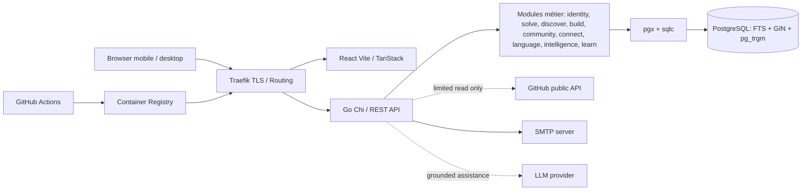

# 226os — Architecture Reference

**Décision acceptée :** React/TanStack + Go + PostgreSQL + Docker Compose/Traefik + GitHub Actions, monorepo, API REST/OpenAPI, monolithe modulaire. Les versions sont verrouillées : voir [ADR-0006](../decisions/0006-toolchain-environments-quality-commands.md), [ADR-0007](../decisions/0007-astryx-version-pinning-and-verification.md) et les fichiers qui les épinglent (`go.mod`, `package.json`, `compose.yaml`).

## Boundaries
- Web ne parle qu'aux API explicites, sans accès DB ; API est propriétaire des invariants et permissions.
- Modules métier n'importent pas directement transport HTTP de leurs voisins ; partage via interfaces explicites et modèles limités.
- PostgreSQL transactionnel est la source de vérité ; FTS dans le même cluster pour MVP ; aucun index secondaire externe.
- Build/Discover/Solve partagent des *relations de contenu*, pas une table géante mélangeant leurs modèles.
- Profils et identité réutilisés ; auth et authorization centralisés, vérification d'accès au plus près des opérations métier.
- Traefik seul exposé publiquement, DB en réseau privé ; secrets via variables sécurisées et volumes maîtrisés.

## Critères de changement
Cette section est la seule référence pour la règle de dérogation. Tout écart à la stack ou toute fragmentation microservices, nouvelle DB ou search externe requiert ADR avec justification mesurée, coût, risques et approbation humaine.

## Couche plateforme de l'API
Aucun module métier n'existe encore dans `src/api/internal` : les modules du diagramme sont **planifiés**. Le code livré est la couche transverse, que les futurs modules consommeront par des interfaces.
- `internal/app` : racine de composition (configuration, journalisation, transport, pool pgx, purge périodique des clés d'idempotence).
- `platform/apigen` (code généré depuis `api/openapi.yaml`) et `platform/apispec` (contrat embarqué pour valider les requêtes) ; une opération non livrée répond 501.
- `platform/httpx` : routeur, middleware, cycle de vie du serveur ; `/healthz`, `/readyz` et l'API sous `/api/v1`.
- `platform/apperr` : erreur applicative typée, rendue en problem+json ; `platform/config` : configuration validée depuis l'environnement.
- `platform/cursor`, `platform/etag`, `platform/idempotency` : conventions de l'[ADR-0004](../decisions/0004-api-contract-conventions.md) (curseurs signés, ETag fort et `If-Match`, `Idempotency-Key`).
- `platform/db` : exécuteur de transactions ; `platform/dbgen` : code sqlc généré ; `platform/pgtest` : tests d'intégration PostgreSQL réel (build tag `integration`).
- `platform/subject` : l'appelant authentifié, ou anonyme tant que l'identité n'est pas livrée.
- `platform/mailer` : port d'envoi de mail, adaptateur SMTP (authentification seulement sous TLS, STARTTLS exigé) ; Mailpit en `local-dev`. Aucun code métier n'importe `net/smtp`.
- `platform/llm` : port vers un fournisseur de modèle de langage, indépendant du fournisseur ; un adaptateur AI Studio existe. Il n'est pas encore branché sur l'API.
- `cmd/api` : point d'entrée HTTP ; `cmd/aicheck` et `cmd/mailcheck` : vérifications manuelles de la configuration IA et SMTP, avec de vrais appels ; `cmd/healthcheck` : sonde `/healthz` ou `/readyz` embarquée dans l'image (pas de shell dans l'image distroless).

## Threat boundaries
Entrées externes : navigateur, URL GitHub, contenu Markdown, snippets, recherche, candidatures, uploads futurs. Appliquer validation des inputs, contrôle des rôles, anti-XSS, SSRF, CSRF et logs minimaux ; jamais exécuter le code déposé.
