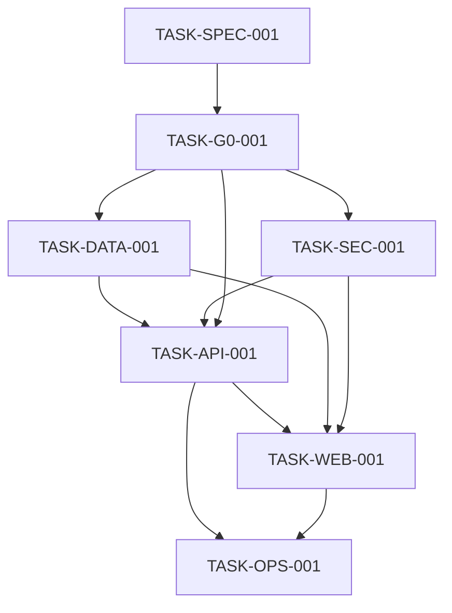

> Archived 2026-11-12. Historical record, not maintained.
> Current source: [docs/spec-kit/README.md](../../spec-kit/README.md) and `CLAUDE.md`.

# 226os Claude Code Handoff

**Prepared:** 2026-11-11
**Mode:** documentation review by the `lead` agent (`.claude/agents/lead.md`) and Claude harness contract documented; G0 reconciled, ready for the B0 bootstrap
**Recommendation:** **GO for P0 implementation (B0 bootstrap next)** under [ADR-0001](../../decisions/0001-g0-conditional-baseline.md) to ADR-0007. Gates G1 to G7 are `NOT RUN`; release remains blocked until they produce evidence on the target SHA.

## Verified repository state

Observed in the repository:

- Product and engineering documents are split between the root and `docs/`: `README.md`, `DESIGN.md`, and governance files remain at the root; `docs/PRD.md`, `docs/SPEC.md`, `docs/DEV.md`, `docs/TEST.md`, `docs/SHIP.md`, and `docs/RULES.md` are canonical.
- `docs/architecture/ARCHITECTURE.md` and `docs/research/REFERENCES.md` exist.
- The repository contains no application code, database migration, Makefile, Compose, Traefik, workflow, test, or release evidence artifacts yet. `api/openapi.yaml` and the contracts exist.
- `docs/spec-kit/`, `docs/quality/`, and `docs/decisions/` were created by this documentation review; they are plans and registries, not execution evidence.
- `CONTRIBUTING.md`, `AI_USAGE.md`, and `THIRD_PARTY_NOTICES.md` are in force (ADR-0001); project-specific completion (dependency inventory, provenance entries) is G4/G7 evidence.
- `CLAUDE.md` and `PROJECT_HARNESS_SPEC.md` document the Claude operating contract and bounded delegation model. The `.claude/` runtime (settings, five agents, five skills) is installed and load-validated (see `AI_USAGE.md` H0 record); implementer agents remain unused until an approved slice exists.
- `docs/decisions/0001-g0-conditional-baseline.md` to `0007-*.md` record the repository owner's final G0 decisions (all ACCEPTED, 2026-11-11). `LICENSE` (Apache-2.0) and `NOTICE` exist at the root; `api/openapi.yaml` exists as the accepted contract.

No builds, tests, package installs, deployments, remote mutations, or application implementation have been executed. All execution-dependent gates are `NOT RUN`.

## Authority and accepted baseline

Read `AGENTS.md` first. Then use the precedence in `docs/spec-kit/README.md`.

Preserve all nine PRD domains: Solve, Discover, Build, Learn (PRD amendment 3.1), Identity & Community, Connect, Language, Access, and Intelligence. Preserve all four differentiators: African Integration Intelligence, Problem-to-Project, Cross-Border Developer Collaboration, and Evidence-Based Technical Knowledge.

Accepted baseline:

- React 19, TypeScript, Vite, TanStack Router/Query/Form.
- Meta Astryx as the primary component foundation, pinned and verified at bootstrap (ADR-0007); Tailwind may provide complementary layout styling only.
- Graphite & Lime direction.
- Go modular monolith with Chi, pgx, sqlc, REST/OpenAPI.
- PostgreSQL 18 with FTS, GIN, `pg_trgm` and `unaccent`.
- Docker, Compose, Traefik, GitHub Actions, and Make.
- Valkey and S3-compatible storage are excluded at P0; adopting either needs a new ADR.

## Findings resolved by documentation

- The README/DEV shadcn/ui conflict is corrected in the canonical engineering direction: Astryx is primary. Astryx release/API details are verified at bootstrap because the dependency is not installed yet.
- The Spec Kit now maps PRD -> SPEC -> API/data/UI -> BDD -> tasks -> gates.
- All six PRD journeys are listed with required nominal and negative evidence. Existing SPEC scenarios remain the current source; missing cases are planned work, not claimed coverage.
- The missing coverage scope and ADR registry now have canonical locations.
- G0 blockers now have explicit proposal artifacts for authentication/authorization, REST/errors, PostgreSQL schema/migrations, Astryx verification, and governance drafts. Their decisions are accepted (ADR-0003 to ADR-0007); Datacloud hosting and the Apache-2.0 licence are decided in ADR-0001, with deployment evidence still a G7 item.
- Application, CI, deployment, and executable licence evidence remain absent. Governance policies are in force; the dependency inventory, licence report and AI provenance records are G4/G7 evidence.

## Initial implementation batch

G0 is GO. Start with **B0 bootstrap** (repository scaffold with Makefile, Compose profiles, workflows, lockfiles, exact Go/Node/pnpm/Astryx pins recorded in the PR), then this batch. Owner and reviewer are `Y4NN77` (ADR-0002):

1. `TASK-SPEC-001`: done (G0 reconciliation, 2026-11-11).
2. `TASK-G0-001`: done (owner approval, ADR-0001 to ADR-0007).
3. `TASK-DATA-001`: implement reviewed PostgreSQL schema, migrations, seeds, invariants, and bounded search.
4. `TASK-SEC-001`: implement session/authentication and server authorization tests.
5. `TASK-API-001`: approve OpenAPI and implement the first Go vertical slices.
6. `TASK-WEB-001`: install and pin Astryx, then implement the P0 frontend shell and flows.
7. `TASK-OPS-001`: add Make/CI/Compose/Traefik and collect real gate evidence.

Dependency graph:

## First-session instructions

1. Read `AGENTS.md`, then `docs/spec-kit/README.md`, `TRACEABILITY.md`, `CONTRACTS.md`, and `TASKS.md`.
2. Read `G0_DECISIONS.md`, `AUTHORIZATION_MATRIX.md`, `API_CONTRACT.md`, `DATABASE_DESIGN.md`, `ASTRYX_VERIFICATION.md`, and `G0_APPROVAL_TEMPLATE.md`.
3. Create application files only inside an approved slice (`/start-slice TASK-ID`) with story, owner, reviewer, allowed paths and gates.
4. All G0 decisions are ACCEPTED in `docs/decisions/`; a change to the stack or a contract needs a new or superseding ADR.
5. Start from the accepted `api/openapi.yaml`, `DATABASE_DESIGN.md` and `AUTHORIZATION_MATRIX.md`; run the generator verification (oapi-codegen, ogen fallback) at bootstrap.
6. Write RED tests for the selected vertical slice before GREEN code. Keep authorization negative cases and evidence provenance in scope.
7. Use only the allowed paths in the task contract. Never add a hidden dependency, fake seed activity, unverified provider claim, or undocumented endpoint.
8. Run only documented repository-approved targets after implementation artifacts exist. Record exact commands, exit status, target SHA, environment, and reports. `NOT RUN` is not `PASS`.
9. Stop and request human approval for architecture, auth/security exceptions, migrations, new dependencies, storage services, secrets, costs, remote access, deployment, or release.

## Human checkpoints that remain (execution, not decisions)

- Production approval on the `develop` to `main` PR (owner, ADR-0002) with G7 evidence.
- Datacloud account/product, DNS, budget and approver evidence before any deployment claim.
- The G4/G7 security and legal reviews (ADR-0002 does not waive them).
- Architecture or contract changes after P0 starts, new dependencies and services, secrets, costs, migrations on live data, remote access, release.

## Gate status at handoff

| Gate | Status | Reason |
|---|---|---|
| G0 | GO | all G0 decisions ACCEPTED (ADR-0001 to ADR-0007); owners per ADR-0002 |
| G1 | NOT RUN | no implementation or CI |
| G2 | NOT RUN | no tests or coverage reports |
| G3 | NOT RUN | OpenAPI exists but no migrations, generator run or real PostgreSQL evidence |
| G4 | NOT RUN | no scans or security test evidence |
| G5 | NOT RUN | no app, E2E, accessibility, or locale evidence |
| G6 | NOT RUN | no performance baseline |
| G7 | NOT RUN | no deployment, backup/restore, rollback, or production approval |

**Decision:** `GO` for P0 implementation starting with B0 bootstrap. Release remains blocked until G1-G7 produce evidence on the target SHA.
