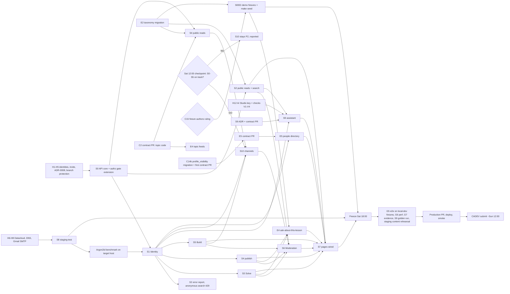

# ROADMAP archive, 2026-11-12 (historical record)

> Archived 2026-11-12. Historical record, not maintained. Current source: [ROADMAP.md](../../../ROADMAP.md) (live status: [TODO.md](../../../TODO.md)).
> This file holds the text moved out of `ROADMAP.md` when it was trimmed (original at commit `ba7cb7a`, 905 lines). Nothing was deleted. Line numbers in the quoted text refer to the original file and to the repository as of that commit; they may be stale.

## What moved

| Original lines | Content | Disposition in the live ROADMAP.md |
|---|---|---|
| 47-58 | Section 2 "Starting point" (said the API mounts only `/healthz`, 47 operations not mounted) | Rewritten from the code (S0 merged, 501 for unimplemented operations); stale text kept below |
| 176-254 | Section 6 detailed timeline | Reduced to checkpoints with dates |
| 256-302 | Section 7 mermaid dependency graph | Replaced by the critical-path list |
| 135-143 | Capacity notes | Shortened to one paragraph |
| 326-355 | Section 8 intro and closed rows H1, H3, H9, H11, H18, plus the long H5 and H7 cells and H2 to H16 as written | Closed rows archived; H4, H6, H7, H8, H10, H12, H13, H16, H19 kept; H8 fixed |
| 360 | PRD section 12 "3 personnes" box | Ticked (the PRD states four members) |
| 366-737 | Section 10 blockers, contradictions, open decisions in full (B5 options, C14 and C15 original analysis, C19 detail, O5 Google terms detail) | Condensed with all statuses, decisions and consequences kept; C11 merged into C19; C6 and C7 marked resolved |
| 736-771 | Risk rows K3, K12, K13, K21, K22, K36, K37 as written | K3 closed, K36 merged into K12, K37 closed; K12, K13, K21, K22 updated in place |
| 831-856 | Section 13 NOT RUN as written (stale V1 to V4 and SMTP claims) | Rewritten from the evidence |
| 869, 871, 874, 877, 878, 879, 896, 903, 904 | Superseded decisions-log entries | Archived; entries 870, 873, 891 and 898 carry "superseded by" notes in the live log |

## Section 2, Starting point (stale) (original lines 47-58)

## 2. Starting point (2026-11-12)

**B0 is merged (PR #24).** It contains:

- a Go API skeleton that mounts only `GET /healthz` (`src/api/internal/platform/httpx/router.go:24`) and has no database connection (`compose.yaml:90`);
- migrations `00001` to `00010`;
- the generated `apigen` server interface, with 47 operations, not mounted;
- sqlc queries for identity, platform and reference data (`db/queries/`);
- a web skeleton (Vite, React 19, TanStack, Astryx 0.7.14) with API types in `src/web/src/api/schema.d.ts`;
- the Compose profiles.

**Gates.** `make quality` (G1 to G4) is green in CI. G5, G6 and G7 are **NOT RUN**. `make test-e2e`, `make perf` and `make seed` exit with `NOT IMPLEMENTED` (`mk/40-quality.mk:18-22`, `mk/50-ops.mk:50-51`).

## Capacity notes (original lines 135-143)

**Capacity note (GUESS).**

- `mibienpanjoe` carries the most: about 19 operations, plus the E2 migration and the S4 content script.
- The default split once `NICE-DEV226` finishes Solve: `NICE-DEV226` helps on S5 Build first, and `Y4NN777` helps on S4 Learn and the content script.
- **Checkpoint Fri 13 Nov 23:00 GMT.** The progress of S4 and S5 at that time decides who helps first. This replaces the earlier rule that `NICE-DEV226` takes Build.
- The instruction said "Fri 14 Nov", but 14 Nov is a Saturday, so Friday 13 Nov is assumed.
- **C14b adds work in the same window:** one migration (`mibienpanjoe`), one contract field (first contract PR), one S1 task (`NICE-DEV226`) and one settings UI task (`PANK4SS`). GUESS: size S, about half a day of extra work across the three owners. It enters the slip order only if the team is behind, and then the visibility setting UI slips before the column.

Workload: the 43 P0 operations are spread as 11 + 5 + 10 + 5 + 9 + 3. `NICE-DEV226` has 21 of them and `mibienpanjoe` has 19. The owner carries S0, S6, S8, the core of S9 and most reviews. S9, S10, E1 to E5 and the pillar change add work for the same four people (GUESS; not quantified). E1 is part of S9.

## Section 6, detailed timeline (original lines 176-254)

## 6. Timeline (GMT)

**Thu 12, evening**

- `Y4NN777`: personal tasks H6 and H7 (Datacloud, DNS) and H4 (branch protection). S0 work: the B1 gate as DECIDED (three route files, `go test -list` check, single registration point, RED/GREEN), then pgxpool, `/readyz` and the apigen mount via `HandlerWithOptions`. Opens the S0 PR for `NICE-DEV226` to review.
- `NICE-DEV226`: identity confirmed (H1 done). S1 RED tests for the domain and service with fakes: hashing, tokens, CSRF, sessions. Mounts no routes before S0 merges.
- `mibienpanjoe`: identity confirmed (H1 done). S2 sqlc queries with local EXPLAIN. Opens **the first contract PR** (reviewed by `Y4NN777` and `PANK4SS`, then `make generate`). It carries:
  - the C2 topic code in `listLearnArticles` and `listTrainingSeries`, and an optional `topic` on `ArticleCreate`;
  - the `decideApplication` owner-only x-authz (C1);
  - `profile_visibility` in the profile read and update schemas, and `deny_status 404` on `getProfile` with the C14b semantics.
- `mibienpanjoe` also writes the `profile_visibility` migration (C14b, `make migrate-new`). It may share a PR with E2 but stays a separate file, and the pgtest structure tests change in the same PR. In parallel, opens the E2 taxonomy migration PR (`make migrate-new`, plus the pgtest list update).
- `PANK4SS`: accepts the invitation (H2) and records identity (H1). S7 shell, i18n and shared components on typed fixtures. SEED design: demo accounts per C15.

**Checkpoint, Thu end of day: S0 merged or in review.**

**Fri 13, until noon**

- `Y4NN777`: merges S0. S0 follow-ups: Idempotency-Key, mailer, Mailpit. Starts S8 staging. Reviews.
- `NICE-DEV226`: S1 auth endpoints and the rate limiter.
- `mibienpanjoe`: S2 reads merged, then the S4 reads.
- `PANK4SS`: public read pages: accueil, discover, resource, recherche.

**Checkpoint, Fri 12:00: public reads merged.** That means S2's `listResources`, `getResource`, `listResourceSources` and `search`. The S4 reads are in review. The Solve and Build reads come with S3 and S5, after S1.

**Fri 13, afternoon and evening**

- `Y4NN777`: staging up with TLS, DNS and SMTP (H8). AI Studio key and V1 to V4 (H12). Argon2id benchmark on the target host. Drafts the S9 ADR (PROPOSED, including AI-1 to AI-5, AI-9 and AI-10) and the S9 contract PR. Reviews the C2 contract PR.
- `PANK4SS` (SEED): fixtures for Discover, Build and the 3 to 4 lesson Learn series, written as original team text, with demo accounts per C15. `make seed` refuses everywhere except `local-dev`. Reviewed by `mibienpanjoe`.
- E5: the contract PR (backend lead plus `PANK4SS` review) is opened, with `make generate`. The backend comes later, by `NICE-DEV226`.
- `PANK4SS`: pillar emphasis in navigation, home and FR/EN copy (information architecture only).
- `NICE-DEV226`: S1 `me` and profiles. Merges S1.
- `mibienpanjoe`: S4 reads merged. S2 error report and S4 publish once S1 has merged.
- `PANK4SS`: apprendre, article, formation, solve and question pages (on fixtures), then the identity pages. Reviews the S9 contract.

**Checkpoint, Fri end of day: S1 merged. AI Studio key in the staging env file, and V1 to V4 checked, including the free versus billing decision (H12, K21).**

**Checkpoint, Fri 13 Nov 23:00: helpers.** The progress of S4 and S5 decides who helps first. By default, `NICE-DEV226` helps on S5 after Solve, and `Y4NN777` helps on S4 and the content script.

**Sat 14, until noon**

- `Y4NN777`: S9 LLM port, fake adapter and retrieval over S2 search. Helps on S4 and the content script. Starts the S8 `make test-e2e` harness. Reviews.
- `NICE-DEV226`: S3 Solve.
- `mibienpanjoe`: S4 publish and the content script (`scripts/content/`), then S5 Build.
- `PANK4SS`: wires the identity pages to live endpoints, and solve and question to S3.

**Checkpoint, Sat 12:00 (progress).** The owner decides any drop or exception from measured progress (merged PRs, CI status), and decides whether S10 is a GO. These decisions go in the log below.

**Sat 14, until 18:00**

- `Y4NN777`: S6 moderation merged. S9 merged, with `NICE-DEV226` as second developer. `make perf` harness. Backup and restore drill on staging.
- `NICE-DEV226`: S3 merged. Then helps on S5 Build, then is the S9 second developer, then builds the E5 backend if time allows. If S10 is a GO, the owner assigns it; S10 is unassigned today.
- `mibienpanjoe`: S5 merged, with helpers. The content script is rehearsed on `staging-test`. If S10 is a GO, writes its migration.
- `PANK4SS`: write flows (ecrire, build, project, the solve ask form). The S9 panel in recherche and in the ask flow. E4 with `NICE-DEV226`: the "ask about this lesson" button once S3 merges, and the topic feeds once the C2 contract PR merges (articles by topic code, questions by tag).
- `PANK4SS` (SEED): fixtures finished, and `make seed` run on `local-dev` for e2e.
- Content rehearsal on `staging-test`: the team's real accounts create real `live` content, and the free-series content script is rehearsed there with the same procedure as production.
- E5 backend (`NICE-DEV226`, if time allows): the people directory with privacy tests. `PANK4SS` builds the `connect` page, and the spaces block stays "bientôt".

**Freeze, Sat 18:00.** After the freeze, `develop` takes only fixes for failing gates or smoke checks. The freeze applies to S9 and S10 as well.

**Sat 14, evening**

- `Y4NN777`: `make quality-full` on the `develop` SHA. Rollback drill. S9 golden evaluation run. Collects the G7 evidence.
- `NICE-DEV226`: bug fixes and e2e support.
- `mibienpanjoe`: bug fixes, and a check of the content-script run on staging.
- `PANK4SS`: bug fixes. ADR-0007 visual, axe and responsive evidence.

**Sun 15, morning**

- `Y4NN777` runs the release:
  - opens the production PR from `develop` to `main` and gives owner approval;
  - takes a backup, runs the migrations and deploys the exact SHA;
  - runs the production smoke test;
  - promotes the owner account to moderator;
  - runs the reviewed free-series content script on production (H19), with confirmation and a backup first;
  - **submits `https://226os.tech` around 12:00** (O1).
- **Content window (all four), right after the production deploy:** the team's real accounts create real `live` content through the app: questions, answers, articles and projects. No seeds run in production (K38).
- `NICE-DEV226` and `mibienpanjoe` support the smoke test. `PANK4SS` runs the mobile and FR/EN smoke.

**Sun 18:00 to Mon 23:59: every member votes (H10).**

## Section 7, dependency graph and critical path (original lines 256-324)

## 7. Dependencies and critical path

**Critical path.** Each step waits for the one before it:

1. human identity records (H1, done 2026-11-12) and the `PANK4SS` invitation (H2);
2. S0, including the authz gate extension (B1);
3. S1;
4. the member writes in S3, S4 and S5;
5. the S7 write flows;
6. the freeze;
7. G5, G6 and G7;
8. production;
9. submission.

**What waits on S0 and S1.**

- S0 and S1 block every member write.
- Public reads need no login. Even so, `listProjects`, `getProject`, `listContributionNeeds`, `getTrainingSeries`, `getProfile` and `search` accept an optional session (`security: [{}, cookieAuth]` in `api/openapi.yaml`). They need a session resolver that defaults to anonymous.

**Parallel paths.**

- Datacloud leads to staging, and staging to the Argon2id benchmark that S1 needs before it pins its parameters (ADR-0003, "Evidence").
- The provider decision (H12) leads to S9, and the S9 contract leads to its UI panel.

## Section 8, intro and human task rows as written (original lines 326-355)

## 8. Human tasks and lead time

**The owner's remaining personal tasks** (owner instruction 2026-11-12) are exactly three, plus the two kept items:

1. H6 and H7: the Datacloud account and active product, and DNS.
2. H8: the Gmail SMTP app password.
3. H12: the AI Studio API key and the checks V1 to V4.

Kept as they are: H4 (branch protection) and H10 (vote reminders). H19 is the owner running the reviewed content script.

The other rows below are not personal owner tasks. Their status is unchanged unless a row says otherwise.

| Id | Task | Who | Start by | Lead time |
|---|---|---|---|---|
| H1 | Confirm the Git identity records for `NICE-DEV226`, `mibienpanjoe` and `PANK4SS` | `Y4NN777` + each member | **DONE 2026-11-12** (owner confirmed; `docs/team/CONTRIBUTORS.md`) | - |
| H2 | `PANK4SS` accepts the repository invitation (pending, `docs/team/CONTRIBUTORS.md:12`) | `PANK4SS` | Thu evening | minutes (GUESS) |
| H3 | ADR-0008 set to ACCEPTED or amended | `Y4NN777` | **DONE 2026-11-12** (ACCEPTED; the main session edits the ADR file) | - |
| H4 | Branch protection and required reviews on `develop` and `main`, with the `quality` check required (ADR-0006 "CI", ADR-0008 "Consequences") | `Y4NN777` | Thu evening | minutes (GUESS) |
| H5 | Rulings on the items still open in section 10. B1, B5 (for CADEV), C1, C2, C14 and C15 are DECIDED as of 2026-11-12. B2, B3 and B4 are scheduled in S0 and S8, not blocking today. C14 is fully decided, including (a) and (b). C11 and C19 are DECIDED: `00011` is no longer reserved. Still open: C3 to C10, C12, C13, and O4 to O6. O7 is proposed in the docs PR. Suspended users are out of scope for P0. H1 and H3 are done. | `Y4NN777` | Thu evening | - |
| H6 | Datacloud account and an **active commercial product**, SSH key, ports 80/443, storage (`docs/SHIP.md` section 3; a CADEV condition). Handled by the owner. | `Y4NN777` | Thu evening | UNVERIFIED; hours to a day (GUESS) |
| H7 | DNS. The domain `226os.tech` exists and the owner holds it, but **nothing is deployed on it**: today it shows only the hosting provider's placeholder page. When the Datacloud host IP is known, point the apex `226os.tech` and the staging subdomain (PROPOSAL: `staging.226os.tech`, owner to confirm) to it with A records, in the registrar or DNS panel the owner holds. TLS issues through Traefik and Let's Encrypt **only after DNS resolves**, so DNS comes before the first HTTPS smoke test. Never assume DNS works (`docs/SHIP.md` section 1). | `Y4NN777` | as soon as the host IP is known | minutes to hours (GUESS) |
| H8 | Gmail SMTP: create an app password, stored in the staging and production env files only; test with a real inbox | `Y4NN777` | Fri morning | GUESS: an app password needs 2-step verification on the account; verify. **DONE 2026-11-12:** the owner ran `go run ./src/api/cmd/mailcheck` against `smtp.gmail.com:587` (STARTTLS, app password) and the test mail was sent to a real inbox |
| H9 | CADEV registration: team declaration (2 to 5 members), representative and country, split, members registered (`docs/SHIP.md` section 6) | `Y4NN777` | **DONE 2026-11-12** | - |
| H10 | Vote reminders to all four members, plus a named follow-up person (SHIP section 6, "Prévoir responsable de suivi") | `Y4NN777` | Sun 17:00 | - |
| H11 | The "public demo URL" (O1). **DECIDED 2026-11-12:** `production-live` on the project domain (see C). | `Y4NN777` | closed | - |
| H12 | S9: create the Google AI Studio API key (the owner holds the access) and store it only in the staging, then production, env file. Never in Git, CI logs or images. Check items V1 to V4 (section 10, O5) in AI Studio and Google's own current documentation. | `Y4NN777` | Fri 13 evening | UNVERIFIED |
| H13 | Apply PRD amendment 3.2 (text in the S9 ADR) and add a SPEC story for S9, and for S10 if it is a GO; the owner applies these | `Y4NN777` | Fri evening | - |
| H18 | O1 and the SEED owner. **Closed 2026-11-12:** O1 is DECIDED (production), and SEED is assigned to `PANK4SS`. | `Y4NN777` | closed | - |
| H19 | Run the one-time S4 content script on `production-live` after its PR is reviewed, with explicit confirmation and a backup first. Record the run date in the TODO Done log. | `Y4NN777` (runner) | Sun morning, after the production deploy | - |
| H16 | The PRD amendment for the pillars (O7). **Amendment 3.2 is proposed in the docs PR; the owner approves it on that PR.** | `Y4NN777` | on the docs PR | - |

## Section 9, PRD names item as written (original lines 359-360)

- [x] The team has 2 to 5 members, a declared representative and country, an agreed split, and every member registered. DONE 2026-11-12 (H9), as reported by the owner.
- [ ] The names in `docs/PRD.md` section 12 match the declared team. Today that section says "3 personnes", names two people and leaves the third unnamed, while the team has four members (`docs/team/CONTRIBUTORS.md`). This is flagged here, for the docs PR.

## Section 10, blockers, contradictions and open decisions in full (original lines 366-737)

## 10. Blockers, contradictions, open decisions

### Blockers

**B1. The authz gate cannot pass once any protected route is mounted. DECIDED 2026-11-12 (owner instruction: close).**

**The problem.**

- `scripts/authz/routes_check.go.txt:48-66` fails on every mounted route that is not in `scripts/public-routes.txt`. It cannot see whether a negative test exists.
- `HandlerWithOptions` mounts all 47 operations at once.

**The decision.**

- S0 mounts the generated server through `HandlerWithOptions`.
- The gate rule becomes: every mounted route must be in one of three files:
  - (i) `scripts/public-routes.txt`, for public routes;
  - (ii) a new `scripts/unimplemented-routes.txt`, for routes the generated Unimplemented handler still answers with 501. This file starts with all 47 routes and **shrinks** as each slice lands. A route removed from it must then be public or covered;
  - (iii) a new `scripts/authz-tests.txt`, which maps method and path to the name of a negative authz Go test.
- The gate fails if a named test does not exist (checked with `go test -list`), or if a route is in none of the three files.
- The gate also detects routes registered outside `httpx.NewRouter`. All registration goes through that one function, and the gate checks that the `http.Handler` is built only there.
- The gate change needs RED/GREEN proof.

**The reason.** This mounts the contract in one step without weakening the gate. Every route is accounted for at all times.

**The consequences.**

- O3 is closed: the 4 P1 routes stay in `unimplemented-routes.txt` (501).
- Every slice PR moves its routes out of `unimplemented-routes.txt` into `public-routes.txt` or `authz-tests.txt`.
- The overlay check (`routes_check.go.txt:32`) changes in the S0 PR.
- K3 drops to low once the S0 PR is green.

**B2, B3 and B4 are scheduled, not blocking today** (owner, 2026-11-12). They are tasks in S0 and S8 that must close before Sunday.

**B2. `/readyz` cannot be reached from outside (scheduled: S8 and S0).** The edge rule routes only `/api/` and `/healthz` (`deploy/traefik/dynamic.edge.yml:6`), but SHIP 4.2 smoke-tests `/readyz`. The owner decides between routing it and checking it from the host.

**B2 DECIDED (owner approved, 2026-11-12): `/readyz` is NOT routed at the edge.** It is unauthenticated and pings the database, so a public route would be a database-state oracle and a cheap way to force pings. The smoke test runs it from the host through the container (`docker compose exec api /busybox/busybox wget -q -O- http://127.0.0.1:8080/readyz`); the compose healthcheck keeps `/healthz`. Verified trap: at the edge `/readyz` falls through to the `web` catch-all and answers `200` with the SPA `index.html`, so a probe through the public host would report ready with the API down. S8 updates SHIP 4.2.

**B3. The router's request timeout breaks long requests (scheduled: S0).** It is 30 s (`src/api/internal/platform/httpx/router.go:14,23`) and applies to every route. A server-sent events stream (S10) is cut after 30 s, and slow LLM calls (S9) are cut too (INFERRED). S0, S9 and S10 need a per-route timeout decision.

**B3 DECIDED (owner approved, 2026-11-12): the 30 s timeout stays the default for every route.** A route that needs longer (S9 assistant, S10 live stream) is declared in ONE table in `httpx` and applied by a per-operation middleware installed through the apigen `Middlewares` slice (chi `r.Use` middleware runs before routing and cannot know the route); streams also extend the write deadline with `http.ResponseController`. Nothing is built before an S9 or S10 operation needs it. Already done in S0: a timeout answers a problem+json 503 `SERVICE_UNAVAILABLE` with `Retry-After` (it used to be a bare 504).

**B4. Production has no deploy path yet (scheduled: S8, before Sunday).**

- `make up-production-live` runs only from an automated release job: it requires `CI=true`, no interactive terminal and `PRODUCTION_UP_CONFIRM=production-live`.
- The Makefile itself says "There is no deploy workflow yet (TASK-OPS-001), so today no context satisfies the guard" (`mk/50-ops.mk:20-24`).
- ADR-0006 ("CI") keeps the deploy workflows `NOT IMPLEMENTED` until TASK-OPS-001.
- S8 must deliver a reviewed release workflow, with the protected `production` environment, before Sunday. The guard must not be weakened.

**B5. Real lesson content has no path into the production database. DECIDED for CADEV, 2026-11-12 (owner instruction: close).**

**The decision.** Option (b), adapted. The free public series (US-LEARN-001) reaches production through a **one-time, PR-reviewed, owner-run content script**. It is neither a seed nor a migration.

- The SQL lives in `scripts/content/`.
- It is run once with an explicit confirmation, like `migrate-up`, and a backup first.
- It attributes the lessons to the owner's real account, looked up by username, with `provenance='live'`.
- The run date is recorded in the TODO Done log.
- It is an S4 task: `mibienpanjoe` writes it and `Y4NN777` runs it (H19).

**The reason.** The production demo needs the series. A restricted create endpoint would be a late contract change, and seeds never run in production (ADR-0005 point 17).

**The consequences.**

- The script is a remote mutation that needs human approval (AGENTS.md); the owner gives it by running the script.
- It is rehearsed on `staging-test` first.
- A restricted create endpoint stays a post-CADEV option.
- The Discover catalogue gap is the same: no operation writes providers or resources (`docs/spec-kit/AUTHORIZATION_MATRIX.md:37`). For CADEV, production Discover entries come from the team's real content path. The owner decides whether the same script pattern covers them.

The original analysis follows.

- Only reads of series and lessons are P0. No operation creates a `training_series` or a `training_lessons` row (`api/openapi.yaml:1734-1798`).
- Seeds never run in production (ADR-0005 point 17).
- The lesson bodies themselves can go through the API: each lesson is a tutorial `learn_article` that its named author creates with `createLearnArticle`, including `links[]`. Only the series row and the lesson rows (`training_lessons.article_id`, `db/migrations/00008_learn.sql:97`) lack a path.

| Option | For | Against |
|---|---|---|
| (a) Content migration, `provenance='live'`, reviewed like code | Reviewed, reproducible, runs through the existing gated `migrate-up` | Migrations are immutable, so every correction needs a new migration. `author_id` and `article_id` are foreign keys to rows that are created in production by sign-up and the API, so the ids are unknown when the migration is written. Mixes content with schema. |
| (b) One-time admin script run by the owner | Can use the real user and article ids after the authors publish. No contract change. | Manual production mutation that needs human approval (AGENTS.md). Must be rehearsed on staging, take a backup first and write an `audit_log` row. Not exercised in CI. |
| (c) Restricted create endpoint (for example moderator-only) | A proper, tested path | A contract change late in the week (R7 review by `Y4NN777` and `PANK4SS`), new negative authz tests, B1 applies, and more scope |

### Contradictions (each item is open unless marked DECIDED)

**C1. Maintainer rights. DECIDED 2026-11-12 (owner approved).**

The finding:

- The matrix gives "O or maintainer" for `PATCH /projects/{projectId}`, `POST .../contribution-needs` and `GET .../applications` (`docs/spec-kit/AUTHORIZATION_MATRIX.md:40,42,45`; ADR-0005 point 10).
- OpenAPI x-authz says `allow: owner` with "no delegation in P0" (`api/openapi.yaml:1313-1317`, `:1397-1401`, `:1515-1519`).
- No P0 operation creates a maintainer.

**Decision:** project actions belong to the **project owner only** at P0. That covers editing the project, adding needs, listing applications, and accepting or declining an application. There is no maintainer delegation. The applicant can still withdraw their own application.

**Reason:** OpenAPI x-authz already says this for three of the four operations, and no operation creates a maintainer.

**Consequences:**

- The S5 PR corrects matrix lines 40, 42 and 45 to "owner only".
- S5 authz is unblocked.
- `decideApplication` x-authz still says "owner or maintainer (accepted|declined)" (`api/openapi.yaml:1559-1561`), so the "already says" premise does not hold for that one operation. Its x-authz text needs a correction in a contract PR (R7: `Y4NN777` and `PANK4SS`).
- ADR-0005 point 10 and the matrix are ACCEPTED documents (ADR-0003). This ruling narrows them. The owner records it as an amendment, and this plan does not edit the ADRs.

**C2. Learn `topic`. DECIDED 2026-11-12 (owner approved).**

The finding:

- `listLearnArticles` types `topic` as a `TagSlug` that "matches an article tag" (`api/openapi.yaml:1626-1630`).
- The database stores `topic_code` as an FK to `learn_topics` (`docs/spec-kit/DATABASE_DESIGN.md:920,931`).
- `ArticleCreate` has no topic field at all (`api/openapi.yaml:4194-4241`).

**Decision:** the topic filter uses the **topic code** (`learn_topics.code`, the database FK), not a tag slug. This is a **contract fix** in its own PR, merged before the S4 handlers and the E4 topic feeds:

- The `listLearnArticles` `topic` parameter is retyped as the topic code, with the DB CHECK pattern `^[a-z][a-z0-9-]{1,29}$` and an updated description.
- `listTrainingSeries` has no `topic` parameter today (`api/openapi.yaml:1746-1753`), so one is added with the same type.
- An optional `topic` field is added to `ArticleCreate`.
- `make generate` follows.
- Authored by `mibienpanjoe` and reviewed by `Y4NN777` (backend lead) and `PANK4SS`.

**Mapping rule:** questions have no topic. The E4 topic feeds show articles by topic code and questions by tag. By convention, a topic's feed page may also list questions tagged with the same slug as the topic code. Topic codes match the `TagSlug` pattern.

**Consequence:** S4 and the E4 topic feeds are unblocked once that contract PR merges.

**C3. `my_progress` without a progress table.** `getTrainingSeries` promises `my_progress` when a session exists (`api/openapi.yaml:1780`), but `learn_progress` is P1 and arrives in a later migration, with whatever number is next (ADR-0005 point 16 named 00011; see C11).

**C4. Search query length.** `q` has `maxLength: 200` (`api/openapi.yaml:1905`, `:1621`), but ADR-0005 point 6 bounds queries at 100 characters.

**C5. Error codes.**

- The router emits `METHOD_NOT_ALLOWED` (`src/api/internal/platform/httpx/router.go:29`), which is not in the `ErrorCode` enum (`api/openapi.yaml:2631-2657`).
- No code exists for a wrong `Content-Type` (ADR-0004 point 8).

**C6. Ownership.**

- ADR-0008 is ACCEPTED (2026-11-12), but `docs/spec-kit/TASKS.md:3` and `docs/DEV.md:58` still say there are 3 members and one owner/reviewer (`Y4NN77`) for everything. This is now a stale-docs follow-up.
- ADR-0008 gives migrations to the lead, who may delegate them. The owner decision gives them to `mibienpanjoe`. The two agree only if that is recorded as a delegation.

**C7. Stale `db/` status.** `docs/spec-kit/DATABASE_DESIGN.md:3` and `:1266` say `db/` does not exist. B0 created migrations 00001 to 00010.

**C8. Branch domains.** `docs/GIT_WORKFLOW.md:38` lists the allowed domains without `learn`. The CI regex accepts any lowercase domain (`.github/workflows/branch-policy.yml:29`).

**C9. Stale x-authz labels.** Some `matrix:` labels do not match the matrix paths, for example `POST /sessions`, `GET /users/me` and `PATCH /profiles/me` (`api/openapi.yaml:55,173,339,369`).

**C10. S9 priority.**

- `docs/PRD.md` 5.8 puts the sourced assistant at P2.
- The owner made it P0 on 2026-11-12.
- PRD amendment 3.2 is needed (H13).

**C11. Migration 00011 is reserved. DECIDED 2026-11-12 (with C19): 00011 is no longer reserved.** `docs/spec-kit/DATABASE_DESIGN.md:1280` reserved `00011` for the deferred P1 tables (`learn_progress`, `resource_reviews`, `content_reports`). Those tables now take whatever number `make migrate-new` gives when they are built, and so do S9 and S10 tables.

**C12. Who may create an article-to-question link.**

- The database allows only canonical pairs, and `('article','question')` is not one of them; only `('question','article')` is (`db/migrations/00009_content_relations.sql:51-53`).
- ADR-0005 point 13 says only the author of the source item creates a relation, and `ArticleCreate.links[]` accepts questions.
- So an article author linking to a question stores a relation whose source, the question, they did not write.
- E4 in the other direction (a question linking to an article) is consistent.

**C13. `LinkRef` accepts `series`, but the database cannot store it.** `LinkRef.type` includes `series` (`api/openapi.yaml:3171`), but `content_relations` has no series column (`db/migrations/00009_content_relations.sql:24-25`; `docs/spec-kit/DATABASE_DESIGN.md:142`). This is why each lesson of the demo-fixture series is a `learn_article` of kind `tutorial`, referenced by `training_lessons.article_id`.

**C14. A "private profile" has no column. DECIDED 2026-11-12 (owner approved).**

**Decision:**

- A profile is **listable** in the people directory only when its owner is an **active** user **and** has set `open_to_collab = true`.
- Listed fields are limited to those whose `field_visibility` allows the caller, anonymous or member.
- Email is never listed.
- The directory filters (country, language, skill) apply **only to fields visible to the caller**. A hidden field counts as absent for filtering, so a filter cannot reveal its value.
- No column is needed for the listing rule itself. The joint decision (b) below adds one column, `profiles.profile_visibility`, through one new migration written by `mibienpanjoe`.
- The direct read `GET /profiles/{username}` follows (b) below.

**Consequence:** C14 is fully decided. E5 depends on the `profile_visibility` migration and the first contract PR.

**Residual points (a) and (b): both DECIDED 2026-11-12, jointly by the owner and the main session.**

**(a) The listing predicate and `open_to_collab` visibility. DECIDED.**

- The finding: `open_to_collab_visibility` takes the values `public | members | private`, default `public` (`db/migrations/00003_identity.sql:58,71-74`). Listing on the flag alone would reveal it.
- **Decision:**
  - A profile is listed for a given caller only if `open_to_collab = true` **and** that caller may see the flag under `open_to_collab_visibility`. Anonymous callers see `public`; members see `public` and `members`; `private` is never listed.
  - The listing predicate and every directory filter use caller-visible fields only; a hidden field counts as absent.
  - E5 has negative tests per visibility value and per caller.

**(b) Profile-level visibility. DECIDED: add a column.**

- The finding: `getProfile` declares `private_profile: 404` (`api/openapi.yaml:414-415`), but no profile-level visibility column backs it (`00003_identity.sql:42-75`).
- **Decision:** add `profile_visibility text NOT NULL DEFAULT 'public'` with `CHECK (profile_visibility IN ('public','members','private'))` on `profiles`.
  - It goes in a **new migration written only by `mibienpanjoe`**, numbered by `make migrate-new`.
  - It may share a PR with the E2 migration, but it stays a separate migration file.
  - The pgtest tests that assert table structure and constraints change in the same PR.
  - The `DATABASE_DESIGN.md` line about `profiles` is a docs follow-up.
- **`GET /profiles/{username}` semantics:**
  - `public`: visible to everyone.
  - `members`: visible to authenticated members; anonymous callers get 404.
  - `private`: visible only to the owner; everyone else gets 404.
  - The 404 body for a hidden profile is **identical** to the 404 for an unknown or deleted username, so they cannot be told apart.
- **Moderators** have no special profile access at P0. That is the rule: moderation acts on content, not on profiles.
- **Author bylines:** username and display name stay visible in the author byline of published content, whatever `profile_visibility` says. The byline is part of the content, not the profile page, and the distinction is deliberate. Deleted accounts show "membre supprimé" (ADR-0005 point 15).
- **People directory:** a profile is listed only if `profile_visibility` allows the caller (`private` never; `members` only for members) **and** rule (a) holds.
- **Contract (the first contract PR):** together with the C2 topic fix and the `decideApplication` owner-only fix, it:
  - adds `profile_visibility` to the profile read and update schemas, so `PATCH /me/profile` accepts it, with default `public`;
  - keeps `deny_status 404` on `getProfile`, with the semantics above.
- **Owners:**
  - S1 (`NICE-DEV226`) owns the profile read and write and their negative tests.
  - S7 (`PANK4SS`) adds a profile visibility setting on the settings page, with FR/EN copy.
  - E5 depends on the migration.
- **Suspended users:** out of scope for P0 (owner, 2026-11-12). No suspension feature exists to test.

The original analysis follows.

- `getProfile` declares `private_profile: 404` (`api/openapi.yaml:414-415`), and E5 requires "private profiles never listed".
- The `profiles` table has only per-field visibility (`country`, `languages`, `skills`, `github`, `bio`, `open_to_collab`; `db/migrations/00003_identity.sql:53-58`). It has no profile-level visibility and no listing opt-in.
- The owner chooses one of:
  - a derivation rule, for example listed only when `users.status='active'` plus a rule on `open_to_collab` and its visibility;
  - a new column through a migration (`mibienpanjoe`, number from `make migrate-new`).
- Filters must also apply only to fields visible to the caller. Otherwise filtering by a hidden country, language or skill reveals that field (INFERRED).

**C15. Demo fixtures need authors, but "no fake users". DECIDED 2026-11-12 (owner instruction: close).**

**The decision.**

- Demo fixtures use clearly labelled **non-real demo accounts**:
  - usernames prefixed `demo-`;
  - emails on the reserved invalid domain (`@demo.226os.invalid`, `docs/spec-kit/DATABASE_DESIGN.md:1295`);
  - **no password hash**, meaning no `user_credentials` row, so they cannot sign in;
  - `provenance='demo'` and a visible "demo" badge in the UI;
  - **`local-dev` only**. This is owner correction B, 2026-11-12. The original wording said "local-dev and staging-test". ADR-0005 allows staging seeds, but the owner chooses not to use them, so no ADR change is needed.
- There are **no fake votes, endorsements or verifications**.
- The team's real accounts create real `live` content through the app.
- "No real users" in ADR-0005 point 17 means never impersonate real people.

**The reason.** ADR-0005 point 17 and `DATABASE_DESIGN.md:1295` already plan these demo accounts, so this introduces nothing new.

**The consequence.** SEED is unblocked and assigned to `PANK4SS`. The options below are kept as history.

This item still applied after the ingestion was removed, because fixtures raise the same problem.

- Every fixture root row requires a user foreign key:
  - `resources.created_by` and `providers.created_by` (`db/migrations/00006_discover.sql`);
  - `projects.owner_id` (`00007_build.sql:14`);
  - `learn_articles.author_id` and `training_series.author_id` (`00008_learn.sql`);
  - `questions.author_id` and `answers.author_id` (`00005_solve.sql`).
- The seed policy plans demo accounts (`@demo.226os.invalid`, `demo-` usernames; `docs/spec-kit/DATABASE_DESIGN.md:1295`). Under the new rule, "no fake users", that is a conflict.
- The team's real accounts cannot be seeded either: their emails would go into Git, and fixed UUIDs cannot reference accounts created later by sign-up.
- The owner chooses one of:
  - one clearly labelled demo account, `provenance='demo'` and shown as "demo" and never as a person (`training_series.origin='platform'` exists, `00008_learn.sql:75`);
  - fixtures restricted to catalogue tables owned by that one account, with Solve, Build and Learn member content created live by the team through the app;
  - nullable author columns, which needs a migration and is the larger change.
- Whatever the choice, fixtures create **no votes, answers by fake people, or applications**.
- C16, C17 and C18 were removed with the ingestion. C17's remaining point, that there is no write path for the catalogue, is folded into B5.

**C19. Migration 00011 is reserved, but the tooling cannot skip it (reviewer finding). DECIDED 2026-11-12: 00011 is no longer reserved.**

The finding:

- `scripts/migrate-new.sh:16-25` creates the highest number + 1.
- `scripts/check-migrations.sh:35-38` requires "sequential, no gap".
- `docs/spec-kit/DATABASE_DESIGN.md` section 5 (line 1280) reserved `00011` for the P1 tables.

**Decision:** `00011` is no longer reserved.

**Reason:**

- The gate requires sequential numbers with no gap.
- Nothing in the code depends on the reservation.
- The P1 tables do not exist yet, so they take the next free number when they are built.

**Consequences:**

- Use the number `make migrate-new` gives. The E2 taxonomy migration is `00011` and the `profile_visibility` migration is `00012`, or the reverse if `profile_visibility` merges first. Both are written by `mibienpanjoe`.
- The scripts and the gate do not change.
- Docs follow-up in the same PR as the migration: correct the reservation statements in `DATABASE_DESIGN.md` section 5 and its migration plan. Owner `mibienpanjoe`, reviewer `NICE-DEV226`.
- ADR-0005 point 16 also names `00011`. The owner records that the number is no longer fixed.

**C2, addition. DECIDED with C2.** Questions have no topic; `listQuestions` filters only by `tag` (`api/openapi.yaml:462`). Mapping rule: a topic's feed shows articles by topic code and questions whose tag equals the topic code.

### Open decisions

**O1. The public demo URL. DECIDED 2026-11-12 (owner instruction: close).**

**The decision.**

- The CADEV submission URL is **`https://226os.tech`**, the `production-live` deployment, once it is deployed. Nothing is deployed there today; it shows the hosting provider's placeholder page (owner correction C, 2026-11-12).
- Before submission it is populated with **real `live` content** created through the app by the team's real accounts.
- `staging-test` (PROPOSAL: `staging.226os.tech`, owner to confirm) is a similar real environment. It has **no demo data** and is used for rehearsals with real accounts and real content (owner correction B, 2026-11-12).

**The reason.** This does not depend on the unverified question of whether a staging URL counts for CADEV.

**The consequences.**

- The free series reaches production through the B5 content script.
- The team needs a content window on production before submission, which needs Gmail SMTP working in production so accounts can verify their emails and publish (K38).
- No seeds ever run in production (ADR-0005 point 17, unchanged).

**O2. Where the shared pieces live.** These are listed in TODO.md under "Shared pieces": the rate limiter, the session resolver that defaults to anonymous, the `links[]` relation writer and reader, the audit-log writer, and the `EMAIL_NOT_VERIFIED` check.

**O3. The 4 P1 routes. CLOSED by B1 (2026-11-12).** They are mounted and stay listed in `scripts/unimplemented-routes.txt`, where they answer 501.

**O4. Resending the verification email.** ADR-0003 sets a resend rate limit of 3 per account per hour, but no P0 operation resends a verification email.

**O5. S9 questions the PROPOSED ADR must decide.**

The provider is decided: Google AI Studio, Gemma 4 (Decisions log). The **free tier is for development and evaluation; production use needs the V3 decision** (free versus billing-linked, EEA rule). These items stay open:

- Exactly what is sent to the provider: the question text and retrieved public content only. No emails, no private data, no secrets.
- The cost cap, or the quota guard, and where its counter lives.
- Timeouts.
- The fallback when the provider is down or its quota is exhausted. The assistant degrades to a clear "assistant unavailable" response and never fails the page.
- FR/EN behaviour.
- The evaluation set and its pass criteria.
- Whether anonymous users may call it, and the per-subject rate limit.
- Who the second developer is. **Assigned 2026-11-12:** `NICE-DEV226`, after Solve.

**Facts from Google's terms.** Source: `https://aistudio.google.com/docs/terms`, "Effective March 23, 2026". The coordinator fetched this page and this review re-fetched it on 2026-11-12; label OFFICIAL.

- **Unpaid Services.**
  - Google uses submitted content to improve its products.
  - "Human reviewers may read, annotate, and process your API input and output."
  - The terms say: "Do not submit sensitive, confidential, or personal information to the Unpaid Services."
- **Paid Services.**
  - Google does not use prompts or responses to improve its products.
  - It logs them for a limited period to detect policy violations.
- **When a project counts as paid.**
  - For the Gemini API: only through a Cloud project associated with an active billing account.
  - For AI Studio: it counts as paid if the account has access to a Cloud project with active Cloud Billing. The coordinator's summary said "AI Studio itself counts as free"; the re-fetch shows this condition.
- **EEA, Switzerland and UK.** "You may use only Paid Services when making API Clients available to users in the European Economic Area". The same rule applies to Switzerland and the UK.

**NOT CONFIRMED.**

- **Gemma 4 model ids.**
  - Third-party aggregators list `gemma-4-31b-it`, `gemma-4-26b-a4b-it` and `gemma-4-e2b-it`, as reported by the coordinator.
  - The official models page fetched by the coordinator listed no Gemma model, and that fetch may have been incomplete.
- **Free-tier rate limits for Gemma.**
  - They are not published in the public docs. AI Studio shows the limits per project.
  - Third-party figures conflict: Gemma 3 at 30 requests/min and 14,400/day; a 2026 blog on Gemma 4 at 15/min and 1,500/day.
  - Treat the limits as UNKNOWN.
- Further sources cited by the coordinator, not re-fetched here: `https://ai.google.dev/gemini-api/docs/logs-policy` and `https://ai.google.dev/gemini-api/docs/rate-limits`.

**Open verification items.** These replace the earlier V1 to V6 list. Owner `Y4NN777`, due Fri 13 evening:

- **V1.** DONE 2026-11-12: `aicheck models` lists `gemma-4-26b-a4b-it` and `gemma-4-31b-it` (both `generateContent`, 262144 input, 32768 output). Staging uses `gemma-4-26b-a4b-it`.
- **V2.** Read the project's real limits in AI Studio. Still open; the 3 probes of `aicheck limits` do not measure them.
- **V3.** DECIDED 2026-11-12 by the owner: free project. The K21 consequence (EEA, Switzerland, UK) is INFERRED and still to be handled by the owner.
- **V4.** Measure FR/EN latency and quality on the golden evaluation set before the demo.

**Design consequences proposed for the S9 ADR** (the owner decides):

- Send only the question text and retrieved public content. Never send emails, private data or secrets.
- Show a visible notice that the question is sent to Google.
- Redact obvious secrets and email addresses before sending, with tests.
- Make the assistant switchable off per environment through configuration.
- When the quota is exhausted, return a clear "assistant unavailable" response. The page must never fail.

**Fallback.** If the free tier is rate-limited or its terms are unsuitable, switch provider through the LLM port by configuration. An alternative paid key is possible; that is the owner's decision.

**O6. S10 builder and displacement.**

- Nobody owns S10 yet.
- If it is built, it takes Saturday afternoon capacity from S6 and S7 integration, the G5/G6 harnesses, the backup/restore drill and the bug-fix buffer before the freeze (GUESS; not quantified).
- It also displaces the E4-type work.

**O7. Prominent pillars: amendment 3.2 proposed in the docs PR; the owner approves on that PR.**

- "Learn & Grow" and "Connect" are made **prominent in navigation, home and wording only**.
- **No PRD pillar is erased or demoted.** All nine domains and all four differentiators stay (AGENTS.md, "Mission"), and nothing is deleted.
- Prominence is an emphasis in information architecture and copy (`PANK4SS`), with no new endpoints and nothing non-functional announced.
- **PRD amendment 3.2 is written and proposed in the docs PR; the owner approves it on that PR.** It says "prominence, not removal".
- The pillars stay one ecosystem (section 12.4).

**O9. E5 backend owner. Assigned 2026-11-12:** `NICE-DEV226`, after Solve, if time allows. It slips early (section 12.1).

**O10. SEED owner and fixture writers. Assigned 2026-11-12:** `PANK4SS` writes the original fixture text, the SQL in `db/seeds` and `make seed`. Reviewed by `mibienpanjoe`; the `mk/50-ops.mk` change is also reviewed by `Y4NN777`, the area owner. The production copy of the series is the S4 content script (B5).

## 11. Risk register

## Section 11, risk rows as written (K3, K12, K13, K21, K22, K36, K37) (original lines 742-743)

| K3 | B1 authz gate blocks the S0 merge | medium (B1 DECIDED; implementation pending) | First S0 task, with RED/GREEN proof, reviewed by `NICE-DEV226` |
| K22 | B4: no release workflow, so production cannot be started under the existing guard | high | S8 builds the workflow by Sat; rehearse it on staging first |
| K12 | Thin content on the production demo URL (O1 DECIDED: production) | high | The team creates real `live` content through the app before submission; the series arrives through the content script (H19) |
| K13 | S9 provider (Google AI Studio, Gemma 4): the model id and free-tier limits are UNKNOWN (V1, V2); third-party figures conflict | high | Owner verifies by Fri 13 evening; the fake adapter means work does not wait; provider can be switched by configuration |
| K21 | **EEA rule (OFFICIAL, AI Studio terms):** only Paid Services may be offered to users in the EEA, Switzerland or the UK. INFERRED: a French UI and a public demo make EEA users likely, and the free tier cannot serve them. The free tier also allows human review and product use of the data, and forbids personal information. | high | Owner decides (V3): link the project to a billing account (paid terms; cost to be measured) or do not offer the assistant to EEA users (not realistic). Until then, the assistant is switchable off per environment. |
| K36 | Thin content: staging and production hold only real content written by the team | medium | Real member activity by the team on staging (rehearsal) and on production (content window), plus the free-series script |
| K37 | C15: fixture authors versus "no fake users" | low (DECIDED: non-real demo accounts that cannot sign in) | Seed tests: no credentials rows for demo accounts, no votes |

## Section 13, NOT RUN as written (original lines 831-856)

## 13. NOT RUN (as of 2026-11-12)

- **Gates.** G5 e2e, G6 perf and G7 release. `make test-e2e`, `make perf` and `make seed` are NOT IMPLEMENTED. There is no deploy or release workflow (B4).
- **Frontend evidence.** The ADR-0007 visual, axe and responsive evidence, and frontend coverage of the new pages.
- **Before pinning parameters.** The Argon2id benchmark on the target host (ADR-0003).
- **Operations.**
  - Staging deployment, TLS and DNS.
  - A real-inbox SMTP test.
  - Backup and restore drill.
  - Rollback drill.
- **Search.** The relevance dataset and EXPLAIN evidence (ADR-0005).
- **Reviews.**
  - Per-surface threat models.
  - The human and legal licence review (G4/G7).
- **S9.**
  - Owner verification V1 to V4.
  - The integration run with the real AI Studio key.
  - The FR/EN latency and quality measurement (V4).
  - The golden evaluation set runs in CI only against the fake adapter.
- **S10.** Everything; it is conditional.
- **E2.** The migration and the updated pgtest lists, on fresh and upgrade runs.
- **SEED.** The fixtures and `make seed`, which is NOT IMPLEMENTED today (`mk/50-ops.mk:50`).
- **E4.** All of it.
- **E5.** The contract PR, the backend, the privacy tests and the `connect` page.
- **Pillar change.** The navigation, home and copy change.
- **UNVERIFIED.** Whether `SMTP_*` variables exist in `.env.example`; this review could not read the file.

## Section 14, superseded decisions-log entries (verbatim)

| Date | Decision | By |
|---|---|---|
| 2026-11-12 | S9 provider: the OpenAI API, with a key the owner buys (billing and a monthly spending cap). Never a ChatGPT or Codex login: personal OAuth tokens are never used in the product. **Superseded by the next entry.** | `Y4NN777` |
| 2026-11-12 | S9 terms findings recorded (section 10, O5; K21). Free-tier content may be used by Google and read by human reviewers. Only Paid Services may be offered to EEA, Swiss or UK users. The open items are now V1 to V4: confirm the model id, read the real limits, decide free versus billing-linked, measure on the golden set. Design rules proposed for the S9 ADR: public content and question only, a visible notice, redaction of secrets and emails, a per-environment switch, and an "assistant unavailable" fallback. | Coordinator's search results, re-fetched in this review. **Not an owner decision.** |
| 2026-11-12 | **E3 accepted as S11.** - The series "Coder avec l’IA sans perdre la main": 9 planned lessons, FR first, cutoff Sat 14 18:00 GMT. - Only lessons written by a named human author are published. Authors are UNASSIGNED (owner to name them). - Each lesson is a tutorial `learn_article` referenced by `training_lessons.article_id`. - Lessons 5 to 8 are outline or P1. - No generated text is presented as expert work. B5 is flagged and not resolved. **Superseded** by the aggregation-first entry below, which is itself superseded by the original-content entry. | `Y4NN777` |
| 2026-11-12 | **Pillars.** "Learn & Grow" and "Connect" are the two prominent pillars. O7 is extended: the PRD amendment must cover both and end the equal weight of 3.1. It is OPEN, and the owner approves its text. Meanwhile `PANK4SS` changes only the navigation, home and FR/EN copy, with no new endpoints. **The wording was replaced later the same day:** prominence only, no demotion (see the entry below). | `Y4NN777` |
| 2026-11-12 | **SUPERSEDED. Content strategy: aggregation first.** S11 was replaced by an ingestion slice, S12: an ingestion CLI, source allowlist, connectors, `provenance='aggregated'`, a pinned snapshot, `make ingest`, and scraping rules. H14, O8 and K27 were removed. **Superseded by the next entry.** | `Y4NN777` |
| 2026-11-12 | **No third-party content (supersedes aggregation first).** - **Reasons:** originality and the CADEV third-party rules (`docs/SHIP.md` section 6), copyright and terms of use, and licence overhead. - **Removed:** S12 (ingestion and curated paths), the `aggregated` provenance migration, `make ingest`, the scraping criteria, the ingestion human tasks and open decisions, risks K30 to K35, and contradictions C16 to C18. C15 is kept, reworded for demo fixtures. - **Content is original:** (a) member content by the team's real accounts through the app (`live`); (b) small deterministic demo fixtures in `db/seeds`, original team text, `provenance='demo'`, visibly marked, no fake users or votes, `local-dev` and `staging-test` only (ADR-0005 point 17, unchanged). - `make seed` is a task again (SEED), with its owner OPEN. - The Learn series is a demo fixture of 3 to 4 short original lessons. Each lesson is a `learn_article` of kind `tutorial` referenced by `training_lessons.article_id`. - External material stays as references and as source links on Discover entries. - **O1 recommended:** the demo URL is `staging-test`, and production starts empty. B5 is OPEN for after CADEV only. - No new ADR is needed. **Parts superseded the same day:** the fixture environments (now `local-dev` only), O1 (now production) and B5 (now the content script). See the entries below. | `Y4NN777` |
| 2026-11-12 | **The C14 residual points were briefly recorded as DECIDED, then retracted to OPEN on the coordinator's correction. They are now DECIDED jointly; see the next two entries.** | - |
| 2026-11-12 | **Note:** the "Learn as the heart" entry below is superseded by O7, with amendment 3.2 proposed in the docs PR and approved by the owner on that PR. | `Y4NN777` |
| 2026-11-12 | **OPEN, not applied.** "Learn as the heart": a PRD amendment 3.2 or 3.3 ending the equal pillar weight of 3.1, or equal weight kept and only topics, series and home ordering change (O7). S10 is unchanged: it is conditional on the Sat 12:00 checkpoint, and if built it displaces E4-type work. | `Y4NN777` (pending) |
