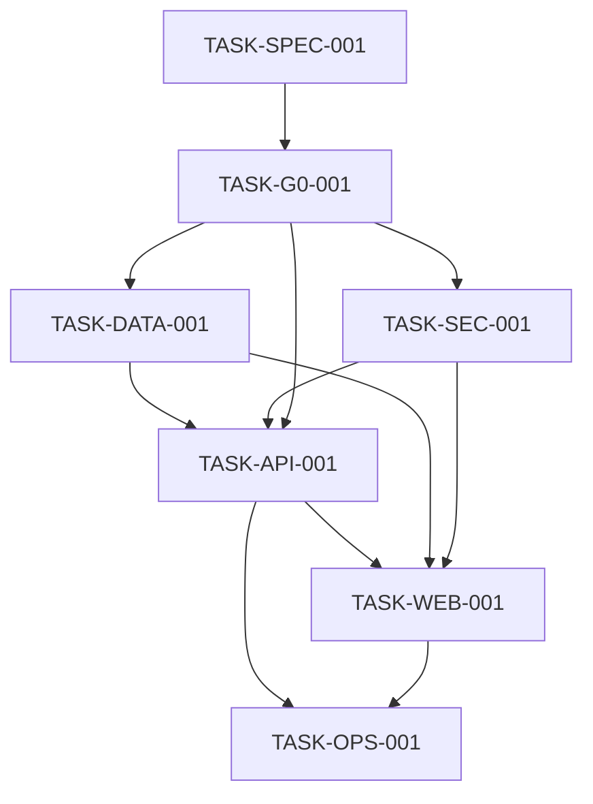

# 226OS Claude Code Handoff

**Prepared:** 2026-11-11
**Mode:** COP-ASS documentation review complete; stop before implementation
**Recommendation:** NO-GO for implementation until the human checkpoint below is closed

## Verified repository state

Observed in the repository:

- Product and engineering documents exist at the repository root: `README.md`, `PRD.md`, `SPEC.md`, `DESIGN.md`, `DEV.md`, `TEST.md`, `SHIP.md`, and `RULES.md`.
- `docs/architecture/ARCHITECTURE.md` and `docs/research/REFERENCES.md` exist.
- The repository contains no application, API, database migration, Makefile, Compose, Traefik, workflow, OpenAPI, test, or release evidence artifacts.
- `docs/spec-kit/`, `docs/quality/`, and `docs/decisions/` were created by this documentation review; they are plans and registries, not execution evidence.
- `CONTRIBUTING.md`, `AI_USAGE.md`, and `THIRD_PARTY_NOTICES.md` now exist as drafts; they require human/CADEV review and project-specific completion before release/compliance review.

No shell commands, builds, tests, package installs, deployments, remote mutations, or application implementation were executed. All execution-dependent gates are `NOT RUN`.

## Authority and accepted baseline

Read `AGENTS.md` first. Then use the precedence in `docs/spec-kit/README.md`.

Preserve all eight PRD domains: Solve, Discover, Build, Identity & Community, Connect, Language, Access, and Intelligence. Preserve all four differentiators: African Integration Intelligence, Problem-to-Project, Cross-Border Developer Collaboration, and Evidence-Based Technical Knowledge.

Accepted baseline:

- React 19, TypeScript, Vite, TanStack Router/Query/Form.
- Meta Astryx as the primary component foundation; Tailwind may provide complementary layout styling only.
- Graphite & Lime direction.
- Go modular monolith with Chi, pgx, sqlc, REST/OpenAPI.
- PostgreSQL with FTS, GIN, and `pg_trgm`.
- Docker, Compose, Traefik, GitHub Actions, and Make.
- Valkey and S3-compatible storage are candidates only; do not make either a P0 dependency without a human-approved ADR.

## Findings resolved by documentation

- The README/DEV shadcn/ui conflict is corrected in the canonical engineering direction: Astryx is primary. Astryx release/API details remain validation-dependent because the dependency is not installed.
- The Spec Kit now maps PRD -> SPEC -> API/data/UI -> BDD -> tasks -> gates.
- All six PRD journeys are listed with required nominal and negative evidence. Existing SPEC scenarios remain the current source; missing cases are planned work, not claimed coverage.
- The missing coverage scope and ADR registry now have canonical locations.
- G0 blockers now have explicit proposal artifacts for authentication/authorization, REST/errors, PostgreSQL schema/migrations, Astryx verification, and governance drafts. They remain unapproved.
- Application, CI, deployment, and executable license evidence remain absent. Governance policy drafts now exist, while the actual dependency inventory, license report, and AI provenance records remain open.

## Initial implementation batch

Do not start this batch until G0 is approved:

1. `TASK-SPEC-001`: assign owners and close product/route/locale scope.
2. `TASK-G0-001`: human review and approval of the explicit G0 proposals and governance drafts.
3. `TASK-DATA-001`: implement reviewed PostgreSQL schema, migrations, seeds, invariants, and bounded search.
4. `TASK-SEC-001`: implement session/authentication and server authorization tests.
5. `TASK-API-001`: approve OpenAPI and implement the first Go vertical slices.
6. `TASK-WEB-001`: install and pin Astryx, then implement the P0 frontend shell and flows.
7. `TASK-OPS-001`: add Make/CI/Compose/Traefik and collect real gate evidence.

Dependency graph:

## First-session instructions

1. Read `AGENTS.md`, then `docs/spec-kit/README.md`, `TRACEABILITY.md`, `CONTRACTS.md`, and `TASKS.md`.
2. Read `G0_DECISIONS.md`, `AUTHORIZATION_MATRIX.md`, `API_CONTRACT.md`, `DATABASE_DESIGN.md`, `ASTRYX_VERIFICATION.md`, and `G0_APPROVAL_TEMPLATE.md`.
3. Do not execute implementation commands or create application files until a human approves G0 and assigns owners/reviewers.
4. Resolve pending ADRs in `docs/decisions/README.md`; record each accepted decision as a numbered ADR before changing the stack or contracts.
5. Produce `api/openapi.yaml`, reviewed DTO/error schemas, database migrations/queries/seeds, and route/locale decisions before parallel frontend/backend work.
6. Write RED tests for the selected vertical slice before GREEN code. Keep authorization negative cases and evidence provenance in scope.
7. Use only the allowed paths in the task contract. Never add a hidden dependency, fake seed activity, unverified provider claim, or undocumented endpoint.
8. Run only documented repository-approved targets after implementation artifacts exist. Record exact commands, exit status, target SHA, environment, and reports. `NOT RUN` is not `PASS`.
9. Stop and request human approval for architecture, auth/security exceptions, migrations, new dependencies, storage services, secrets, costs, remote access, deployment, or release.

## Human checkpoint blockers

The human owner must decide or assign:

- P0 owners and distinct reviewers.
- Approval or rejection of every proposal in `G0_DECISIONS.md`.
- Canonical documentation layout: retain root documents or perform an approved move to `docs/`.
- Exact Astryx release/package manager, installed API verification, and beta mitigation owner.
- Authentication/session/recovery/CSRF/rate-limit policy and authorization matrix.
- OpenAPI schemas, error catalogue, pagination, idempotency, and generation policy.
- PostgreSQL schema, migration/restore, deletion, FTS strategy, seed policy, and bilingual search strategy.
- Whether Valkey or object storage is necessary for P0.
- Original-code license, CADEV license interpretation, and AI/third-party provenance owners.
- Datacloud product/account, DNS, budget, registry, and production approver.

## Gate status at handoff

| Gate | Status | Reason |
|---|---|---|
| G0 | BLOCKED | plan exists, but human approval/owners and open decisions are absent |
| G1 | NOT RUN | no implementation or CI |
| G2 | NOT RUN | no tests or coverage reports |
| G3 | NOT RUN | no OpenAPI, migrations, or real PostgreSQL evidence |
| G4 | NOT RUN | no scans or security test evidence |
| G5 | NOT RUN | no app, E2E, accessibility, or locale evidence |
| G6 | NOT RUN | no performance baseline |
| G7 | NOT RUN | no deployment, backup/restore, rollback, or production approval |

**Decision:** `NO-GO` for implementation start and release. A human may move to conditional implementation GO only after G0 approval and closure of the contracts explicitly marked `OPEN`; release remains blocked until G1-G7 produce evidence on the target SHA.
