# 226os P0 PostgreSQL Schema and Migration Design

**Status:** ACCEPTED design (ADR-0005, 2026-11-11, approver `Y4NN77`). Implementation state (updated 2026-11-12): B0 bootstrap (PR #24) created `db/migrations/00001` to `00010` from this document, `db/sqlc.yaml`, and sqlc queries for identity, platform and reference data only (`db/queries/identity.sql`, `platform.sql`, `reference.sql`). No domain application code beyond the API skeleton exists yet. Planned additions that are not yet migrations are marked **PLANNED** below (3.1, 3.2, 3.4, 5).
**Target engine:** **PostgreSQL 18** with native `uuidv7()`. **Tooling:** goose forward-only SQL migrations under root `db/migrations/`, sqlc queries under `db/queries/`, `pgx` v5.
**Decision owner:** `Y4NN77` (interim owner, ADR-0002). The SQL blocks are the accepted design. Migrations `00001` to `00010` implementing them are executed on a **fresh** PostgreSQL 18 database by the B0 integration suite `src/api/internal/platform/pgtest` (`TestFreshMigrationToHead` in `migrate_integration_test.go:28-88`; image pinned to `postgres:18` by digest in `harness_integration_test.go:29-31`), run by `make test-integration`, which `make quality` and CI include. `ROADMAP.md` section 2 records `make quality` green in CI; this document does not re-run it. Not established here: an upgrade-from-previous-schema test (none exists in pgtest yet, see 5), and a line-by-line match between the DDL blocks below and the migration files. That diff has not been done; any difference it finds is a finding for the owner.

Citations use `path:line` against the repository at the time of the first draft; line numbers in the cited documents may have shifted since the G0 reconciliation, so treat them as pointers to the topic. `SPEC:n` means `docs/SPEC.md:n`; `AUTHZ:n` means `docs/spec-kit/AUTHORIZATION_MATRIX.md:n`; `G0:n` means `docs/spec-kit/G0_DECISIONS.md:n`; `CONTRACTS:n` means `docs/spec-kit/CONTRACTS.md:n`; `API:n` means `docs/spec-kit/API_CONTRACT.md:n`.

## 1. Design principles and conventions

PostgreSQL remains the source of truth and initial search engine (BASE-005). Tables stay separated by domain; cross-domain links use typed relations rather than a universal content table. Every ownership and visibility decision must be enforceable in SQL or a transactionally adjacent authorization check.

| Topic | Decision | Justification |
|---|---|---|
| Primary keys | `uuid PRIMARY KEY DEFAULT uuidv7()` (native in PostgreSQL 18) | v7 is time-ordered, so btree inserts stay local and `(created_at, id)` keyset order is cheap, and every client (application, tests, seeds) gets the same default. Cost: creation time is observable from the ID; accepted because `created_at` is public on most content and IDs are never authorization. Seeds use fixed UUIDs. |
| Exceptions | `audit_log.id` is `bigint GENERATED ALWAYS AS IDENTITY` (append-only, never exposed through the API). Reference tables use stable text codes (`countries.code`, etc.). Pure join tables use composite primary keys. | Opaque IDs are only useful for objects addressable through the API. |
| Time | `timestamptz` everywhere (stored UTC, serialized RFC 3339 UTC, `SPEC:131`). `created_at` immutable; `updated_at` set by the sqlc query (`updated_at = now()`), **not by trigger**, to avoid hidden mutation. | Matches the existing trigger-avoidance stance on search vectors. |
| Status | `text` + named `CHECK (... IN (...))`, not PG `ENUM`, so a value is added by a forward-only `ALTER TABLE ... DROP/ADD CONSTRAINT` without enum-type surgery. **Publication lifecycle** is the `status` column: `learn_articles` `draft/published/archived/removed`, every other publishable entity `published/removed`. **Question solve state** is not stored: the API derives `state` = `open` (no answers), `answered` (answers, none accepted), `resolved` (`accepted_answer_id` set) from `answer_count` and `accepted_answer_id`. **Project visibility** is its own column (`public/private`). | Business-driven, evolving sets; three concerns, three mechanisms. |
| Language | `language text CHECK (language IN ('fr','en'))`, always `NOT NULL` on user-authored content (original language is preserved and displayed, never translated: `SPEC:81-87`, `SPEC:154`). A `DOMAIN` was rejected because sqlc support for `CREATE DOMAIN` is unverified. | |
| Email | **No `citext`.** Store only the normalized form: `email text CHECK (email = lower(btrim(email)))` with `UNIQUE (email)`. The Go layer lower-cases, trims and applies Unicode NFC before insert; the CHECK is the backstop. | One representation, one unique index, no extension; satisfies `SPEC:141`. Display-as-typed casing is not needed in P0. |
| Delete policy | Soft delete (`status = 'removed'` + `removed_at`) for all user content and entities that other rows reference; hard delete only for credentials/tokens/sessions/idempotency/rate-limit rows and for pure join rows. See the table in 1.1. | Relations, votes and applications must not dangle (`SPEC:148`); privacy erasure is done by anonymization, not row deletion. |
| `ON DELETE` | `RESTRICT` for every FK to content or users. `CASCADE` only on (a) auth artefacts (`user_credentials`, `sessions`, token tables, `idempotency_keys`) and (b) pure join/child rows owned by one parent (`question_tags`, `resource_countries`, ...). No `SET NULL` except where a nullable column is documented below. | No cascading delete of user-owned content (`DATABASE_DESIGN` principle). |
| Constraint names | Every `CHECK`, `UNIQUE`, `FK` is named `<table>_<what>_<ck|uq|fk>`; repositories map SQLSTATE + constraint name to domain errors. | `.claude/skills/postgres-data/SKILL.md:32`. |
| Bounds | Every free-text column has `char_length` CHECK; Markdown bodies are capped; `jsonb` only for bounded audit/idempotency payloads. | Query cost and abuse limits (`SPEC:153`, `SPEC:157`). |
| Triggers | None in P0 (updated_at, search vectors, counters are explicit). | Auditable, testable behaviour. |
| Extensions | `pg_trgm` and `unaccent`. `unaccent` is used only through the immutable wrapper `f_unaccent(text)` (3.0) so it can appear in generated columns and indexes. | ADR-0005 points 1 and 6. |

### 1.1 Soft versus hard delete per entity

| Entity | Delete mode | Why |
|---|---|---|
| `users` | Soft, **within 30 days of the request**: `status='deleted'`, `deleted_at`, email replaced by `deleted-<uuid>@invalid`, credentials/sessions/tokens hard-deleted, profile personal data scrubbed (username replaced by `deleted-<8 hex>`). Authored public content is **kept and shown as "membre supprimé"** (the API returns no username or display name for a deleted author). | Keeps answers/votes/relations referentially intact while honouring erasure requests (ADR-0005). |
| `questions`, `answers`, `resources`, `providers`, `projects`, `learn_articles`, `training_series`, `training_lessons` | Soft: `status='removed'`, `removed_at`; a moderator hide writes `audit_log` in the same transaction and a restore sets `status='published'` and clears `removed_at`. Hard delete only by a documented, approved privacy/legal procedure. | Referenced by relations, votes, applications, reports. |
| `contribution_needs` | Status `closed` (no removal column) | Needs are closed, not deleted; moderators hide the parent project. |
| `applications` | Soft: status `withdrawn`; never hard-deleted by users. A withdrawn row is reused when the applicant re-applies. | Preserves the unique `(user_id, contribution_need_id)` rule and the owner's audit trail. |
| `votes` | Hard delete (user retracts vote), score adjusted in the same transaction. | A vote has no independent meaning; `DELETE /votes` exists. |
| `content_relations` | Soft: `status='hidden'` (moderator removal, audited; restore sets `active`). | Moderation reversibility. |
| `sessions`, `email_verifications`, `password_resets`, `idempotency_keys`, `rate_limit_buckets` | Hard delete by expiry job. | Secrets/operational data; minimal retention. |
| join tables (`question_tags`, `user_skills`, `need_skills`, ...) | Hard delete (row is the relation). | |
| `audit_log` | Never deleted or updated by the application role (grants, see 3.8). | Moderation accountability (`AUTHZ:49`). |

## 2. ERD

```mermaid
erDiagram
    users ||--|| user_credentials : "has secret"
    users ||--|| profiles : "has"
    users ||--o{ sessions : "opens"
    users ||--o{ email_verifications : "requests"
    users ||--o{ password_resets : "requests"
    users ||--o{ user_skills : "declares"
    tags ||--o{ user_skills : "skill"
    countries ||--o{ profiles : "country"

    users ||--o{ questions : "asks"
    questions ||--o{ answers : "has"
    questions |o--o| answers : "accepted answer (composite FK)"
    users ||--o{ answers : "writes"
    users ||--o{ votes : "casts"
    questions ||--o{ votes : "target"
    answers ||--o{ votes : "target"
    questions ||--o{ question_tags : "tagged"
    tags ||--o{ question_tags : "tag"
    questions ||--o{ question_sources : "cites"
    answers ||--o{ answer_sources : "cites"
    countries ||--o{ questions : "context"

    providers ||--o{ resources : "offers"
    resource_categories ||--o{ resources : "classifies"
    users ||--o{ resources : "creates"
    resources ||--o{ resource_countries : "supports"
    countries ||--o{ resource_countries : "country"
    resources ||--o{ resource_sdk_languages : "has official SDK in"
    resources ||--o{ resource_sources : "sourced by"
    resource_sources |o--o| resources : "verified_source (composite FK)"
    resources ||--o{ resource_tags : "tagged"
    tags ||--o{ resource_tags : "tag"
    resources ||--o{ error_reports : "reported"
    users ||--o{ error_reports : "reports"
    resources ||--o{ resource_reviews : "reviewed P1"
    users ||--o{ resource_reviews : "writes P1"

    users ||--o{ projects : "owns"
    projects ||--o{ project_maintainers : "delegates"
    users ||--o{ project_maintainers : "maintains"
    projects ||--o{ project_tags : "stack"
    tags ||--o{ project_tags : "tag"
    projects ||--o{ contribution_needs : "needs"
    contribution_needs ||--o{ need_skills : "requires"
    tags ||--o{ need_skills : "skill"
    contribution_needs ||--o{ applications : "receives"
    users ||--o{ applications : "applies"

    learn_topics ||--o{ learn_articles : "topic"
    users ||--o{ learn_articles : "authors"
    learn_articles ||--o{ learn_article_tags : "tagged"
    tags ||--o{ learn_article_tags : "tag"
    users ||--o{ training_series : "authors"
    learn_topics ||--o{ training_series : "topic"
    training_series ||--o{ training_lessons : "ordered lessons"
    learn_articles |o--o{ training_lessons : "optional article"
    users ||--o{ learn_progress : "tracks P1"
    training_lessons ||--o{ learn_progress : "completed P1"

    questions ||--o{ content_relations : "src/tgt"
    resources ||--o{ content_relations : "src/tgt"
    projects ||--o{ content_relations : "src/tgt"
    learn_articles ||--o{ content_relations : "src/tgt"
    users ||--o{ content_relations : "creates"
    users ||--o{ content_reports : "reports P1"
    users ||--o{ audit_log : "acts"
    users ||--o{ idempotency_keys : "retries"

    users { uuid id PK "email normalized unique" }
    profiles { uuid user_id PK "username unique" }
    sessions { uuid id PK "token_hash unique" }
    questions { uuid id PK "accepted_answer_id composite FK" }
    answers { uuid id PK "unique id+question_id" }
    votes { uuid user_id PK "user+target_type+target_id" }
    resources { uuid id PK "verified_source_id composite FK" }
    projects { uuid id PK "github_url unique partial" }
    applications { uuid id PK "unique user+need" }
    learn_articles { uuid id PK "kind article or tutorial" }
    content_relations { uuid id PK "typed src/tgt FKs" }
```



### 2.1 Table inventory (authoritative, 41 tables: 38 in the P0 bootstrap, 3 deferred to P1)

| Domain | Tables | Count | P1 (deferred) |
|---|---|---|---|
| Reference / taxonomy | `countries`, `tags`, `learn_topics` | 3 | - |
| Identity | `users`, `user_credentials`, `profiles`, `user_skills`, `sessions`, `email_verifications`, `password_resets`, `rate_limit_buckets` | 8 | - |
| Solve | `questions`, `answers`, `votes`, `question_tags`, `question_sources`, `answer_sources` | 6 | - |
| Discover | `resource_categories`, `providers`, `resources`, `resource_countries`, `resource_sdk_languages`, `resource_sources`, `resource_tags`, `error_reports`, `resource_reviews` | 9 | `resource_reviews` |
| Build | `projects`, `project_maintainers`, `project_tags`, `contribution_needs`, `need_skills`, `applications` | 6 | - |
| Learn | `learn_articles`, `learn_article_tags`, `training_series`, `training_lessons`, `learn_progress` | 5 | `learn_progress` |
| Cross-cutting | `content_relations`, `content_reports`, `audit_log`, `idempotency_keys` | 4 | `content_reports` (no P0 endpoint; moderators resolve error reports only) |
| **Total** | | **41** | **3** |

### 2.2 Why `content_relations` is not polymorphic

A classic `(source_type text, source_id uuid, target_type text, target_id uuid)` table cannot carry foreign keys, so dangling links and cross-type confusion are possible (`SPEC:148` requires allowed source/target types and no pending links; `.claude/skills/postgres-data/SKILL.md:53`). Per-pair tables (6 unordered pairs) would multiply tables and queries. The design is **one table with one nullable real FK column per entity per side** (4 x 2 columns), a `CHECK` that exactly one column per side is set and agrees with the declared type, a `CHECK` that `(source_type, target_type)` is one of six canonical cross-type pairs (so A-B and B-A cannot both exist), and generated `source_id`/`target_id` columns for a single uniqueness constraint. Referential integrity is therefore enforced by PostgreSQL; "target is published and public" cannot be a column check and is enforced in the creating transaction (`SELECT ... FOR SHARE` on the target) and in every read query (join with `status = 'published'` and visibility). Adding a fifth type (e.g. `training_series`) is an expand-only `ADD COLUMN` plus a new CHECK.

## 3. Table-by-table DDL draft

All blocks are ordered so that every FK target already exists at that point, except the two documented composite FKs added with `ALTER TABLE` (`questions` to `answers`, `resources` to `resource_sources`). Primary keys default to `uuidv7()`; seeds supply fixed UUIDs.

### 3.0 Extensions and the `unaccent` wrapper (`00001`)

`unaccent()` is `STABLE`, so it cannot be used in generated columns or expression indexes. The accepted fix is an **immutable wrapper** with a schema-qualified dictionary, used identically for documents and queries (French-first accent folding, ADR-0005 point 6):

```sql
CREATE EXTENSION IF NOT EXISTS pg_trgm;
CREATE EXTENSION IF NOT EXISTS unaccent;

CREATE FUNCTION f_unaccent(text) RETURNS text
  LANGUAGE sql IMMUTABLE PARALLEL SAFE STRICT
  AS $$ SELECT public.unaccent('public.unaccent'::regdictionary, $1) $$;
```
(Test: `f_unaccent('éléphant') = 'elephant'`, and creating a generated column with `f_unaccent` succeeds. Both are G3 checks.)

### 3.1 Reference and taxonomy

**`countries`** - stable ISO 3166-1 alpha-2 codes with separate FR/EN labels (labels localized separately from codes). Enforces: validated country (`SPEC:141`). Reference data (not demo data) is inserted by the migration.

```sql
CREATE TABLE countries (
  code    text PRIMARY KEY,
  name_fr text NOT NULL,
  name_en text NOT NULL,
  CONSTRAINT countries_code_ck CHECK (code ~ '^[A-Z]{2}$'),
  CONSTRAINT countries_name_fr_ck CHECK (char_length(name_fr) BETWEEN 1 AND 100),
  CONSTRAINT countries_name_en_ck CHECK (char_length(name_en) BETWEEN 1 AND 100)
);
```

**`tags`** - one free-form slug namespace shared by questions, resources, projects, articles and user skills/technologies. Any member may create a tag when publishing; the slug is normalized to lowercase and at most 32 characters (the `TagSlug` pattern of the OpenAPI), **at most 5 tags per item** (service rule), and moderators can merge or rename (P1 operation; `status = 'hidden'` is the P0 moderator tool). Enforces: unique normalized identifiers.

```sql
CREATE TABLE tags (
  id         uuid PRIMARY KEY DEFAULT uuidv7(),
  slug       text NOT NULL,
  label      text NOT NULL,
  status     text NOT NULL DEFAULT 'active',
  provenance text NOT NULL DEFAULT 'live',
  created_by uuid,                             -- FK to users added in 3.2 (users is defined later)
  created_at timestamptz NOT NULL DEFAULT now(),
  CONSTRAINT tags_slug_uq UNIQUE (slug),
  CONSTRAINT tags_slug_ck CHECK (slug ~ '^[a-z0-9][a-z0-9.+#-]{0,31}$'),
  CONSTRAINT tags_label_ck CHECK (char_length(label) BETWEEN 1 AND 60),
  CONSTRAINT tags_status_ck CHECK (status IN ('active','hidden')),
  CONSTRAINT tags_provenance_ck CHECK (provenance IN ('live','demo'))
);
CREATE INDEX tags_slug_trgm_idx ON tags USING gin (slug gin_trgm_ops);   -- tag autocomplete (bounded, slug <= 32)
```

**`learn_topics`** - small reference list for Learn so new topics are data, not constraint changes. The current rows are the 9 owner-approved topics inserted by `db/migrations/00002_reference_taxonomy.sql:112-121` (`ai`, `payments`, `ussd-messaging`, `mobile`, `api-integration`, `security-privacy`, `cloud-devops`, `geo-data`, `open-source`); the prototype list that used to be cited here is superseded.

**PLANNED (E2, owner decision 2026-11-12; new migration, not in 00002, which is immutable):** one new forward-only migration, numbered by `make migrate-new` and written by the single migration writer (`ROADMAP.md` R6), adds 5 topics (`learn-to-learn`, `ai-assisted-dev`, `ai-agents`, `open-models`, `african-languages`) and relabels `ai`, `mobile` and `open-source` (same codes, new `name_fr`/`name_en`), for **14 topics**. No row is deleted; removals are deferred and need explicit human approval. The exact labels are in `TODO.md`, section E2. The same PR updates the exact lists and counts in `src/api/internal/platform/pgtest/migrate_integration_test.go`.

```sql
CREATE TABLE learn_topics (
  code    text PRIMARY KEY,
  name_fr text NOT NULL,
  name_en text NOT NULL,
  CONSTRAINT learn_topics_code_ck CHECK (code ~ '^[a-z][a-z0-9-]{1,29}$')
);
```

### 3.2 Identity (`00003`)

**`users`** - account identity and lifecycle. Enforces: unique normalized email (`SPEC:141`, `CONTRACTS:23`); bounded status; moderator role is data (granted by the repository owner through an audited operational step), never a frontend flag. There is no `collaborator` role: collaboration is derived from accepted `applications` and `project_maintainers`.

```sql
CREATE TABLE users (
  id                uuid PRIMARY KEY DEFAULT uuidv7(),
  email             text NOT NULL,
  email_verified_at timestamptz,
  role              text NOT NULL DEFAULT 'member',
  status            text NOT NULL DEFAULT 'active',
  provenance        text NOT NULL DEFAULT 'live',
  created_at        timestamptz NOT NULL DEFAULT now(),
  updated_at        timestamptz NOT NULL DEFAULT now(),
  deleted_at        timestamptz,
  CONSTRAINT users_email_uq UNIQUE (email),
  CONSTRAINT users_email_normalized_ck CHECK (
    email = lower(btrim(email)) AND char_length(email) BETWEEN 3 AND 254 AND position('@' IN email) > 1),
  CONSTRAINT users_role_ck CHECK (role IN ('member','moderator')),
  CONSTRAINT users_status_ck CHECK (status IN ('active','suspended','deleted')),   -- unverified email is email_verified_at IS NULL, not a status
  CONSTRAINT users_deleted_ck CHECK ((status = 'deleted') = (deleted_at IS NOT NULL)),
  CONSTRAINT users_provenance_ck CHECK (provenance IN ('live','demo'))
);
ALTER TABLE tags ADD CONSTRAINT tags_created_by_fk FOREIGN KEY (created_by) REFERENCES users (id) ON DELETE RESTRICT;
CREATE INDEX tags_created_by_idx ON tags (created_by) WHERE created_by IS NOT NULL;
```

**`user_credentials`** - Argon2id password hash kept out of `users` so profile/session queries never select it (`G0:9`, `AUTHZ:9`). CASCADE: it is a secret artefact, not content.

```sql
CREATE TABLE user_credentials (
  user_id             uuid PRIMARY KEY,
  password_hash       text NOT NULL,           -- PHC string, includes salt and parameters
  hash_params_version smallint NOT NULL DEFAULT 1,
  password_changed_at timestamptz NOT NULL DEFAULT now(),
  CONSTRAINT user_credentials_user_fk FOREIGN KEY (user_id) REFERENCES users (id) ON DELETE CASCADE,
  CONSTRAINT user_credentials_hash_ck CHECK (left(password_hash, 10) = '$argon2id$' AND char_length(password_hash) <= 255)
);
```

**`profiles`** - one public profile per user with per-field visibility. **Defaults: display name, username, skills, country, bio, GitHub username, `open_to_collab` and languages are public**; the owner can narrow each optional field to `members` or `private`. **Email is never public** and is not a profile field. Enforces: profile belongs to user; unique username; validated country/languages; explicit visibility.

```sql
CREATE TABLE profiles (
  user_id        uuid PRIMARY KEY,
  username       text NOT NULL,
  display_name   text NOT NULL,
  intent         text,
  country_code   text,
  languages      text[] NOT NULL DEFAULT '{}',   -- spoken languages (BCP 47 primary tags)
  github_username text,
  bio            text,
  bio_language   text,
  open_to_collab boolean NOT NULL DEFAULT false,
  country_visibility        text NOT NULL DEFAULT 'public',
  languages_visibility      text NOT NULL DEFAULT 'public',
  skills_visibility         text NOT NULL DEFAULT 'public',
  github_visibility         text NOT NULL DEFAULT 'public',
  bio_visibility            text NOT NULL DEFAULT 'public',
  open_to_collab_visibility text NOT NULL DEFAULT 'public',
  created_at     timestamptz NOT NULL DEFAULT now(),
  updated_at     timestamptz NOT NULL DEFAULT now(),
  CONSTRAINT profiles_user_fk FOREIGN KEY (user_id) REFERENCES users (id) ON DELETE RESTRICT,
  CONSTRAINT profiles_country_fk FOREIGN KEY (country_code) REFERENCES countries (code) ON DELETE RESTRICT,
  CONSTRAINT profiles_username_uq UNIQUE (username),
  CONSTRAINT profiles_username_ck CHECK (username ~ '^[a-z0-9][a-z0-9_-]{2,29}$'),
  CONSTRAINT profiles_display_name_ck CHECK (char_length(display_name) BETWEEN 1 AND 80),
  CONSTRAINT profiles_intent_ck CHECK (intent IS NULL OR intent IN ('ask','help','integrate','contribute','learn')),
  CONSTRAINT profiles_languages_ck CHECK (cardinality(languages) <= 10 AND array_to_string(languages, ',') ~ '^([a-z]{2,3}(,[a-z]{2,3})*)?$'),
  CONSTRAINT profiles_github_ck CHECK (github_username IS NULL OR github_username ~ '^[A-Za-z0-9][A-Za-z0-9-]{0,38}$'),
  CONSTRAINT profiles_bio_ck CHECK (bio IS NULL OR char_length(bio) <= 500),
  CONSTRAINT profiles_bio_language_ck CHECK ((bio IS NULL) = (bio_language IS NULL) AND (bio_language IS NULL OR bio_language IN ('fr','en'))),
  CONSTRAINT profiles_visibility_ck CHECK (
    country_visibility IN ('public','members','private') AND languages_visibility IN ('public','members','private')
    AND skills_visibility IN ('public','members','private') AND github_visibility IN ('public','members','private')
    AND bio_visibility IN ('public','members','private') AND open_to_collab_visibility IN ('public','members','private'))
);
CREATE INDEX profiles_country_idx ON profiles (country_code) WHERE country_code IS NOT NULL;
```

**PLANNED: `profiles.profile_visibility` (C14b, decided by the owner and the main session on 2026-11-12; new migration, not in 00003, which is immutable).** The accepted DDL above is unchanged. A separate forward-only migration, numbered by `make migrate-new` and written by the single migration writer, adds:

- `profile_visibility text NOT NULL DEFAULT 'public'` on `profiles`, with a named `CHECK (profile_visibility IN ('public','members','private'))`;
- in the same PR, the pgtest tests that assert table structure and constraints.

Semantics (`ROADMAP.md` section 10, C14):

- `GET /profiles/{username}`: `public` is visible to everyone, `members` to authenticated members only, `private` to the owner only. Everyone else gets a 404 whose body is identical to an unknown or deleted username. Moderators get no special profile access.
- Author bylines on published content keep showing the username and display name whatever `profile_visibility` says; deleted accounts still show "membre supprimé" (1.1).
- People directory (E5): a profile is listed for a caller only if the user is `active`, `profile_visibility` allows that caller, `open_to_collab = true` and `open_to_collab_visibility` allows that caller. Listed fields and filters use only fields visible to the caller. Email is never selected.
- Not decided: how suspended users are treated by `GET /profiles/{username}`.

Once this migration merges, decision 8 in section 10 ("only `projects` and profile fields carry visibility") also covers this profile-level column.

**`user_skills`** - user skills/technologies as tags (feeds the skills-based home feed and project needs matching). Join row: CASCADE from either side.

```sql
CREATE TABLE user_skills (
  user_id    uuid NOT NULL,
  tag_id     uuid NOT NULL,
  created_at timestamptz NOT NULL DEFAULT now(),
  CONSTRAINT user_skills_pk PRIMARY KEY (user_id, tag_id),
  CONSTRAINT user_skills_user_fk FOREIGN KEY (user_id) REFERENCES users (id) ON DELETE CASCADE,
  CONSTRAINT user_skills_tag_fk FOREIGN KEY (tag_id) REFERENCES tags (id) ON DELETE RESTRICT
);
CREATE INDEX user_skills_tag_idx ON user_skills (tag_id, user_id);
```

**`sessions`** - opaque server-side sessions; only the SHA-256 of the 256-bit token and of the CSRF synchronizer token are stored. Enforces: session hash unique; idle and absolute expiry; revoked/expired sessions unusable (ADR-0003; rotation = new row + old row revoked with reason). IP is a truncated network prefix and the user agent a short parsed summary, no raw values.

```sql
CREATE TABLE sessions (
  id                  uuid PRIMARY KEY DEFAULT uuidv7(),
  user_id             uuid NOT NULL,
  token_hash          bytea NOT NULL,
  csrf_token_hash     bytea NOT NULL,
  created_at          timestamptz NOT NULL DEFAULT now(),
  last_seen_at        timestamptz NOT NULL DEFAULT now(),   -- updated at most every few minutes (write amplification)
  authenticated_at    timestamptz NOT NULL DEFAULT now(),   -- last sign-in or re-authentication; sensitive actions need it within 15 min
  idle_expires_at     timestamptz NOT NULL,                 -- last_seen + 2 h (ADR-0003)
  absolute_expires_at timestamptz NOT NULL,                 -- created + 7 d (ADR-0003)
  revoked_at          timestamptz,
  revoked_reason      text,
  ip_prefix           cidr,                                 -- /24 (IPv4) or /48 (IPv6) only
  user_agent_summary  text,
  CONSTRAINT sessions_user_fk FOREIGN KEY (user_id) REFERENCES users (id) ON DELETE CASCADE,
  CONSTRAINT sessions_token_hash_uq UNIQUE (token_hash),
  CONSTRAINT sessions_token_hash_ck CHECK (octet_length(token_hash) = 32),
  CONSTRAINT sessions_csrf_hash_ck CHECK (octet_length(csrf_token_hash) = 32),
  CONSTRAINT sessions_expiry_ck CHECK (idle_expires_at <= absolute_expires_at AND absolute_expires_at > created_at),
  CONSTRAINT sessions_revoked_ck CHECK ((revoked_at IS NULL) = (revoked_reason IS NULL)),
  CONSTRAINT sessions_revoked_reason_ck CHECK (revoked_reason IS NULL OR revoked_reason IN
    ('logout','rotated','password_reset','password_change','security_event','moderation','expired')),
  CONSTRAINT sessions_ua_ck CHECK (user_agent_summary IS NULL OR char_length(user_agent_summary) <= 120)
);
CREATE INDEX sessions_user_active_idx ON sessions (user_id) WHERE revoked_at IS NULL;
CREATE INDEX sessions_absolute_expiry_idx ON sessions (absolute_expires_at);      -- purge job
```
A session is usable iff `revoked_at IS NULL AND now() < LEAST(idle_expires_at, absolute_expires_at)`; this predicate lives in one sqlc query and is tested. There is no `session_events` table: the revocation reason is a column and security events go to `audit_log` (decided, section 10).

**`email_verifications`** - hashed, single-use, 24 h verification tokens (ADR-0003). A user with `email_verified_at IS NULL` may sign in, read and draft; publishing needs a verified email (service rule, 403 `EMAIL_NOT_VERIFIED`).

```sql
CREATE TABLE email_verifications (
  id          uuid PRIMARY KEY DEFAULT uuidv7(),
  user_id     uuid NOT NULL,
  email       text NOT NULL,                  -- address being verified (supports future email change)
  token_hash  bytea NOT NULL,
  created_at  timestamptz NOT NULL DEFAULT now(),
  expires_at  timestamptz NOT NULL,
  consumed_at timestamptz,
  CONSTRAINT email_verifications_user_fk FOREIGN KEY (user_id) REFERENCES users (id) ON DELETE CASCADE,
  CONSTRAINT email_verifications_token_uq UNIQUE (token_hash),
  CONSTRAINT email_verifications_hash_ck CHECK (octet_length(token_hash) = 32),
  CONSTRAINT email_verifications_email_ck CHECK (email = lower(btrim(email)) AND char_length(email) <= 254),
  CONSTRAINT email_verifications_expiry_ck CHECK (expires_at > created_at)
);
CREATE INDEX email_verifications_user_open_idx ON email_verifications (user_id) WHERE consumed_at IS NULL;
```
Single use is enforced by `UPDATE ... SET consumed_at = now() WHERE token_hash = $1 AND consumed_at IS NULL AND expires_at > now() RETURNING user_id`; zero rows means invalid/used/expired (one generic error, no enumeration).

**`password_resets`** - same shape, 30 minute lifetime (ADR-0003), no `email` column.

```sql
CREATE TABLE password_resets (
  id          uuid PRIMARY KEY DEFAULT uuidv7(),
  user_id     uuid NOT NULL,
  token_hash  bytea NOT NULL,
  created_at  timestamptz NOT NULL DEFAULT now(),
  expires_at  timestamptz NOT NULL,
  consumed_at timestamptz,
  CONSTRAINT password_resets_user_fk FOREIGN KEY (user_id) REFERENCES users (id) ON DELETE CASCADE,
  CONSTRAINT password_resets_token_uq UNIQUE (token_hash),
  CONSTRAINT password_resets_hash_ck CHECK (octet_length(token_hash) = 32),
  CONSTRAINT password_resets_expiry_ck CHECK (expires_at > created_at)
);
CREATE INDEX password_resets_user_open_idx ON password_resets (user_id) WHERE consumed_at IS NULL;
```

**`rate_limit_buckets`** - PostgreSQL-backed fixed-window counters, no new dependency (ADR-0003). Keys are HMACs of the IP/account so no plaintext personal data is stored. `UNLOGGED` (rebuildable, avoids WAL cost on a hot table); **accepted** (ADR-0003): a crash resets counters, a documented residual risk.

```sql
CREATE UNLOGGED TABLE rate_limit_buckets (
  scope        text NOT NULL,        -- e.g. 'signin:ip', 'signin:account', 'reset:ip', 'write:user', 'github_import:user'
  key_hash     bytea NOT NULL,
  window_start timestamptz NOT NULL,
  hits         integer NOT NULL DEFAULT 1,
  CONSTRAINT rate_limit_buckets_pk PRIMARY KEY (scope, key_hash, window_start),
  CONSTRAINT rate_limit_buckets_scope_ck CHECK (scope ~ '^[a-z_]+(:[a-z_]+)?$' AND char_length(scope) <= 64),
  CONSTRAINT rate_limit_buckets_hits_ck CHECK (hits > 0)
);
CREATE INDEX rate_limit_buckets_window_idx ON rate_limit_buckets (window_start);   -- purge
```
Increment: `INSERT ... ON CONFLICT (scope, key_hash, window_start) DO UPDATE SET hits = rate_limit_buckets.hits + 1 RETURNING hits`.

### 3.3 Solve (`00005`)

**`questions`** - a technical question. Enforces: owner required, bounded state (`SPEC:142`); at most one accepted answer per question **by construction** (a single `accepted_answer_id` column) and that the accepted answer belongs to the same question (composite FK, added after `answers` exists) (`SPEC:21`, `SPEC:142`, `CONTRACTS:23`); searchable (`SPEC:22`).

```sql
CREATE TABLE questions (
  id                 uuid PRIMARY KEY DEFAULT uuidv7(),
  author_id          uuid NOT NULL,
  title              text NOT NULL,
  body_md            text NOT NULL,
  language           text NOT NULL,
  snippet            text,
  snippet_language   text,                   -- programming language label, display only (never executed: SPEC:158)
  environment        text,                   -- e.g. 'Go 1.23'
  country_code       text,
  status             text NOT NULL DEFAULT 'published',   -- publication lifecycle only; solve state is derived (below)
  accepted_answer_id uuid,
  answer_count       integer NOT NULL DEFAULT 0,
  vote_score         integer NOT NULL DEFAULT 0,
  provenance         text NOT NULL DEFAULT 'live',
  published_at       timestamptz NOT NULL DEFAULT now(),
  removed_at         timestamptz,
  created_at         timestamptz NOT NULL DEFAULT now(),
  updated_at         timestamptz NOT NULL DEFAULT now(),
  search_document    tsvector GENERATED ALWAYS AS (
    setweight(to_tsvector('simple', f_unaccent(title)), 'A') || setweight(to_tsvector('simple', f_unaccent(body_md)), 'B')) STORED,
  CONSTRAINT questions_author_fk FOREIGN KEY (author_id) REFERENCES users (id) ON DELETE RESTRICT,
  CONSTRAINT questions_country_fk FOREIGN KEY (country_code) REFERENCES countries (code) ON DELETE RESTRICT,
  CONSTRAINT questions_title_ck CHECK (char_length(title) BETWEEN 1 AND 200),
  CONSTRAINT questions_body_ck CHECK (char_length(body_md) BETWEEN 1 AND 20000),
  CONSTRAINT questions_language_ck CHECK (language IN ('fr','en')),
  CONSTRAINT questions_snippet_ck CHECK (snippet IS NULL OR char_length(snippet) <= 10000),
  CONSTRAINT questions_snippet_language_ck CHECK (snippet_language IS NULL OR char_length(snippet_language) <= 30),
  CONSTRAINT questions_environment_ck CHECK (environment IS NULL OR char_length(environment) <= 100),
  CONSTRAINT questions_status_ck CHECK (status IN ('published','removed')),
  CONSTRAINT questions_removed_ck CHECK ((status = 'removed') = (removed_at IS NOT NULL)),
  CONSTRAINT questions_counters_ck CHECK (answer_count >= 0),
  CONSTRAINT questions_provenance_ck CHECK (provenance IN ('live','demo'))
);
CREATE INDEX questions_author_idx ON questions (author_id, created_at DESC, id DESC);
CREATE INDEX questions_country_idx ON questions (country_code) WHERE country_code IS NOT NULL;
```
The API `state` is derived: `resolved` when `accepted_answer_id IS NOT NULL`, else `answered` when `answer_count > 0`, else `open`. (Decided: the unused `questions_id_author_uq` constraint is dropped from the bootstrap migration.)

**`answers`** - an answer. Enforces: owner required, bounded state (`SPEC:142`); `UNIQUE (id, question_id)` is the target of the accepted-answer composite FK.

```sql
CREATE TABLE answers (
  id          uuid PRIMARY KEY DEFAULT uuidv7(),
  question_id uuid NOT NULL,
  author_id   uuid NOT NULL,
  body_md     text NOT NULL,
  language    text NOT NULL,
  status      text NOT NULL DEFAULT 'published',
  vote_score  integer NOT NULL DEFAULT 0,
  provenance  text NOT NULL DEFAULT 'live',
  removed_at  timestamptz,
  created_at  timestamptz NOT NULL DEFAULT now(),
  updated_at  timestamptz NOT NULL DEFAULT now(),
  search_document tsvector GENERATED ALWAYS AS (to_tsvector('simple', f_unaccent(body_md))) STORED,
  CONSTRAINT answers_question_fk FOREIGN KEY (question_id) REFERENCES questions (id) ON DELETE RESTRICT,
  CONSTRAINT answers_author_fk FOREIGN KEY (author_id) REFERENCES users (id) ON DELETE RESTRICT,
  CONSTRAINT answers_id_question_uq UNIQUE (id, question_id),
  CONSTRAINT answers_body_ck CHECK (char_length(body_md) BETWEEN 1 AND 20000),
  CONSTRAINT answers_language_ck CHECK (language IN ('fr','en')),
  CONSTRAINT answers_status_ck CHECK (status IN ('published','removed')),
  CONSTRAINT answers_removed_ck CHECK ((status = 'removed') = (removed_at IS NOT NULL)),
  CONSTRAINT answers_provenance_ck CHECK (provenance IN ('live','demo'))
);
CREATE INDEX answers_question_idx ON answers (question_id, created_at, id) WHERE status = 'published';
CREATE INDEX answers_author_idx ON answers (author_id, created_at DESC, id DESC);

ALTER TABLE questions
  ADD CONSTRAINT questions_accepted_answer_fk
  FOREIGN KEY (accepted_answer_id, id) REFERENCES answers (id, question_id) ON DELETE RESTRICT;
```
`MATCH SIMPLE` means the FK is not checked while `accepted_answer_id IS NULL`. A second acceptance is an `UPDATE` of the same column (at most one value), so "two accepted answers" is unrepresentable; acceptance by a non-author, acceptance of a `removed` answer, and clearing on answer removal are service rules in one transaction with `SELECT ... FOR UPDATE` on the question (the DB cannot see the caller). Concurrent accepts serialize on the row lock. Alternative (partial unique index `ON answers(question_id) WHERE accepted`) rejected: two sources of truth.

**`votes`** - one vote per user per target with real FKs for both target kinds. Enforces: unique `(user_id, target_type, target_id)` (`SPEC:143`, `CONTRACTS:23`) literally, via a generated `target_id`; no dangling target; counters never taken from the client (`SPEC:143`).

```sql
CREATE TABLE votes (
  user_id     uuid NOT NULL,
  target_type text NOT NULL,
  question_id uuid,
  answer_id   uuid,
  target_id   uuid GENERATED ALWAYS AS (COALESCE(question_id, answer_id)) STORED NOT NULL,
  value       smallint NOT NULL DEFAULT 1,
  created_at  timestamptz NOT NULL DEFAULT now(),
  CONSTRAINT votes_pk PRIMARY KEY (user_id, target_type, target_id),
  CONSTRAINT votes_user_fk FOREIGN KEY (user_id) REFERENCES users (id) ON DELETE RESTRICT,
  CONSTRAINT votes_question_fk FOREIGN KEY (question_id) REFERENCES questions (id) ON DELETE RESTRICT,
  CONSTRAINT votes_answer_fk FOREIGN KEY (answer_id) REFERENCES answers (id) ON DELETE RESTRICT,
  CONSTRAINT votes_target_ck CHECK (
    (target_type = 'question' AND question_id IS NOT NULL AND answer_id IS NULL)
    OR (target_type = 'answer' AND answer_id IS NOT NULL AND question_id IS NULL)),
  CONSTRAINT votes_value_ck CHECK (value IN (1, -1))
);
CREATE INDEX votes_question_idx ON votes (question_id) WHERE question_id IS NOT NULL;
CREATE INDEX votes_answer_idx ON votes (answer_id) WHERE answer_id IS NOT NULL;
```
`vote_score` on questions/answers is maintained by the repository in the same transaction as the vote insert/flip/delete (`INSERT ... ON CONFLICT (user_id, target_type, target_id) DO UPDATE`), with a reconciliation test comparing it to `SUM(value)`. Up and down votes are both allowed (`value` +1 / -1). **Self-vote is forbidden** (403 `SELF_VOTE_FORBIDDEN`): the author of the target cannot vote on it, a service rule checked in the vote transaction (a CHECK cannot cross tables).

**`question_tags`**, **`question_sources`**, **`answer_sources`** - tags and cited links (answers are "explained and sourced", PRD pitch). URLs are `https?` only and length-bounded; they are rendered as links, never fetched in P0 (anti-SSRF, `SPEC:158`).

```sql
CREATE TABLE question_tags (
  question_id uuid NOT NULL,
  tag_id      uuid NOT NULL,
  CONSTRAINT question_tags_pk PRIMARY KEY (question_id, tag_id),
  CONSTRAINT question_tags_question_fk FOREIGN KEY (question_id) REFERENCES questions (id) ON DELETE CASCADE,
  CONSTRAINT question_tags_tag_fk FOREIGN KEY (tag_id) REFERENCES tags (id) ON DELETE RESTRICT
);
CREATE INDEX question_tags_tag_idx ON question_tags (tag_id, question_id);

CREATE TABLE question_sources (
  id          uuid PRIMARY KEY DEFAULT uuidv7(),
  question_id uuid NOT NULL,
  title       text,
  url         text NOT NULL,
  created_at  timestamptz NOT NULL DEFAULT now(),
  CONSTRAINT question_sources_question_fk FOREIGN KEY (question_id) REFERENCES questions (id) ON DELETE CASCADE,
  CONSTRAINT question_sources_url_uq UNIQUE (question_id, url),
  CONSTRAINT question_sources_url_ck CHECK (url ~ '^https?://' AND char_length(url) <= 2048),
  CONSTRAINT question_sources_title_ck CHECK (title IS NULL OR char_length(title) <= 200)
);

CREATE TABLE answer_sources (
  id         uuid PRIMARY KEY DEFAULT uuidv7(),
  answer_id  uuid NOT NULL,
  title      text,
  url        text NOT NULL,
  created_at timestamptz NOT NULL DEFAULT now(),
  CONSTRAINT answer_sources_answer_fk FOREIGN KEY (answer_id) REFERENCES answers (id) ON DELETE CASCADE,
  CONSTRAINT answer_sources_url_uq UNIQUE (answer_id, url),
  CONSTRAINT answer_sources_url_ck CHECK (url ~ '^https?://' AND char_length(url) <= 2048),
  CONSTRAINT answer_sources_title_ck CHECK (title IS NULL OR char_length(title) <= 200)
);
```
"At most 5 tags per question" is a service rule (decided, ADR-0005).

### 3.4 Discover (`00006`)

**`resource_categories`** - controlled category codes with FR/EN labels. The current rows are the 15 owner-approved categories inserted by `db/migrations/00002_reference_taxonomy.sql:124-139`, `sort_order` in steps of 10 (`mobile-money` through `dev-tools`).

**PLANNED (E2, owner decision 2026-11-12; new migration, not in 00002, which is immutable):** the same E2 migration as for `learn_topics` adds `ai-models`, `ai-tooling` and `ai-datasets` (each with an explicit `sort_order`) and relabels `cloud-hosting`, for **18 categories**. `mobile-money` and `sms-ussd` stay (differentiator 1). No row is deleted.

```sql
CREATE TABLE resource_categories (
  code       text PRIMARY KEY,
  name_fr    text NOT NULL,
  name_en    text NOT NULL,
  sort_order smallint NOT NULL DEFAULT 0,
  CONSTRAINT resource_categories_code_ck CHECK (code ~ '^[a-z][a-z0-9-]{1,29}$')
);
```

**`providers`** - organisation behind one or more resources. Enforces: no unsupported provider claim: a provider carries no verification flag, only `resources`/`resource_sources` do (`SPEC:144`, `AUTHZ:34`).

```sql
CREATE TABLE providers (
  id             uuid PRIMARY KEY DEFAULT uuidv7(),
  slug           text NOT NULL,
  name           text NOT NULL,
  website_url    text,
  summary        text,
  summary_language text,
  status         text NOT NULL DEFAULT 'published',
  provenance     text NOT NULL DEFAULT 'live',
  created_by     uuid NOT NULL,
  created_at     timestamptz NOT NULL DEFAULT now(),
  updated_at     timestamptz NOT NULL DEFAULT now(),
  removed_at     timestamptz,
  CONSTRAINT providers_created_by_fk FOREIGN KEY (created_by) REFERENCES users (id) ON DELETE RESTRICT,
  CONSTRAINT providers_slug_uq UNIQUE (slug),
  CONSTRAINT providers_slug_ck CHECK (slug ~ '^[a-z0-9][a-z0-9-]{0,59}$'),
  CONSTRAINT providers_name_ck CHECK (char_length(name) BETWEEN 1 AND 120),
  CONSTRAINT providers_website_ck CHECK (website_url IS NULL OR (website_url ~ '^https://' AND char_length(website_url) <= 2048)),
  CONSTRAINT providers_summary_ck CHECK (summary IS NULL OR char_length(summary) <= 1000),
  CONSTRAINT providers_summary_language_ck CHECK ((summary IS NULL) = (summary_language IS NULL) AND (summary_language IS NULL OR summary_language IN ('fr','en'))),
  CONSTRAINT providers_status_ck CHECK (status IN ('published','removed')),
  CONSTRAINT providers_removed_ck CHECK ((status = 'removed') = (removed_at IS NOT NULL)),
  CONSTRAINT providers_provenance_ck CHECK (provenance IN ('live','demo'))
);
CREATE INDEX providers_created_by_idx ON providers (created_by);
```

**`resources`** - API, SDK or tool catalogue entry. Enforces: category and country links (`SPEC:144`, `SPEC:34`); `verified` is representable **only with a source row of that resource and a verification date**, via composite FK `(verified_source_id, id)` to `resource_sources(id, resource_id)` (`SPEC:144`, `SPEC:38`); staleness is computed at read time from `resource_sources.checked_at` (not stored), so a stale source is never shown as verified merely because it ranks (search design).

```sql
CREATE TABLE resources (
  id                  uuid PRIMARY KEY DEFAULT uuidv7(),
  provider_id         uuid,
  category_code       text NOT NULL,
  type                text NOT NULL,                -- what the item is: api | sdk | tool
  slug                text NOT NULL,
  name                text NOT NULL,
  summary             text NOT NULL,
  summary_language    text NOT NULL,
  doc_languages       text[] NOT NULL DEFAULT '{}',
  website_url         text,
  docs_url            text,
  auth_note           text,                    -- free text, original language (summary_language)
  version_note        text,
  verification_status text NOT NULL DEFAULT 'unverified',
  verified_at         timestamptz,
  verified_source_id  uuid,
  status              text NOT NULL DEFAULT 'published',
  provenance          text NOT NULL DEFAULT 'live',
  created_by          uuid NOT NULL,
  published_at        timestamptz NOT NULL DEFAULT now(),
  removed_at          timestamptz,
  created_at          timestamptz NOT NULL DEFAULT now(),
  updated_at          timestamptz NOT NULL DEFAULT now(),
  search_document     tsvector GENERATED ALWAYS AS (
    setweight(to_tsvector('simple', f_unaccent(name)), 'A') || setweight(to_tsvector('simple', f_unaccent(summary)), 'B')) STORED,
  CONSTRAINT resources_provider_fk FOREIGN KEY (provider_id) REFERENCES providers (id) ON DELETE RESTRICT,
  CONSTRAINT resources_category_fk FOREIGN KEY (category_code) REFERENCES resource_categories (code) ON DELETE RESTRICT,
  CONSTRAINT resources_created_by_fk FOREIGN KEY (created_by) REFERENCES users (id) ON DELETE RESTRICT,
  CONSTRAINT resources_slug_uq UNIQUE (slug),
  CONSTRAINT resources_slug_ck CHECK (slug ~ '^[a-z0-9][a-z0-9-]{0,79}$'),
  CONSTRAINT resources_type_ck CHECK (type IN ('api','sdk','tool')),
  CONSTRAINT resources_name_ck CHECK (char_length(name) BETWEEN 1 AND 120),
  CONSTRAINT resources_summary_ck CHECK (char_length(summary) BETWEEN 1 AND 2000),
  CONSTRAINT resources_summary_language_ck CHECK (summary_language IN ('fr','en')),
  CONSTRAINT resources_doc_languages_ck CHECK (doc_languages <@ ARRAY['fr','en']::text[]),
  CONSTRAINT resources_urls_ck CHECK (
    (website_url IS NULL OR (website_url ~ '^https://' AND char_length(website_url) <= 2048))
    AND (docs_url IS NULL OR (docs_url ~ '^https://' AND char_length(docs_url) <= 2048))),
  CONSTRAINT resources_notes_ck CHECK (
    (auth_note IS NULL OR char_length(auth_note) <= 1000) AND (version_note IS NULL OR char_length(version_note) <= 200)),
  CONSTRAINT resources_verification_status_ck CHECK (verification_status IN ('unverified','claimed','verified','disputed')),
  CONSTRAINT resources_verified_ck CHECK (
    verification_status <> 'verified' OR (verified_source_id IS NOT NULL AND verified_at IS NOT NULL)),
  CONSTRAINT resources_status_ck CHECK (status IN ('published','removed')),
  CONSTRAINT resources_removed_ck CHECK ((status = 'removed') = (removed_at IS NOT NULL)),
  CONSTRAINT resources_provenance_ck CHECK (provenance IN ('live','demo'))
);
CREATE INDEX resources_provider_idx ON resources (provider_id) WHERE provider_id IS NOT NULL;
CREATE INDEX resources_created_by_idx ON resources (created_by);
CREATE INDEX resources_catalogue_idx ON resources (category_code, type, name, id) WHERE status = 'published';
```

**`resource_sources`** - provenance links with publication and last-check dates. Enforces: source + URL + verification date when declared (`SPEC:144`, `SPEC:38`).

```sql
CREATE TABLE resource_sources (
  id           uuid PRIMARY KEY DEFAULT uuidv7(),
  resource_id  uuid NOT NULL,
  kind         text NOT NULL,
  title        text NOT NULL,
  url          text NOT NULL,
  published_at timestamptz,
  checked_at   timestamptz,
  checked_by   uuid,
  created_at   timestamptz NOT NULL DEFAULT now(),
  CONSTRAINT resource_sources_resource_fk FOREIGN KEY (resource_id) REFERENCES resources (id) ON DELETE RESTRICT,
  CONSTRAINT resource_sources_checked_by_fk FOREIGN KEY (checked_by) REFERENCES users (id) ON DELETE RESTRICT,
  CONSTRAINT resource_sources_id_resource_uq UNIQUE (id, resource_id),
  CONSTRAINT resource_sources_url_uq UNIQUE (resource_id, url),
  CONSTRAINT resource_sources_kind_ck CHECK (kind IN ('official_docs','changelog','pricing','community','other','claim')),
  CONSTRAINT resource_sources_url_ck CHECK (url ~ '^https://' AND char_length(url) <= 2048),
  CONSTRAINT resource_sources_title_ck CHECK (char_length(title) BETWEEN 1 AND 200),
  CONSTRAINT resource_sources_checked_ck CHECK (kind = 'claim' OR checked_at IS NOT NULL)
);
CREATE INDEX resource_sources_resource_idx ON resource_sources (resource_id, checked_at DESC);
CREATE INDEX resource_sources_checked_by_idx ON resource_sources (checked_by) WHERE checked_by IS NOT NULL;

ALTER TABLE resources
  ADD CONSTRAINT resources_verified_source_fk
  FOREIGN KEY (verified_source_id, id) REFERENCES resource_sources (id, resource_id) ON DELETE RESTRICT;
```
`kind = 'claim'` (provider claim, not verified) is the only kind allowed without `checked_at`; the service additionally forbids pointing `verified_source_id` at a `claim` source (decided, section 10 item 19: a partial composite FK cannot express this).

**`resource_countries`**, **`resource_tags`**, **`resource_sdk_languages`** - supported countries, tags, and the languages in which the resource has an official SDK (with the package/repository link). `resources.type` says what the item is (`api`, `sdk` or `tool`); `resource_sdk_languages` says in which languages an item offers an SDK, so the two do not overlap. Enforces: country relation unique, no dangling country (`SPEC:144`, `SPEC:36`).

```sql
CREATE TABLE resource_countries (
  resource_id  uuid NOT NULL,
  country_code text NOT NULL,
  CONSTRAINT resource_countries_pk PRIMARY KEY (resource_id, country_code),
  CONSTRAINT resource_countries_resource_fk FOREIGN KEY (resource_id) REFERENCES resources (id) ON DELETE CASCADE,
  CONSTRAINT resource_countries_country_fk FOREIGN KEY (country_code) REFERENCES countries (code) ON DELETE RESTRICT
);
CREATE INDEX resource_countries_country_idx ON resource_countries (country_code, resource_id);

CREATE TABLE resource_tags (
  resource_id uuid NOT NULL,
  tag_id      uuid NOT NULL,
  CONSTRAINT resource_tags_pk PRIMARY KEY (resource_id, tag_id),
  CONSTRAINT resource_tags_resource_fk FOREIGN KEY (resource_id) REFERENCES resources (id) ON DELETE CASCADE,
  CONSTRAINT resource_tags_tag_fk FOREIGN KEY (tag_id) REFERENCES tags (id) ON DELETE RESTRICT
);
CREATE INDEX resource_tags_tag_idx ON resource_tags (tag_id, resource_id);

CREATE TABLE resource_sdk_languages (
  id           uuid PRIMARY KEY DEFAULT uuidv7(),
  resource_id  uuid NOT NULL,
  language     text NOT NULL,         -- programming language slug: 'go', 'python', 'typescript'
  name         text NOT NULL,
  package_url  text,
  repo_url     text,
  version_note text,
  created_at   timestamptz NOT NULL DEFAULT now(),
  CONSTRAINT resource_sdk_languages_resource_fk FOREIGN KEY (resource_id) REFERENCES resources (id) ON DELETE CASCADE,
  CONSTRAINT resource_sdk_languages_uq UNIQUE (resource_id, language, name),
  CONSTRAINT resource_sdk_languages_language_ck CHECK (language ~ '^[a-z0-9][a-z0-9+#.-]{0,29}$'),
  CONSTRAINT resource_sdk_languages_name_ck CHECK (char_length(name) BETWEEN 1 AND 100),
  CONSTRAINT resource_sdk_languages_urls_ck CHECK (
    (package_url IS NULL OR (package_url ~ '^https://' AND char_length(package_url) <= 2048))
    AND (repo_url IS NULL OR (repo_url ~ '^https://' AND char_length(repo_url) <= 2048))),
  CONSTRAINT resource_sdk_languages_version_ck CHECK (version_note IS NULL OR char_length(version_note) <= 100)
);
CREATE INDEX resource_sdk_languages_language_idx ON resource_sdk_languages (language, resource_id);
```

**`error_reports`** - "outdated / broken API" signalling (PRD Discover). One open report per reporter/resource/kind prevents spam; resolution fields stay consistent. **Moderators resolve (or reject) error reports** at P0, audited in the same transaction.

```sql
CREATE TABLE error_reports (
  id          uuid PRIMARY KEY DEFAULT uuidv7(),
  resource_id uuid NOT NULL,
  reporter_id uuid NOT NULL,
  kind        text NOT NULL,
  message     text,
  status      text NOT NULL DEFAULT 'received',
  handled_by  uuid,
  handled_at  timestamptz,
  created_at  timestamptz NOT NULL DEFAULT now(),
  CONSTRAINT error_reports_resource_fk FOREIGN KEY (resource_id) REFERENCES resources (id) ON DELETE RESTRICT,
  CONSTRAINT error_reports_reporter_fk FOREIGN KEY (reporter_id) REFERENCES users (id) ON DELETE RESTRICT,
  CONSTRAINT error_reports_handled_by_fk FOREIGN KEY (handled_by) REFERENCES users (id) ON DELETE RESTRICT,
  CONSTRAINT error_reports_kind_ck CHECK (kind IN ('broken_link','outdated','incorrect','unsupported_country','other')),
  CONSTRAINT error_reports_message_ck CHECK (message IS NULL OR char_length(message) <= 2000),
  CONSTRAINT error_reports_status_ck CHECK (status IN ('received','triaged','resolved','rejected')),
  CONSTRAINT error_reports_handled_ck CHECK ((status IN ('resolved','rejected')) = (handled_at IS NOT NULL AND handled_by IS NOT NULL))
);
CREATE UNIQUE INDEX error_reports_open_uq ON error_reports (resource_id, reporter_id, kind) WHERE status IN ('received','triaged');
CREATE INDEX error_reports_reporter_idx ON error_reports (reporter_id);
CREATE INDEX error_reports_status_idx ON error_reports (status, created_at, id);
```

**`resource_reviews`** (**P1**, minimal; not in the initial bootstrap) - one review per user per resource.

```sql
CREATE TABLE resource_reviews (
  id          uuid PRIMARY KEY DEFAULT uuidv7(),
  resource_id uuid NOT NULL,
  user_id     uuid NOT NULL,
  rating      smallint NOT NULL,
  body_md     text,
  language    text,
  status      text NOT NULL DEFAULT 'published',
  created_at  timestamptz NOT NULL DEFAULT now(),
  updated_at  timestamptz NOT NULL DEFAULT now(),
  CONSTRAINT resource_reviews_resource_fk FOREIGN KEY (resource_id) REFERENCES resources (id) ON DELETE RESTRICT,
  CONSTRAINT resource_reviews_user_fk FOREIGN KEY (user_id) REFERENCES users (id) ON DELETE RESTRICT,
  CONSTRAINT resource_reviews_user_resource_uq UNIQUE (user_id, resource_id),
  CONSTRAINT resource_reviews_rating_ck CHECK (rating BETWEEN 1 AND 5),
  CONSTRAINT resource_reviews_body_ck CHECK (body_md IS NULL OR char_length(body_md) <= 2000),
  CONSTRAINT resource_reviews_language_ck CHECK ((body_md IS NULL) = (language IS NULL) AND (language IS NULL OR language IN ('fr','en'))),
  CONSTRAINT resource_reviews_status_ck CHECK (status IN ('published','removed'))
);
CREATE INDEX resource_reviews_resource_idx ON resource_reviews (resource_id, created_at DESC, id DESC) WHERE status = 'published';
```

### 3.5 Build (`00007`)

**`projects`** - an open-source project or idea. Enforces: normalized GitHub URL unique among non-removed projects, internal owner required, explicit visibility (`SPEC:145`, `CONTRACTS:23`); bounded stage/status. The URL is stored **already normalized** (`https://github.com/<owner>/<repo>`, lower-case, no trailing slash, no `.git`, no query/fragment); the Go normalizer is the single place of the rule and the CHECK is the backstop. Resolving the repo against the GitHub API (SSRF-guarded, quota-bound: `SPEC:158`) is application behaviour, never a DB concern.

```sql
CREATE TABLE projects (
  id           uuid PRIMARY KEY DEFAULT uuidv7(),
  owner_id     uuid NOT NULL,
  name         text NOT NULL,
  summary      text NOT NULL,
  description_md text,
  language     text NOT NULL,
  github_url   text,
  license_spdx text,
  stage        text NOT NULL DEFAULT 'idea',
  country_code text,
  visibility   text NOT NULL DEFAULT 'public',         -- public | private (independent of status)
  status       text NOT NULL DEFAULT 'published',      -- publication lifecycle: published | removed
  provenance   text NOT NULL DEFAULT 'live',
  published_at timestamptz NOT NULL DEFAULT now(),
  removed_at   timestamptz,
  created_at   timestamptz NOT NULL DEFAULT now(),
  updated_at   timestamptz NOT NULL DEFAULT now(),
  search_document tsvector GENERATED ALWAYS AS (
    setweight(to_tsvector('simple', f_unaccent(name)), 'A') || setweight(to_tsvector('simple', f_unaccent(summary)), 'B')
    || setweight(to_tsvector('simple', f_unaccent(coalesce(description_md, ''))), 'C')) STORED,
  CONSTRAINT projects_owner_fk FOREIGN KEY (owner_id) REFERENCES users (id) ON DELETE RESTRICT,
  CONSTRAINT projects_country_fk FOREIGN KEY (country_code) REFERENCES countries (code) ON DELETE RESTRICT,
  CONSTRAINT projects_name_ck CHECK (char_length(name) BETWEEN 1 AND 100),
  CONSTRAINT projects_summary_ck CHECK (char_length(summary) BETWEEN 1 AND 500),
  CONSTRAINT projects_description_ck CHECK (description_md IS NULL OR char_length(description_md) <= 20000),
  CONSTRAINT projects_language_ck CHECK (language IN ('fr','en')),
  CONSTRAINT projects_github_url_ck CHECK (github_url IS NULL OR
    (github_url ~ '^https://github\.com/[a-z0-9][a-z0-9-]{0,38}/[a-z0-9._-]{1,100}$' AND github_url !~ '\.git$')),
  CONSTRAINT projects_github_required_ck CHECK (github_url IS NOT NULL OR stage = 'idea'),
  CONSTRAINT projects_license_ck CHECK (license_spdx IS NULL OR license_spdx ~ '^[A-Za-z0-9.+-]{1,64}$'),
  CONSTRAINT projects_stage_ck CHECK (stage IN ('idea','prototype','active','maintained')),
  CONSTRAINT projects_visibility_ck CHECK (visibility IN ('public','private')),
  CONSTRAINT projects_status_ck CHECK (status IN ('published','removed')),
  CONSTRAINT projects_removed_ck CHECK ((status = 'removed') = (removed_at IS NOT NULL)),
  CONSTRAINT projects_provenance_ck CHECK (provenance IN ('live','demo'))
);
CREATE UNIQUE INDEX projects_github_url_uq ON projects (github_url) WHERE github_url IS NOT NULL AND status <> 'removed';
CREATE INDEX projects_owner_idx ON projects (owner_id, created_at DESC, id DESC);
CREATE INDEX projects_browse_idx ON projects (published_at DESC, id DESC) WHERE status = 'published' AND visibility = 'public';
CREATE INDEX projects_country_idx ON projects (country_code, published_at DESC, id DESC) WHERE status = 'published' AND visibility = 'public' AND country_code IS NOT NULL;
```

**`project_maintainers`** - maintainers added by the project owner, with **explicit rights on that project: edit the project and manage its needs and applications**. The owner stays `projects.owner_id`. A **collaborator** is not a role and not a row here: it is an applicant whose `applications` row is `accepted` on that project (a resource-scoped relationship derived from `applications`).

```sql
CREATE TABLE project_maintainers (
  project_id uuid NOT NULL,
  user_id    uuid NOT NULL,
  added_by   uuid NOT NULL,
  created_at timestamptz NOT NULL DEFAULT now(),
  CONSTRAINT project_maintainers_pk PRIMARY KEY (project_id, user_id),
  CONSTRAINT project_maintainers_project_fk FOREIGN KEY (project_id) REFERENCES projects (id) ON DELETE RESTRICT,
  CONSTRAINT project_maintainers_user_fk FOREIGN KEY (user_id) REFERENCES users (id) ON DELETE RESTRICT,
  CONSTRAINT project_maintainers_added_by_fk FOREIGN KEY (added_by) REFERENCES users (id) ON DELETE RESTRICT
);
CREATE INDEX project_maintainers_user_idx ON project_maintainers (user_id, project_id);
CREATE INDEX project_maintainers_added_by_idx ON project_maintainers (added_by);
```
"Maintainer is not the owner" is a service rule (a CHECK cannot cross tables).

**`project_tags`** (technologies/topics) - join row.

```sql
CREATE TABLE project_tags (
  project_id uuid NOT NULL,
  tag_id     uuid NOT NULL,
  CONSTRAINT project_tags_pk PRIMARY KEY (project_id, tag_id),
  CONSTRAINT project_tags_project_fk FOREIGN KEY (project_id) REFERENCES projects (id) ON DELETE CASCADE,
  CONSTRAINT project_tags_tag_fk FOREIGN KEY (tag_id) REFERENCES tags (id) ON DELETE RESTRICT
);
CREATE INDEX project_tags_tag_idx ON project_tags (tag_id, project_id);
```

**`contribution_needs`** - a concrete contribution need (the SPEC/OpenAPI name; "project_needs" in the brief). Enforces: existing project (FK), bounded state, skills linked (`SPEC:146`).

```sql
CREATE TABLE contribution_needs (
  id              uuid PRIMARY KEY DEFAULT uuidv7(),
  project_id      uuid NOT NULL,
  title           text NOT NULL,
  description_md  text NOT NULL,
  language        text NOT NULL,
  level           text NOT NULL DEFAULT 'beginner',
  time_commitment text,
  status          text NOT NULL DEFAULT 'open',
  created_by      uuid NOT NULL,
  created_at      timestamptz NOT NULL DEFAULT now(),
  updated_at      timestamptz NOT NULL DEFAULT now(),
  closed_at       timestamptz,
  CONSTRAINT contribution_needs_project_fk FOREIGN KEY (project_id) REFERENCES projects (id) ON DELETE RESTRICT,
  CONSTRAINT contribution_needs_created_by_fk FOREIGN KEY (created_by) REFERENCES users (id) ON DELETE RESTRICT,
  CONSTRAINT contribution_needs_title_ck CHECK (char_length(title) BETWEEN 1 AND 150),
  CONSTRAINT contribution_needs_description_ck CHECK (char_length(description_md) BETWEEN 1 AND 5000),
  CONSTRAINT contribution_needs_language_ck CHECK (language IN ('fr','en')),
  CONSTRAINT contribution_needs_level_ck CHECK (level IN ('beginner','intermediate','advanced')),
  CONSTRAINT contribution_needs_time_ck CHECK (time_commitment IS NULL OR time_commitment IN ('lt2','2to5','5to10','gt10')),
  CONSTRAINT contribution_needs_status_ck CHECK (status IN ('open','paused','filled','closed')),
  CONSTRAINT contribution_needs_closed_ck CHECK ((status IN ('filled','closed')) = (closed_at IS NOT NULL))
);
CREATE INDEX contribution_needs_project_idx ON contribution_needs (project_id, status, created_at DESC, id DESC);
CREATE INDEX contribution_needs_open_idx ON contribution_needs (created_at DESC, id DESC) WHERE status = 'open';
CREATE INDEX contribution_needs_created_by_idx ON contribution_needs (created_by);

CREATE TABLE need_skills (
  need_id uuid NOT NULL,
  tag_id  uuid NOT NULL,
  CONSTRAINT need_skills_pk PRIMARY KEY (need_id, tag_id),
  CONSTRAINT need_skills_need_fk FOREIGN KEY (need_id) REFERENCES contribution_needs (id) ON DELETE CASCADE,
  CONSTRAINT need_skills_tag_fk FOREIGN KEY (tag_id) REFERENCES tags (id) ON DELETE RESTRICT
);
CREATE INDEX need_skills_tag_idx ON need_skills (tag_id, need_id);
```

**`applications`** - a member's request to contribute. Enforces: unique `(user_id, contribution_need_id)` so a second click or retry never creates a second row (`SPEC:50`, `SPEC:147`, `CONTRACTS:23`, `AUTHZ:51`); access restriction is authorization, not schema (`SPEC:52-55`, `AUTHZ:39`); decision fields consistent with status.

```sql
CREATE TABLE applications (
  id                   uuid PRIMARY KEY DEFAULT uuidv7(),
  contribution_need_id uuid NOT NULL,
  user_id              uuid NOT NULL,
  message              text NOT NULL,
  language             text NOT NULL,
  status               text NOT NULL DEFAULT 'pending',
  decided_by           uuid,
  decided_at           timestamptz,
  withdrawn_at         timestamptz,
  created_at           timestamptz NOT NULL DEFAULT now(),
  updated_at           timestamptz NOT NULL DEFAULT now(),
  CONSTRAINT applications_need_fk FOREIGN KEY (contribution_need_id) REFERENCES contribution_needs (id) ON DELETE RESTRICT,
  CONSTRAINT applications_user_fk FOREIGN KEY (user_id) REFERENCES users (id) ON DELETE RESTRICT,
  CONSTRAINT applications_decided_by_fk FOREIGN KEY (decided_by) REFERENCES users (id) ON DELETE RESTRICT,
  CONSTRAINT applications_user_need_uq UNIQUE (user_id, contribution_need_id),
  CONSTRAINT applications_message_ck CHECK (char_length(message) BETWEEN 1 AND 2000),
  CONSTRAINT applications_language_ck CHECK (language IN ('fr','en')),
  CONSTRAINT applications_status_ck CHECK (status IN ('pending','accepted','declined','withdrawn')),
  CONSTRAINT applications_decision_ck CHECK (
    (status IN ('accepted','declined')) = (decided_at IS NOT NULL AND decided_by IS NOT NULL)),
  CONSTRAINT applications_withdrawn_ck CHECK ((status = 'withdrawn') = (withdrawn_at IS NOT NULL))
);
CREATE INDEX applications_need_idx ON applications (contribution_need_id, status, created_at DESC, id DESC);
CREATE INDEX applications_user_idx ON applications (user_id, created_at DESC, id DESC);
CREATE INDEX applications_decided_by_idx ON applications (decided_by) WHERE decided_by IS NOT NULL;
```
Transitions are guarded in the service with `UPDATE applications SET status = $new ... WHERE id = $1 AND status = $expected` (zero rows = conflict `409`): `pending -> accepted | declined | withdrawn`; `withdrawn -> pending` (the applicant re-applies: the row is reused and reopened, `withdrawn_at` cleared and the message replaced; allowed **only** when the previous application was withdrawn by the applicant); `accepted` and `declined` are terminal, so there is **no re-apply after a decline**. An applicant whose application is `accepted` is the project's "collaborator" (a relationship, not a role). A transition trigger is deliberately not used (decided, section 10 item 13). "Applicant is not the project owner" and "need is open" are service rules inside the creating transaction.

### 3.6 Learn (`00008`, progress in a P1 migration)

Table names follow ADR-0005 point 7 (`learn_articles`, `training_series`, `training_lessons`, `learn_progress`). Enforces: public read and authenticated publish; publishing needs a verified email (`SPEC:61-79`), mandatory original language (`SPEC:81-87`), validated level/language (`SPEC:68-72`), searchable articles (`SPEC:72`).

**`learn_articles`** - article or tutorial.

```sql
CREATE TABLE learn_articles (
  id           uuid PRIMARY KEY DEFAULT uuidv7(),
  author_id    uuid NOT NULL,
  kind         text NOT NULL,
  title        text NOT NULL,
  summary      text,
  body_md      text NOT NULL,
  language     text NOT NULL,
  level        text NOT NULL,
  topic_code   text,
  status       text NOT NULL DEFAULT 'draft',     -- draft | published | archived | removed; public iff published
  provenance   text NOT NULL DEFAULT 'live',
  published_at timestamptz,
  removed_at   timestamptz,
  created_at   timestamptz NOT NULL DEFAULT now(),
  updated_at   timestamptz NOT NULL DEFAULT now(),
  search_document tsvector GENERATED ALWAYS AS (
    setweight(to_tsvector('simple', f_unaccent(title)), 'A') || setweight(to_tsvector('simple', f_unaccent(coalesce(summary, ''))), 'B')
    || setweight(to_tsvector('simple', f_unaccent(body_md)), 'C')) STORED,
  CONSTRAINT learn_articles_author_fk FOREIGN KEY (author_id) REFERENCES users (id) ON DELETE RESTRICT,
  CONSTRAINT learn_articles_topic_fk FOREIGN KEY (topic_code) REFERENCES learn_topics (code) ON DELETE RESTRICT,
  CONSTRAINT learn_articles_kind_ck CHECK (kind IN ('article','tutorial')),
  CONSTRAINT learn_articles_title_ck CHECK (char_length(title) BETWEEN 1 AND 200),
  CONSTRAINT learn_articles_summary_ck CHECK (summary IS NULL OR char_length(summary) <= 500),
  CONSTRAINT learn_articles_body_ck CHECK (char_length(body_md) BETWEEN 1 AND 50000),
  CONSTRAINT learn_articles_language_ck CHECK (language IN ('fr','en')),
  CONSTRAINT learn_articles_level_ck CHECK (level IN ('beginner','intermediate','advanced')),
  CONSTRAINT learn_articles_status_ck CHECK (status IN ('draft','published','archived','removed')),
  CONSTRAINT learn_articles_published_ck CHECK (status = 'draft' OR status = 'removed' OR published_at IS NOT NULL),
  CONSTRAINT learn_articles_removed_ck CHECK ((status = 'removed') = (removed_at IS NOT NULL)),
  CONSTRAINT learn_articles_provenance_ck CHECK (provenance IN ('live','demo'))
);
CREATE INDEX learn_articles_author_idx ON learn_articles (author_id, created_at DESC, id DESC);
CREATE INDEX learn_articles_browse_idx ON learn_articles (published_at DESC, id DESC) WHERE status = 'published';
CREATE INDEX learn_articles_topic_idx ON learn_articles (topic_code, published_at DESC, id DESC) WHERE status = 'published' AND topic_code IS NOT NULL;
CREATE INDEX learn_articles_topic_fk_idx ON learn_articles (topic_code) WHERE topic_code IS NOT NULL;

CREATE TABLE learn_article_tags (
  article_id uuid NOT NULL,
  tag_id     uuid NOT NULL,
  CONSTRAINT learn_article_tags_pk PRIMARY KEY (article_id, tag_id),
  CONSTRAINT learn_article_tags_article_fk FOREIGN KEY (article_id) REFERENCES learn_articles (id) ON DELETE CASCADE,
  CONSTRAINT learn_article_tags_tag_fk FOREIGN KEY (tag_id) REFERENCES tags (id) ON DELETE RESTRICT
);
CREATE INDEX learn_article_tags_tag_idx ON learn_article_tags (tag_id, article_id);
```
(`learn_articles_topic_fk_idx` duplicates the leading column of `learn_articles_topic_idx`; drop it in review if the topic index stays. Kept here only to make the "every FK is indexed" check visible.)

**`training_series`** - a free training series (P0: one public series readable without login, PRD 5.9). `origin = 'platform'` marks the founder/team series with the "Formation gratuite" label; `author_id` is always a real account (accountability), so the label is data, not a claim by absence of author.

```sql
CREATE TABLE training_series (
  id           uuid PRIMARY KEY DEFAULT uuidv7(),
  author_id    uuid NOT NULL,
  origin       text NOT NULL DEFAULT 'member',
  title        text NOT NULL,
  summary      text NOT NULL,
  language     text NOT NULL,
  level        text NOT NULL,
  topic_code   text,
  status       text NOT NULL DEFAULT 'published',   -- published | removed
  provenance   text NOT NULL DEFAULT 'live',
  published_at timestamptz NOT NULL DEFAULT now(),
  removed_at   timestamptz,
  created_at   timestamptz NOT NULL DEFAULT now(),
  updated_at   timestamptz NOT NULL DEFAULT now(),
  CONSTRAINT training_series_author_fk FOREIGN KEY (author_id) REFERENCES users (id) ON DELETE RESTRICT,
  CONSTRAINT training_series_topic_fk FOREIGN KEY (topic_code) REFERENCES learn_topics (code) ON DELETE RESTRICT,
  CONSTRAINT training_series_origin_ck CHECK (origin IN ('member','platform')),
  CONSTRAINT training_series_title_ck CHECK (char_length(title) BETWEEN 1 AND 200),
  CONSTRAINT training_series_summary_ck CHECK (char_length(summary) BETWEEN 1 AND 1000),
  CONSTRAINT training_series_language_ck CHECK (language IN ('fr','en')),
  CONSTRAINT training_series_level_ck CHECK (level IN ('beginner','intermediate','advanced')),
  CONSTRAINT training_series_status_ck CHECK (status IN ('published','removed')),
  CONSTRAINT training_series_removed_ck CHECK ((status = 'removed') = (removed_at IS NOT NULL)),
  CONSTRAINT training_series_provenance_ck CHECK (provenance IN ('live','demo'))
);
CREATE INDEX training_series_author_idx ON training_series (author_id);
CREATE INDEX training_series_browse_idx ON training_series (published_at DESC, id DESC) WHERE status = 'published';
CREATE INDEX training_series_topic_idx ON training_series (topic_code) WHERE topic_code IS NOT NULL;
```

**`training_lessons`** - ordered lessons. Order is unique per series; the constraint is `DEFERRABLE INITIALLY DEFERRED` so a reorder can swap positions in one transaction. A lesson has its own Markdown body and may additionally reference a published article/tutorial (ADR-0005 point 7).

```sql
CREATE TABLE training_lessons (
  id          uuid PRIMARY KEY DEFAULT uuidv7(),
  series_id   uuid NOT NULL,
  position    integer NOT NULL,
  title       text NOT NULL,
  body_md     text,
  language    text NOT NULL,
  article_id  uuid,
  status      text NOT NULL DEFAULT 'published',
  created_at  timestamptz NOT NULL DEFAULT now(),
  updated_at  timestamptz NOT NULL DEFAULT now(),
  removed_at  timestamptz,
  CONSTRAINT training_lessons_series_fk FOREIGN KEY (series_id) REFERENCES training_series (id) ON DELETE RESTRICT,
  CONSTRAINT training_lessons_article_fk FOREIGN KEY (article_id) REFERENCES learn_articles (id) ON DELETE RESTRICT,
  CONSTRAINT training_lessons_position_uq UNIQUE (series_id, position) DEFERRABLE INITIALLY DEFERRED,
  CONSTRAINT training_lessons_position_ck CHECK (position BETWEEN 1 AND 200),
  CONSTRAINT training_lessons_title_ck CHECK (char_length(title) BETWEEN 1 AND 200),
  CONSTRAINT training_lessons_body_ck CHECK (body_md IS NULL OR char_length(body_md) <= 100000),
  CONSTRAINT training_lessons_content_ck CHECK (body_md IS NOT NULL OR article_id IS NOT NULL),
  CONSTRAINT training_lessons_language_ck CHECK (language IN ('fr','en')),
  CONSTRAINT training_lessons_status_ck CHECK (status IN ('published','removed')),
  CONSTRAINT training_lessons_removed_ck CHECK ((status = 'removed') = (removed_at IS NOT NULL))
);
CREATE INDEX training_lessons_article_idx ON training_lessons (article_id) WHERE article_id IS NOT NULL;
```
(`UNIQUE (series_id, position)` already provides the `series_id` FK index.) Note: a unique constraint that is `DEFERRABLE` cannot be used as an `ON CONFLICT` arbiter; no upsert on position is planned.

**`learn_progress`** (**P1**, created in a later migration, not in the P0 bootstrap per ADR-0005) - lesson completion per user.

```sql
CREATE TABLE learn_progress (
  user_id      uuid NOT NULL,
  lesson_id    uuid NOT NULL,
  completed_at timestamptz NOT NULL DEFAULT now(),
  CONSTRAINT learn_progress_pk PRIMARY KEY (user_id, lesson_id),     -- unique user+lesson
  CONSTRAINT learn_progress_user_fk FOREIGN KEY (user_id) REFERENCES users (id) ON DELETE CASCADE,
  CONSTRAINT learn_progress_lesson_fk FOREIGN KEY (lesson_id) REFERENCES training_lessons (id) ON DELETE RESTRICT
);
CREATE INDEX learn_progress_lesson_idx ON learn_progress (lesson_id, user_id);
```

### 3.7 Cross-cutting relations and moderation (`00009`)

**`content_relations`** - typed links between question, resource, project and article, with real FKs (rationale in 2.2). The accepted matrix is question-resource, question-project, resource-project and article-question/resource/project; the table stores each pair in one canonical orientation (the pair CHECK below), and `created_by` must be the **author (or owner) of the item the creator was editing**, who may link **only to published public targets**; the item's author is the only member who creates a relation, and **moderators can remove it** (`status = 'hidden'`, audited). Enforces: allowed source/target types and no dangling links (`SPEC:148`, `CONTRACTS:23`); "no pending/private target exposure" is the read rule plus the creating transaction.

```sql
CREATE TABLE content_relations (
  id             uuid PRIMARY KEY DEFAULT uuidv7(),
  source_type    text NOT NULL,
  src_question_id uuid,
  src_resource_id uuid,
  src_project_id  uuid,
  src_article_id  uuid,
  target_type    text NOT NULL,
  tgt_question_id uuid,
  tgt_resource_id uuid,
  tgt_project_id  uuid,
  tgt_article_id  uuid,
  source_id uuid GENERATED ALWAYS AS (COALESCE(src_question_id, src_resource_id, src_project_id, src_article_id)) STORED NOT NULL,
  target_id uuid GENERATED ALWAYS AS (COALESCE(tgt_question_id, tgt_resource_id, tgt_project_id, tgt_article_id)) STORED NOT NULL,
  relation_kind  text NOT NULL DEFAULT 'related',
  status         text NOT NULL DEFAULT 'active',
  created_by     uuid NOT NULL,
  created_at     timestamptz NOT NULL DEFAULT now(),
  CONSTRAINT content_relations_src_question_fk FOREIGN KEY (src_question_id) REFERENCES questions (id) ON DELETE RESTRICT,
  CONSTRAINT content_relations_src_resource_fk FOREIGN KEY (src_resource_id) REFERENCES resources (id) ON DELETE RESTRICT,
  CONSTRAINT content_relations_src_project_fk  FOREIGN KEY (src_project_id)  REFERENCES projects (id) ON DELETE RESTRICT,
  CONSTRAINT content_relations_src_article_fk  FOREIGN KEY (src_article_id)  REFERENCES learn_articles (id) ON DELETE RESTRICT,
  CONSTRAINT content_relations_tgt_question_fk FOREIGN KEY (tgt_question_id) REFERENCES questions (id) ON DELETE RESTRICT,
  CONSTRAINT content_relations_tgt_resource_fk FOREIGN KEY (tgt_resource_id) REFERENCES resources (id) ON DELETE RESTRICT,
  CONSTRAINT content_relations_tgt_project_fk  FOREIGN KEY (tgt_project_id)  REFERENCES projects (id) ON DELETE RESTRICT,
  CONSTRAINT content_relations_tgt_article_fk  FOREIGN KEY (tgt_article_id)  REFERENCES learn_articles (id) ON DELETE RESTRICT,
  CONSTRAINT content_relations_created_by_fk   FOREIGN KEY (created_by) REFERENCES users (id) ON DELETE RESTRICT,
  CONSTRAINT content_relations_source_ck CHECK (
    num_nonnulls(src_question_id, src_resource_id, src_project_id, src_article_id) = 1
    AND (source_type = 'question') = (src_question_id IS NOT NULL)
    AND (source_type = 'resource') = (src_resource_id IS NOT NULL)
    AND (source_type = 'project')  = (src_project_id IS NOT NULL)
    AND (source_type = 'article')  = (src_article_id IS NOT NULL)),
  CONSTRAINT content_relations_target_ck CHECK (
    num_nonnulls(tgt_question_id, tgt_resource_id, tgt_project_id, tgt_article_id) = 1
    AND (target_type = 'question') = (tgt_question_id IS NOT NULL)
    AND (target_type = 'resource') = (tgt_resource_id IS NOT NULL)
    AND (target_type = 'project')  = (tgt_project_id IS NOT NULL)
    AND (target_type = 'article')  = (tgt_article_id IS NOT NULL)),
  CONSTRAINT content_relations_pair_ck CHECK ((source_type, target_type) IN (
    ('question','resource'), ('question','project'), ('question','article'),
    ('resource','project'), ('resource','article'), ('project','article'))),
  CONSTRAINT content_relations_kind_ck CHECK (relation_kind IN ('related','uses','explains','implements')),
  CONSTRAINT content_relations_status_ck CHECK (status IN ('active','hidden')),
  CONSTRAINT content_relations_uq UNIQUE (source_type, source_id, target_type, target_id, relation_kind)
);
CREATE INDEX content_relations_target_idx ON content_relations (target_type, target_id) WHERE status = 'active';
CREATE INDEX content_relations_created_by_idx ON content_relations (created_by);
-- one index per nullable FK so RESTRICT checks on parents stay cheap
CREATE INDEX content_relations_src_question_idx ON content_relations (src_question_id) WHERE src_question_id IS NOT NULL;
CREATE INDEX content_relations_src_resource_idx ON content_relations (src_resource_id) WHERE src_resource_id IS NOT NULL;
CREATE INDEX content_relations_src_project_idx  ON content_relations (src_project_id)  WHERE src_project_id IS NOT NULL;
CREATE INDEX content_relations_src_article_idx  ON content_relations (src_article_id)  WHERE src_article_id IS NOT NULL;
CREATE INDEX content_relations_tgt_question_idx ON content_relations (tgt_question_id) WHERE tgt_question_id IS NOT NULL;
CREATE INDEX content_relations_tgt_resource_idx ON content_relations (tgt_resource_id) WHERE tgt_resource_id IS NOT NULL;
CREATE INDEX content_relations_tgt_project_idx  ON content_relations (tgt_project_id)  WHERE tgt_project_id IS NOT NULL;
CREATE INDEX content_relations_tgt_article_idx  ON content_relations (tgt_article_id)  WHERE tgt_article_id IS NOT NULL;
```
Canonical orientation means a question's relations to a resource are stored once as `question -> resource` and read from either side with the `src_*`/`tgt_*` indexes. Typical read for a question: `WHERE src_question_id = $1 AND status = 'active'` joined to published, public targets. (The `content_relations_target_idx` and the eight per-FK indexes overlap; review after EXPLAIN evidence and drop the redundant ones.)

**`content_reports`** (**P1**, not in the P0 bootstrap: no P0 endpoint creates it, and the P0 moderator scope covers error reports only) - member reports of abusive/incorrect content for moderators. Same typed-FK pattern, with `answers` added.

```sql
CREATE TABLE content_reports (
  id          uuid PRIMARY KEY DEFAULT uuidv7(),
  reporter_id uuid NOT NULL,
  target_type text NOT NULL,
  question_id uuid,
  answer_id   uuid,
  resource_id uuid,
  project_id  uuid,
  article_id  uuid,
  target_id   uuid GENERATED ALWAYS AS (COALESCE(question_id, answer_id, resource_id, project_id, article_id)) STORED NOT NULL,
  reason      text NOT NULL,
  details     text,
  status      text NOT NULL DEFAULT 'open',
  handled_by  uuid,
  handled_at  timestamptz,
  created_at  timestamptz NOT NULL DEFAULT now(),
  CONSTRAINT content_reports_reporter_fk FOREIGN KEY (reporter_id) REFERENCES users (id) ON DELETE RESTRICT,
  CONSTRAINT content_reports_handled_by_fk FOREIGN KEY (handled_by) REFERENCES users (id) ON DELETE RESTRICT,
  CONSTRAINT content_reports_question_fk FOREIGN KEY (question_id) REFERENCES questions (id) ON DELETE RESTRICT,
  CONSTRAINT content_reports_answer_fk   FOREIGN KEY (answer_id)   REFERENCES answers (id) ON DELETE RESTRICT,
  CONSTRAINT content_reports_resource_fk FOREIGN KEY (resource_id) REFERENCES resources (id) ON DELETE RESTRICT,
  CONSTRAINT content_reports_project_fk  FOREIGN KEY (project_id)  REFERENCES projects (id) ON DELETE RESTRICT,
  CONSTRAINT content_reports_article_fk  FOREIGN KEY (article_id)  REFERENCES learn_articles (id) ON DELETE RESTRICT,
  CONSTRAINT content_reports_target_ck CHECK (
    num_nonnulls(question_id, answer_id, resource_id, project_id, article_id) = 1
    AND (target_type = 'question') = (question_id IS NOT NULL)
    AND (target_type = 'answer')   = (answer_id IS NOT NULL)
    AND (target_type = 'resource') = (resource_id IS NOT NULL)
    AND (target_type = 'project')  = (project_id IS NOT NULL)
    AND (target_type = 'article')  = (article_id IS NOT NULL)),
  CONSTRAINT content_reports_reason_ck CHECK (reason IN ('spam','abuse','incorrect','copyright','other')),
  CONSTRAINT content_reports_details_ck CHECK (details IS NULL OR char_length(details) <= 2000),
  CONSTRAINT content_reports_status_ck CHECK (status IN ('open','actioned','dismissed')),
  CONSTRAINT content_reports_handled_ck CHECK ((status <> 'open') = (handled_at IS NOT NULL AND handled_by IS NOT NULL))
);
CREATE UNIQUE INDEX content_reports_open_uq ON content_reports (reporter_id, target_type, target_id) WHERE status = 'open';
CREATE INDEX content_reports_queue_idx ON content_reports (status, created_at, id);
CREATE INDEX content_reports_handled_by_idx ON content_reports (handled_by) WHERE handled_by IS NOT NULL;
CREATE INDEX content_reports_question_idx ON content_reports (question_id) WHERE question_id IS NOT NULL;
CREATE INDEX content_reports_answer_idx   ON content_reports (answer_id)   WHERE answer_id IS NOT NULL;
CREATE INDEX content_reports_resource_idx ON content_reports (resource_id) WHERE resource_id IS NOT NULL;
CREATE INDEX content_reports_project_idx  ON content_reports (project_id)  WHERE project_id IS NOT NULL;
CREATE INDEX content_reports_article_idx  ON content_reports (article_id)  WHERE article_id IS NOT NULL;
```
Reporter identity is visible only to moderators (reporter privacy).

### 3.8 Platform support (`00004`)

**`audit_log`** - append-only moderation/security trail. Enforces: every moderator action (hide, restore, error-report resolution, relation removal) is audited **in the same transaction** as the action and never inferred from a UI flag (ADR-0003). `target_id` has **no FK by design** (an audit row must survive any future hard deletion and may describe objects of several tables); `target_type` is CHECK-bounded. Denied-access attempts go to structured application logs without personal data (`SPEC:136`), not to this table, to bound write volume (decided: denied attempts go to logs).

```sql
CREATE TABLE audit_log (
  id          bigint GENERATED ALWAYS AS IDENTITY PRIMARY KEY,
  occurred_at timestamptz NOT NULL DEFAULT now(),
  actor_id    uuid,
  actor_role  text,
  action      text NOT NULL,
  target_type text,
  target_id   uuid,
  outcome     text NOT NULL DEFAULT 'success',
  reason      text,
  request_id  text,
  details     jsonb NOT NULL DEFAULT '{}'::jsonb,
  CONSTRAINT audit_log_actor_fk FOREIGN KEY (actor_id) REFERENCES users (id) ON DELETE RESTRICT,
  CONSTRAINT audit_log_actor_role_ck CHECK (actor_role IS NULL OR actor_role IN ('member','moderator','system')),
  CONSTRAINT audit_log_action_ck CHECK (action ~ '^[a-z_]+\.[a-z_]+$' AND char_length(action) <= 60),
  CONSTRAINT audit_log_target_type_ck CHECK (target_type IS NULL OR target_type IN
    ('user','question','answer','resource','provider','project','contribution_need','application','article','series','lesson','relation','report','session')),
  CONSTRAINT audit_log_outcome_ck CHECK (outcome IN ('success','denied','failed')),
  CONSTRAINT audit_log_reason_ck CHECK (reason IS NULL OR char_length(reason) <= 500),
  CONSTRAINT audit_log_request_id_ck CHECK (request_id IS NULL OR char_length(request_id) <= 64),
  CONSTRAINT audit_log_details_ck CHECK (jsonb_typeof(details) = 'object' AND octet_length(details::text) <= 4096)
);
CREATE INDEX audit_log_target_idx ON audit_log (target_type, target_id, occurred_at DESC) WHERE target_id IS NOT NULL;
CREATE INDEX audit_log_actor_idx ON audit_log (actor_id, occurred_at DESC) WHERE actor_id IS NOT NULL;
CREATE INDEX audit_log_occurred_idx ON audit_log (occurred_at DESC);
```
Append-only is enforced by role grants (the application role gets `INSERT, SELECT` only), to be defined with ops in ADR-0006 scope; not provable by schema alone. `details` must never contain secrets, tokens or message bodies (tested).

**`idempotency_keys`** - safe retries for applications, votes, relation creation and selected publications (ADR-0004). The key is bound to subject; route and request hash are stored and compared so reuse with a different request is rejected (`API:63`).

```sql
CREATE TABLE idempotency_keys (
  user_id         uuid NOT NULL,
  idempotency_key text NOT NULL,
  method          text NOT NULL,
  route           text NOT NULL,            -- route template, not the concrete path
  request_hash    bytea NOT NULL,
  state           text NOT NULL DEFAULT 'in_progress',
  response_status smallint,
  response_body   jsonb,
  created_at      timestamptz NOT NULL DEFAULT now(),
  completed_at    timestamptz,
  expires_at      timestamptz NOT NULL,
  CONSTRAINT idempotency_keys_pk PRIMARY KEY (user_id, idempotency_key),
  CONSTRAINT idempotency_keys_user_fk FOREIGN KEY (user_id) REFERENCES users (id) ON DELETE CASCADE,
  CONSTRAINT idempotency_keys_key_ck CHECK (char_length(idempotency_key) BETWEEN 8 AND 128),
  CONSTRAINT idempotency_keys_method_ck CHECK (method IN ('POST','PATCH','DELETE')),
  CONSTRAINT idempotency_keys_route_ck CHECK (char_length(route) <= 200),
  CONSTRAINT idempotency_keys_hash_ck CHECK (octet_length(request_hash) = 32),
  CONSTRAINT idempotency_keys_state_ck CHECK (state IN ('in_progress','completed')),
  CONSTRAINT idempotency_keys_completed_ck CHECK (
    (state = 'completed') = (completed_at IS NOT NULL AND response_status IS NOT NULL)),
  CONSTRAINT idempotency_keys_body_ck CHECK (response_body IS NULL OR (jsonb_typeof(response_body) = 'object' AND octet_length(response_body::text) <= 16384)),
  CONSTRAINT idempotency_keys_expiry_ck CHECK (expires_at > created_at)
);
CREATE INDEX idempotency_keys_expiry_idx ON idempotency_keys (expires_at);   -- purge job; retention 24 h (ADR-0004)
```
Claim pattern: `INSERT ... ON CONFLICT (user_id, idempotency_key) DO NOTHING RETURNING ...`; on conflict read the row: same hash and `completed` replays the stored response, same hash `in_progress` returns `409`, different hash returns `422`. Idempotency complements, and never replaces, the unique constraints (`applications_user_need_uq`, `votes_pk`).

### 3.9 Search indexes (`00010`)

All search indexes are **partial on `status = 'published'`** (plus `visibility = 'public'` for projects, the only content table with a visibility column) so unpublished or private content is never in the index and queries must carry the predicate (`AUTHZ:23`). The configuration is always the two-argument `'simple'` form; accent handling for French is open question 14. `pg_trgm` GIN is used only on bounded fields (titles, names, slugs <= 200 characters); the application enforces a minimum trigram query length of 3 and a maximum query length (100).

```sql
CREATE INDEX questions_search_gin ON questions USING gin (search_document) WHERE status = 'published';
CREATE INDEX questions_title_trgm ON questions USING gin (f_unaccent(title) gin_trgm_ops) WHERE status = 'published';
CREATE INDEX answers_search_gin   ON answers   USING gin (search_document) WHERE status = 'published';   -- optional, see 6
CREATE INDEX resources_search_gin ON resources USING gin (search_document) WHERE status = 'published';
CREATE INDEX resources_name_trgm  ON resources USING gin (f_unaccent(name) gin_trgm_ops) WHERE status = 'published';
CREATE INDEX providers_name_trgm  ON providers USING gin (f_unaccent(name) gin_trgm_ops) WHERE status = 'published';
CREATE INDEX projects_search_gin  ON projects  USING gin (search_document) WHERE status = 'published' AND visibility = 'public';
CREATE INDEX projects_name_trgm   ON projects  USING gin (f_unaccent(name) gin_trgm_ops) WHERE status = 'published' AND visibility = 'public';
CREATE INDEX learn_articles_search_gin ON learn_articles USING gin (search_document) WHERE status = 'published';
CREATE INDEX learn_articles_title_trgm ON learn_articles USING gin (f_unaccent(title) gin_trgm_ops) WHERE status = 'published';
```
GIN trigram indexes serve `%`, `ILIKE` and `~`; they cannot serve `<->` `ORDER BY ... LIMIT` (that needs GiST), so typo tolerance is `WHERE title % $q ORDER BY similarity(title, $q) DESC LIMIT n` over a small candidate set, or an `ILIKE` fallback when full-text returns too few rows.

### 3.10 FK and invariant self-check (performed while writing this draft)

- Every `REFERENCES` target in 3.1 to 3.9 is a table created earlier in the same section order or by the documented `ALTER TABLE`; the FK targets used are: `users`, `countries`, `tags`, `learn_topics`, `questions`, `answers`, `providers`, `resources`, `resource_categories`, `resource_sources`, `projects`, `contribution_needs`, `learn_articles`, `training_series`, `training_lessons`. A scripted check over all `sql` blocks confirms 41 `CREATE TABLE` statements and zero `REFERENCES` targets missing from them (re-run after the G0 reconciliation renames, see the validation note in the closeout).
- Circular references (`questions` <-> `answers`, `resources` <-> `resource_sources`, `tags` -> `users`) are broken with nullable columns plus `ALTER TABLE ... ADD CONSTRAINT` in the same migration file; neither needs `DEFERRABLE`.
- Every FK column has an index (leading column of a PK/UNIQUE or an explicit index). Review the FK-index list again once EXPLAIN evidence is captured.

## 4. Invariants enforced in the database

| Invariant | Mechanism | Constraint | Source |
|---|---|---|---|
| Unique normalized email | stored lower-cased + CHECK + UNIQUE | `users_email_uq`, `users_email_normalized_ck` | `SPEC:141`, `CONTRACTS:23` |
| Profile belongs to one user; unique username | PK = FK | `profiles_user_fk`, `profiles_username_uq` | `SPEC:141` |
| Validated country and language | FK to `countries`; CHECK on `language` | `*_country_fk`, `*_language_ck` | `SPEC:141` |
| Session hash unique; revoked/expired unusable | UNIQUE hash + CHECKs + usability predicate | `sessions_token_hash_uq`, `sessions_expiry_ck` | `AUTHZ:10-13` |
| Question/answer owner required; bounded state | `NOT NULL` FK + CHECK | `questions_author_fk`, `questions_status_ck`, `answers_author_fk` | `SPEC:142` |
| At most one accepted answer per question; belongs to that question | single column + composite FK | `questions_accepted_answer_fk` | `SPEC:21`, `SPEC:142` |
| Unique vote per `(user, target_type, target_id)`; no dangling target | PK on generated `target_id` + real FKs | `votes_pk`, `votes_target_ck` | `SPEC:143` |
| Resource: source + URL + check date when declared; verified needs a source of the same resource | NOT NULL/CHECK + composite FK | `resource_sources_checked_ck`, `resources_verified_ck`, `resources_verified_source_fk` | `SPEC:144` |
| Resource countries linked, unique | composite PK + FK | `resource_countries_pk` | `SPEC:144` |
| Project: normalized unique GitHub URL, internal owner, explicit visibility | CHECK + partial UNIQUE + NOT NULL FK + CHECK | `projects_github_url_ck`, `projects_github_url_uq`, `projects_owner_fk`, `projects_visibility_ck` | `SPEC:145`, `CONTRACTS:23` |
| Need: existing project, bounded state, skills linked | FK + CHECK + join table | `contribution_needs_project_fk`, `contribution_needs_status_ck`, `need_skills_pk` | `SPEC:146` |
| Application unique per user + need; no duplicate on second click | UNIQUE | `applications_user_need_uq` | `SPEC:50`, `SPEC:147`, `CONTRACTS:23` |
| Content relation: allowed types, no dangling links | typed FKs + CHECKs | `content_relations_pair_ck`, `content_relations_source_ck`, `content_relations_target_ck`, `content_relations_uq` | `SPEC:148` |
| Article/series original language recorded; level valid | NOT NULL + CHECK | `learn_articles_language_ck`, `learn_articles_level_ck` | `SPEC:81-87` |
| One progress row per user + lesson | PK | `learn_progress_pk` | PRD 5.9 (P1), ADR-0005 |
| Lesson order unique per series | deferrable UNIQUE | `training_lessons_position_uq` | ADR-0005 point 7 |
| Single-use hashed tokens | UNIQUE hash + `consumed_at` guard | `*_token_uq` | `G0:11`, `AUTHZ:13` |
| Safe write retries | PK `(user_id, key)` + stored request hash | `idempotency_keys_pk` | `AUTHZ:51`, `API:12` |

Enforced by service plus transaction (not expressible as a constraint): acceptance by the question author only (`SPEC:24-28`, `AUTHZ:32`), self-vote and self-application policy, content relation targets are published/public, allowed application transitions, tag count limits, GitHub URL resolution, and moderator-only actions.

## 5. Initial migration plan

**ADR-0005 is accepted and P0 implementation is authorized (ADR-0001). Files `00001` to `00010` below exist in `db/migrations/` since B0 bootstrap (PR #24) and are immutable; the rows marked PLANNED are not written yet.** Tool: goose, plain SQL, forward-only: no `-- +goose Down` section; CI rejects one. Sequential names `NNNNN_<slug>.sql` per ADR-0005 point 3. Every file begins with the header required by the migration policy (6.1): purpose, tables/indexes, lock risk, volume, transaction behaviour, compatibility window, restore plan, owner (`Y4NN77` under ADR-0002).

| File | Contents | Lock / impact notes |
|---|---|---|
| `00001_extensions.sql` | `CREATE EXTENSION pg_trgm`, `CREATE EXTENSION unaccent`, `f_unaccent()` wrapper (3.0) | Needs a role allowed to create the (trusted) extensions; run once. No data. |
| `00002_reference_taxonomy.sql` | `countries`, `tags`, `learn_topics`, `resource_categories`; reference rows (ISO country subset, learn topics, resource categories) as deterministic `INSERT`s | Empty DB, no lock concern. Reference rows are **not** demo data and are labelled in the file header. |
| `00003_identity.sql` | `users`, `tags_created_by_fk`, `user_credentials`, `profiles`, `user_skills`, `sessions`, `email_verifications`, `password_resets` | Empty DB. Later changes to `users` must be expand/contract; `users` is the most referenced table. |
| `00004_platform_support.sql` | `rate_limit_buckets` (UNLOGGED), `idempotency_keys`, `audit_log` | `rate_limit_buckets` is unlogged: not replicated, truncated after crash (accepted, ADR-0003). Role grants for append-only `audit_log` are applied by ops (separate from migrations or via a guarded `GRANT`). |
| `00005_solve.sql` | `questions`, `answers`, `ALTER questions ADD questions_accepted_answer_fk`, `votes`, `question_tags`, `question_sources`, `answer_sources` | Generated `search_document` columns on empty tables are free; adding one later rewrites the table. |
| `00006_discover.sql` | `providers`, `resources`, `resource_sources`, `ALTER resources ADD resources_verified_source_fk`, `resource_countries`, `resource_tags`, `resource_sdk_languages`, `error_reports` | Empty DB. |
| `00007_build.sql` | `projects`, `project_maintainers`, `project_tags`, `contribution_needs`, `need_skills`, `applications` | Empty DB. The partial unique index on `github_url` is created inline. |
| `00008_learn.sql` | `learn_articles`, `learn_article_tags`, `training_series`, `training_lessons` | Empty DB. |
| `00009_content_relations.sql` | `content_relations` | Must follow 00005 to 00008 (FK targets). |
| `00010_search_indexes.sql` | GIN/trigram indexes in 3.9 (and the optional query indexes from section 7 once measured) | On empty tables a normal transactional `CREATE INDEX` is fine. **After data exists**, every new index uses `CREATE INDEX CONCURRENTLY` in its own file starting with `-- +goose NO TRANSACTION` (cannot run in a transaction block); set `lock_timeout` to fail fast. |
| `00011_learn_progress_reviews_reports.sql` | **Deferred (P1).** `learn_progress`, `resource_reviews`, `content_reports` | Created in a later release; listed here so the ERD and ADR-0005 stay consistent. |
| next number from `make migrate-new` (**PLANNED**, E2) | Taxonomy add and relabel: 5 `learn_topics`, 3 `resource_categories`, 4 relabels (3.1, 3.4); no deletions | Small reference tables, `INSERT` and `UPDATE` only. Not in `00002`, which is immutable. |
| next number from `make migrate-new` (**PLANNED**, C14b) | `profiles.profile_visibility` with its named CHECK (3.2) | `ALTER TABLE ... ADD COLUMN ... NOT NULL DEFAULT 'public'` with a constant default (no table rewrite) takes a short `ACCESS EXCLUSIVE` lock; adding the CHECK validates it with a scan of `profiles`, which is small at P0. Separate file from E2; not in `00003`, which is immutable. |

Numbering caveat: `00011` is reserved above for the deferred P1 tables (`ROADMAP.md` C11), but `scripts/migrate-new.sh` assigns the highest existing number plus one, so today it would produce `00011`. The owner decides how the reservation and the planned migrations are numbered before the first of them is created.

Cross-file rules: foreign keys to populated tables are added `NOT VALID` then `VALIDATE CONSTRAINT`; destructive changes (drop column/table, type narrowing) follow expand/contract with a backup/restore plan and a human-approved ADR (`AGENTS.md:85`, `AGENTS.md:130`); each migration is exercised on a fresh database and on upgrade-from-previous in CI; releases run a dry run and verify a backup first (`docs/SHIP.md:27`); an application rollback never undoes a data migration (`docs/SHIP.md:38`).

### 5.1 Migration policy (retained from the previous draft)

- Use versioned SQL migrations in `db/migrations/`; migration files are immutable after merge.
- Prefer forward-only migrations. Destructive changes require expand/contract sequencing, an explicit backup/restore plan, and a human-approved ADR.
- Each migration documents: purpose, affected tables/indexes, lock duration risk, estimated data volume, transaction behavior, compatibility window, rollback/restore plan, and owner.
- CI must exercise a fresh database and an upgrade from the previous schema. Release must perform a dry run and verify backup availability before risky migrations.
- `sqlc` queries are generated from the reviewed schema/query set; generated output is checked for drift but not hand-edited.

## 6. Seed policy

- Seeds live in `db/seeds/`, **separate from migrations**, as deterministic SQL with **fixed UUIDs** (no `now()` or random values; timestamps are literal) so two runs on an empty database produce identical rows. Reference data (countries, topics, categories) is a migration, not a seed.
- Everything seeded is **fictional and clearly marked**: every root row carries `provenance = 'demo'` (`users`, `tags`, `providers`, `resources`, `questions`, `answers`, `projects`, `learn_articles`, `training_series`); demo accounts use the reserved `@demo.226os.invalid` email domain and `demo-` usernames; URLs point only to `example.org`; the UI shows a demo badge for `provenance = 'demo'`. No real person, company, provider endorsement, contribution, price/quota/benchmark or verification is implied. A demo resource may be `verified` only against a visibly fictional `example.org` source; demo data must never be presented as real activity or reputation.
- Seeds run only in `local-dev` and `staging-test` (ADR-0005 point 8). They never run automatically, and never in `production-live`: the seed command refuses unless the environment name allows it, and a CI/release check asserts `SELECT count(*) FROM <root tables> WHERE provenance = 'demo'` is `0` against a production-live database (and that no `@demo.226os.invalid` account exists). Seeds are `provenance = 'demo'` and run only in `local-dev` and `staging-test`. A demo account in production is not part of `db/seeds/` and would need its own explicit owner decision.
- The prototype data in `prototypes/html/assets/data/*.js` (fictional people, 9 countries, categories, questions, resources, projects, the AI series) is a UX/shape reference for fixtures only; it is not imported as-is and never presented as real.
- Purging demo data is a dev-only script deleting in reverse dependency order (all content FKs are `RESTRICT`); it is not a migration.
- Seed ownership: the owner (`Y4NN77`, ADR-0002) curates and reviews demo content.

## 7. Query and index notes for P0 screens

General: no `OFFSET` on public lists; `limit` bounded (default 20, max 50, ADR-0004); order is always a stable sort key plus `id` tie-breaker; cursors are opaque and integrity-protected; every public read carries `status = 'published'` (and `visibility = 'public'` where applicable) so the partial indexes apply; `statement_timeout` is set as a backstop to Go context deadlines; evidence is `EXPLAIN (ANALYZE, BUFFERS)` per query on representative data (`SPEC:152`, `TASKS.md:56`).

| Screen / query | Filters | Order and cursor key | Index |
|---|---|---|---|
| Question list (Solve) | tag (`EXISTS` on `question_tags`), country, language, unanswered (`answer_count = 0`), accepted (`accepted_answer_id IS NOT NULL`) | newest: `(published_at DESC, id DESC)`; keyset `WHERE (published_at, id) < ($1, $2)` | add `questions_published_idx ON questions (published_at DESC, id DESC) WHERE status = 'published'`; `questions_country_idx` extended to `(country_code, published_at DESC, id DESC)`; `question_tags_tag_idx (tag_id, question_id)`; unanswered partial index only if EXPLAIN justifies it |
| Question list "top" | same | `(vote_score DESC, id DESC)`; `vote_score` changes between pages, so this sort is **not** stable across pages: either accept (documented) or limit "top" to a snapshot/time window | `(vote_score DESC, id DESC) WHERE status = 'published'` only if kept |
| Question detail + answers | by id | answers `(created_at, id)` | `answers_question_idx` |
| Catalogue (Discover) | category, type, country (`resource_countries`), docs language, SDK language (`resource_sdk_languages`), provider, verification status, tag | `(name, id)`; keyset `(name, id) > ($1, $2)`; staleness derived from `max(resource_sources.checked_at)` | `resources_catalogue_idx (category_code, type, name, id)`, `resource_countries_country_idx`, `resource_sdk_languages_language_idx`, `resources_provider_idx`, `resource_tags_tag_idx` |
| Project browse (Build) | country, stage, tag/technology, open needs (`EXISTS contribution_needs ... status = 'open'`), licence | `(published_at DESC, id DESC)` | `projects_browse_idx`, `projects_country_idx`, `project_tags_tag_idx`, `contribution_needs_open_idx` |
| Need discovery by skill | `need_skills.tag_id = ANY(user skills)` | `(contribution_needs.created_at DESC, id DESC)` | `need_skills_tag_idx`, `contribution_needs_open_idx` |
| Applications (owner) | need, status | `(created_at DESC, id DESC)` | `applications_need_idx`; authorization predicate (owner or delegated maintainer of the need's project) is part of the query, never a post-filter |
| My applications | user | `(created_at DESC, id DESC)` | `applications_user_idx` |
| Learn list | kind, level, language, topic, tag | `(published_at DESC, id DESC)` | `learn_articles_browse_idx`, `learn_articles_topic_idx`, `learn_article_tags_tag_idx`; series list via `training_series_browse_idx`; lessons ordered by `(series_id, position)` via `training_lessons_position_uq` |
| Search (all) | `q` length 1-100 (`websearch_to_tsquery('simple', f_unaccent($q))`), type, country, tag, language | rank is unstable for cursors: P0 returns a bounded top-N per source (N <= 50, no deep paging), merged by `(rank DESC, type, id)`; opaque cursor only if the relevance policy fixes a quantized rank | the GIN/trigram indexes in 3.9; candidate set is bounded before `ts_rank` because ranking reads each matching tsvector |
| Explore / home feed by skills | question tags intersect the user's `user_skills` (capped at 20 skills); also open needs and Learn articles matching those tags | `(published_at DESC, id DESC)` | `user_skills` PK, `question_tags_tag_idx`, `learn_article_tags_tag_idx`; if the join is slow on measured data, denormalize `published_at` into the tag join tables or maintain a per-user feed table (not used at P0) |
| Content relations on a detail page | source or target = this entity, `status = 'active'` | `(created_at, id)` | per-FK partial indexes in 3.7, then join to published/public targets |
| Moderation queue (P0: error reports) | `error_reports.status IN ('received','triaged')` | `(created_at, id)` | `error_reports_status_idx` (`content_reports_queue_idx` arrives with `content_reports` in P1) |

Dynamic `ORDER BY` is never built from user input; sort options map to a fixed allowlist of sqlc queries. Optional filters use sqlc `sqlc.narg` with explicit `IS NULL OR` clauses; if the planner handles them poorly (generic plans), split into specialized queries.

## 8. Alternatives and tradeoffs (retained and extended)

- **Shared polymorphic content table:** less duplication but weaker foreign-key and authorization clarity; rejected for auditability. `content_relations` keeps real FKs instead of `(type, id)` pairs.
- **Per-pair relation tables:** perfect FKs but 6+ tables and queries; rejected in favour of one table with four typed columns per side.
- **Integer IDs:** smaller indexes but easier enumeration; UUIDs are used for opaque public identifiers, with authorization still mandatory.
- **UUIDv4 vs v7, app-side vs native:** native `uuidv7()` (PostgreSQL 18) chosen; see section 1.
- **`citext` for email:** extra extension and case-preserving storage not needed; normalized-only storage chosen.
- **`ENUM` types:** rejected for evolving statuses; CHECK constraints chosen.
- **Trigger-maintained search vectors / counters:** portable across writes but hidden mutation behavior; generated stored vectors and explicit in-transaction counters are used.
- **External search engine:** richer ranking but adds operational/data-consistency surface; excluded from P0 by the accepted architecture.
- **Up/down rollback for every migration:** attractive locally but unsafe for data-changing production migrations; restore/redeploy is the release rollback strategy.
- **Search document including tags:** a generated column cannot read another table; tags are filters and facets, not text-ranked in P0.

## 9. Search design

- Stored generated `search_document tsvector` on questions, answers (optional), resources, projects and Learn articles, with GIN indexes. Always the explicit two-argument form `to_tsvector('simple', ...)`; never `default_text_search_config`.
- Use the PostgreSQL `simple` configuration with `f_unaccent` (immutable `unaccent` wrapper) from P0 so French accents fold; a later relevance dataset may tune ranking, not reverse this.
- Add `pg_trgm` indexes only to bounded, user-facing fields where typo tolerance is required. Do not index arbitrary Markdown or unbounded blobs.
- Queries enforce maximum query length, bounded result count, explicit filters, stable ordering, and a deterministic tie-breaker; use `websearch_to_tsquery`.
- Search ranking and source freshness are separate signals; a stale source is not presented as verified merely because it ranks highly.

## 10. Decisions on the former open questions (all decided, ADR-0003/0004/0005)

| # | Topic | Decision |
|---|---|---|
| 1 | PostgreSQL version and UUID | PostgreSQL 18, `DEFAULT uuidv7()` |
| 2 | "Collaborator" | Not a role: an applicant whose application is accepted on a project. `project_maintainers` are owner-added maintainers with explicit rights (edit project, manage needs and applications) |
| 3 | 403 versus 404 | 403 if the object is visible to the caller, 404 if not |
| 4 | Migration wording | Forward-only plus restore; SPEC amended |
| 5 | Search scope | Questions, resources, projects and Learn articles; SPEC and CONTRACTS amended |
| 6 | `session_events` | Dropped: `sessions.revoked_reason` plus `audit_log` |
| 7 | Tags | Free-form, lowercase slug of at most 32 characters, max 5 per item, moderators merge/rename (P1 operation) |
| 8 | Visibility columns | Only `projects` (public/private) and profile fields carry visibility; every other entity is public iff `status = 'published'` |
| 9 | Profile defaults | Public for name, username, skills, country, bio, GitHub, `open_to_collab` and languages; email never public |
| 10 | Projects without GitHub URL and private URL uniqueness | Only `stage = 'idea'` may omit the URL; the URL uniqueness is across non-removed projects (the existence oracle for private projects is accepted at P0 and revisited in the post-P0 review) |
| 11 | Votes | Up and down; self-vote forbidden (403 `SELF_VOTE_FORBIDDEN`) |
| 12 | Counters | `answer_count` and `vote_score` are denormalized, updated in the same transaction, with a reconcile test |
| 13 | Application transitions | Service-guarded; re-apply only after the applicant's own withdrawal; none after a decline; owner or maintainer decides |
| 14 | French search | `simple` plus `f_unaccent` in P0; answers are indexed; denied attempts go to logs, not to `audit_log` |
| 15 | `rate_limit_buckets` | `UNLOGGED` accepted (ADR-0003) |
| 16 | `resource_sdks` overlap | `resources.type` = api/sdk/tool; table renamed `resource_sdk_languages` |
| 17 | Relation matrix | question-resource, question-project, resource-project, article-question/resource/project; source item's author creates, published public targets only, moderators remove |
| 18 | Platform series labelling | One original-language title per series; a bilingual series is two series rows |
| 19 | Verified source semantics | Service rule: a `claim` source cannot be the verified source; moderators and the owner mark verification |
| 20 | `questions_id_author_uq` | Dropped |
| 21 | db location | Root `db/` (DEV.md fixed) |
| 22 | Erasure | Credentials, sessions and profile personal data deleted within 30 days; authored public content kept as "membre supprimé" |
| 23 | Moderator scope | Global `moderator` role limited to hide/restore and error-report resolution; no per-domain scopes |

## 11. Approval record

ADR-0005 is ACCEPTED (2026-11-11, `Y4NN77`). The items above, the DDL in section 3 and the migration plan in section 5 are the approved design. Migrations `00001` to `00010` run on a fresh PostgreSQL 18 database in the pgtest integration suite (see the header). The upgrade-path run, the relevance dataset and EXPLAIN evidence, and the restore drill remain G3, G6 and G7 evidence that is NOT RUN as of 2026-11-12.
